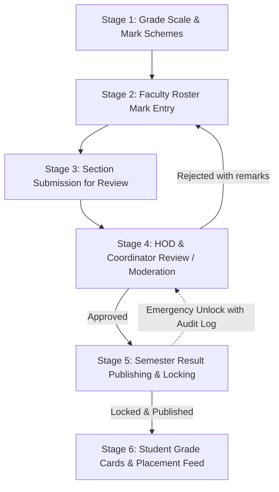

# Academic Results & Mark Processing Workflow

Use this workflow when implementing, testing, or auditing features in the **Academic Results & Mark Processing Lifecycle** specified in `documentation/academic-results-backend-spec.md`.

This module serves as the platform's single source of truth for student academic standing, deterministic CGPA calculation, and placement eligibility gating.

---

## The 6-Stage Lifecycle



---

## Step 1 — Verify Actors, Roles & Permissions

Review the calling user's role and designation before initiating any marks operation:

| Actor | Base Role | Required Designation / Permissions | Allowed Lifecycle Operations |
|---|---|---|---|
| **Allocated Faculty** | `staff` | Allocated via `subject_allocations` (`marks.create`, `marks.view`) | Stages 2–3: Save draft scores, submit sections for review |
| **Head of Department (HOD)** | `staff` | HOD Designation (`marks.approve`, `marks.view`) | Stage 4: Verify with moderation adjustments, approve, reject own department's subjects |
| **Exam Coordinator** | `staff` | Exam Coordinator Designation (`marks.approve`, `marks.publish`, `marks.view`) | Stages 4–5: Institution-wide approval, pre-flight check, semester publishing, unlock |
| **Institution Admin** | `institution_admin` | Full institution scope (`marks.*`) | Stages 1–5: Grade rules, mark schemes, approvals, publishing |
| **Student** | `student` | `marks.view` | Stage 6: View own published semester grade cards |
| **Placement Officer** | `placement_officer` | `results.view_summary` | Stage 6: Read derived academic summary (CGPA & backlogs) for placement gating |

> [!IMPORTANT]
> Non-admin reviewers MUST be restricted to their assigned department (`user->department_code === subject->department->code`). The `marks.approve` permission is granted via designation, preserving departmental separation of duties.

---

## Step 2 — Stage 1: Grade Scale & Mark Schemes

Ensure institutional grading scales and subject schemes are configured before marks entry:

1. **Grade Rules (`/api/v1/grade-rules`)**:
   - Inspect existing grade rules (`GET /api/v1/grade-rules`).
   - If not initialized, call `POST /api/v1/grade-rules/setup-defaults` to seed the standard 10-point scale (O, A+, A, B+, B, C, P, F, Ab).
   - Grade points: O (10.0), A+ (9.0), A (8.0), B+ (7.0), B (6.0), C (5.0), P (4.0), F (0.0).
2. **Mark Schemes (`/api/v1/mark-schemes`)**:
   - Configure subject allocation breakdown: `internal_max`, `external_max`, `total_max`, `internal_pass`, `external_pass`, `total_pass`.
   - Cannot be modified once marks progress beyond `draft`.

---

## Step 3 — Stage 2 & 3: Faculty Roster Entry & Submission

1. **Retrieve Class Roster**:
   - Call `GET /api/v1/mark-entries/get-students?examId={id}&subjectId={id}`.
   - Merges regular section rosters with any re-appearing students holding prior attempts.
2. **Save Draft Marks (`status = 'draft'`)**:
   - Call `POST /api/v1/mark-entries/save-draft` with student entries (`internalMarks`, `externalMarks`, `extraMarks`, `isAbsent`, `remarks`).
   - Server calculates total score, maps grade letter and grade point from active `grade_rules`, and sets verdict.
   - Drafts remain fully editable by the allocated teacher.
3. **Submit Class for Review (`status = 'submitted'`)**:
   - Call `POST /api/v1/mark-entries/submit` with `examId`, `subjectId`, and `declarationConfirmed = true`.
   - **Pre-requisite:** Every enrolled student must have an entry or absent flag.
   - Marks become **read-only** for the faculty member upon submission.

---

## Step 4 — Stage 4: Departmental Review & Moderation

1. **Fetch Review Queue**:
   - Call `GET /api/v1/mark-review/get-submitted-marks?examId={id}&subjectId={id}` to list entries in `submitted` or `verified` state.
   - Review class metrics via `GET /api/v1/mark-review/exam-summary?examId={id}&subjectId={id}` (pass/fail count, class average, grade distribution).
2. **Verify with Moderation (`status = 'verified'`)**:
   - Call `POST /api/v1/mark-review/{markEntryId}/verify` with optional moderation adjustments (e.g., `{"extra_marks": 2.0}`) and audit remarks.
3. **Approve Marks (`status = 'approved'`)**:
   - Individual: `POST /api/v1/mark-review/{markEntryId}/approve`.
   - Bulk: `POST /api/v1/mark-review/bulk-approve` with `examId` and `subjectId`.
4. **Reject Back to Draft (`status = 'draft'`)**:
   - Call `POST /api/v1/mark-review/{markEntryId}/reject` with mandatory `reason`.
   - Unlocks the marks for faculty correction and notifies the instructor.

---

## Step 5 — Stage 5: Semester Publishing & Locking

1. **Pre-Flight Readiness Check**:
   - Call `GET /api/v1/result-publishing/status?semesterId={id}`.
   - Must return `canPublish: true` with zero `pendingSubjects`. If any subject is still in `draft`, `submitted`, or `verified`, publishing is strictly prohibited.
2. **Publish & Lock Results**:
   - Call `POST /api/v1/result-publishing/publish` with `semesterId`.
   - Executes inside a database transaction:
     - Transitions all semester `mark_entries` to immutable `status = 'locked'`.
     - Generates or updates `semester_results` records with computed $\text{SGPA} = \frac{\sum (\text{points} \times \text{credits})}{\sum \text{credits}}$.
     - Inserts immutable entry in `result_publishing_logs`.
     - Automatically recalculates student cumulative summaries (`student_academic_summaries`).
3. **Emergency Administrative Unlock**:
   - Call `POST /api/v1/result-publishing/unlock` with `semesterId` and mandatory `reason`.
   - Reverts semester marks to `approved` state for correction while creating an audit log.

---

## Step 6 — Stage 6: Verification & Placement Intelligence Feed

1. **Verify Student View**:
   - Call `GET /api/v1/student/results/semesters` (lists published semesters only).
   - Call `GET /api/v1/student/results/semester/{id}` to inspect student grade card.
2. **Verify Placement Summary Feed**:
   - Call `GET /api/v1/students/{studentId}/academic-summary`.
   - Confirm derived metrics: `cgpa`, `active_backlogs`, `backlog_history`, and `semesters_published`.
   - Placement eligibility filters evaluate this table directly.

---

## Step 7 — Automated Testing Checklist

Whenever editing code related to this workflow, run the dedicated test suite:

```powershell
& "C:\xampp\php\php.exe" vendor/bin/phpunit tests/Feature/MarkEntryTest.php tests/Feature/MarkReviewPermissionTest.php tests/Feature/ResultPublishingTest.php tests/Feature/AcademicSummaryCalculationTest.php tests/Feature/MarksTenantIsolationTest.php
```

All 5 test suites must pass cleanly without regressions.
