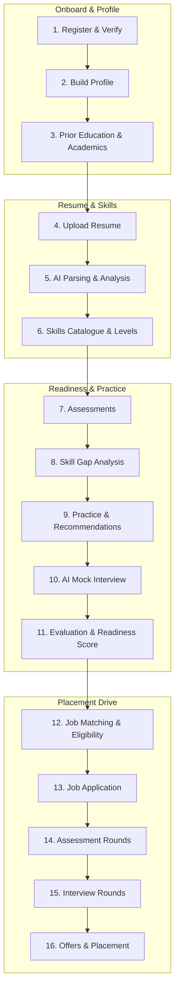

# Student Journey Lifecycle Workflow

This workflow guides developers and QA engineers through verifying, developing, and extending the 16-step Student Journey in Alphagrew, as specified in [`documentation/student-journey-backend-spec.md`](file:///c:/xampp/htdocs/alphagrew/documentation/student-journey-backend-spec.md).



---

## 1. Personas, Roles, and Permissions

| Persona | Role | Key Permissions | Responsibilities |
|---|---|---|---|
| **Student** | `student` | `profile.view`, `profile.edit`, `resumes.manage`, `interviews.practice`, `placement.view`, `placement.apply`, `offers.respond` | Manages own profile, prior education, skills, uploads resumes, runs mock interviews, views readiness, applies to eligible jobs, responds to offers. |
| **Faculty / Reviewer** | `staff` | `students.view`, `students.edit` | Views student profiles, verifies prior education certificates, reviews student academic performance. |
| **Placement Officer** | `institution_admin`, `super_admin` | `placement.view`, `placement.manage`, `placement.create`, `placement.publish_results`, `results.view_summary` | Creates placement drives and job postings, configures eligibility rules, tracks applicant funnels, issues offers. |
| **Recruiter** | `recruiter` | Candidate shortlisting, interview slot booking | Reviews candidate profiles (respecting section visibility flags), records round results. |

---

## 2. The 16 Operational Stages

### Stage 1: Registration & Account Verification
- **Path**: `POST /api/v1/auth/register`, `POST /api/v1/student-invites`, `GET /api/v1/student-invites/{token}`
- **Security**: Sanctum token issuance, institutional isolation via `institution_code` / `inviteToken`.
- **Rules**: Rate limited (5 req/min/IP). Email verification required before placement application.

### Stage 2: Career Profile & Recruiter Visibility
- **Path**: `GET /api/v1/students/me/profile`, `PUT /api/v1/students/me/profile`, `POST /api/v1/students/me/profile/photo`
- **Sub-resources**: `projects`, `certifications`, `experience` under `/api/v1/students/me/*`
- **Completeness Formula**: Weighted section scores (Basics: 15%, Skills: 20%, Projects: 20%, Academics: 15%, Certifications: 10%, Experience: 10%, Preferences: 10%).
- **Privacy Boundary**: Recruiter candidate view drops sections where `visibility[section] === false`. Photo served through signed short-lived URL.

### Stage 3: Academic History & Derived Academic Summary
- **Prior Education**: `GET /api/v1/students/me/academics`, `POST/PUT/DELETE /api/v1/students/me/education/{id}`
  - Levels: `class_10`, `class_12`, `diploma`, `ug`, `pg`.
  - Verification: `POST /api/v1/students/{student}/education/{id}/verify` by staff (`verified_by`, `verified_at`).
- **Current Academics**: `GET /api/v1/students/{student}/academic-summary`
  - Read-only derived values: CGPA, active backlogs, backlog history, attendance percentage.
  - Calculated automatically via `RecalculateAcademicSummaryAction` on semester result publishing or unlock.

### Stage 4: Resume Studio & File Uploads
- **Path**: `GET/POST/PATCH/DELETE /api/v1/students/me/resumes`, `GET /students/me/resumes/{resume}/download`
- **Validation**: Strict mime/content validation (PDF, DOCX, TXT ≤ 5 MB). Max 10 resumes per student. Exactly one `is_primary`.
- **Parsing**: Dispatches `ParseResume` job to extract plain text and structured sections (`education`, `skills`, `projects`).

### Stage 5: AI Resume Analysis
- **Path**: `GET/POST /api/v1/students/me/resumes/{resume}/analysis`
- **Engine**: Provider-agnostic `AiClient` (OpenAI / Anthropic / FakeClient).
- **Audit**: Every analysis logs tokens, model, and latency into `ai_usage_logs`.
- **Heuristics**: Overall score (0–100), 5 section scores (structure, clarity, relevance, keywords, impact), strengths, and explainable improvements.

### Stage 6: Centralized Skills Catalogue & Profiles
- **Path**: `GET /api/v1/skills`, `GET/PUT/DELETE /api/v1/students/me/skills`
- **Catalogue**: Normalizes free-text entries into canonical skills with alias mapping (e.g., "ReactJS" → "React").
- **Hierarchy of Trust**: `assessment` (verified) > `resume` > `self`. Self-reported skills never overwrite assessment-verified levels.

### Stage 7: Assessment Engine
- **Path**: `GET /api/v1/students/me/assessments`, `POST /api/v1/assessments/{id}/attempts`, `PUT /api/v1/attempts/{id}/answers/{qId}`, `POST /api/v1/attempts/{id}/submit`
- **Integrity**: Server owns time via `ends_at`. Answers after expiry rejected with HTTP 409. Correct answers stripped from client payloads.

### Stage 8 & 9: Skill Gap Reports & Targeted Recommendations
- **Path**: `POST/GET /api/v1/students/me/skill-gap`, `GET /api/v1/students/me/recommendations`, `POST /api/v1/students/me/practice`
- **Output**: Compares student skill levels against target role requirements and generates prioritized practice action items.

### Stage 10 & 11: AI Mock Interviews & Comprehensive Readiness
- **Path**: `POST /api/v1/students/me/interviews`, `POST /api/v1/interviews/{id}/start`, `POST /api/v1/interviews/{id}/turns/{turn}/answer`, `POST /api/v1/interviews/{id}/finish`
- **Adaptive Turns**: Dynamic question sequencing based on real-time answer quality, resume claims, and target role difficulty.
- **Readiness Score**: Multi-dimensional score blending resume quality, academics, verified assessments, and mock interview performance.

### Stage 12 & 13: Job Matching, Deterministic Eligibility & Application
- **Path**: `GET /api/v1/students/me/jobs`, `POST /api/v1/job-postings/{id}/applications`, `GET /api/v1/students/me/applications`
- **Eligibility Engine**: Deterministic pure-function evaluation over CGPA, active backlogs, department, and batch. Ineligible applications rejected with clear criteria failures.
- **Audit Trail**: Every state transition (`applied` → `shortlisted` → `in_rounds` → `selected` → `offered` → `placed`) logs immutable `application_events`.

### Stage 14, 15 & 16: Placement Rounds, Interview Slots & Offer Management
- **Path**: `GET /api/v1/students/me/interview-slots`, `POST /api/v1/interview-slots/{id}/confirm`, `GET /api/v1/students/me/offers`, `POST /api/v1/students/me/offers/{id}/accept`
- **Policy Enforcement**: Acceptance of an offer transitions student status to `placed` and auto-withdraws other open applications per institutional policy.

---

## 3. Verification & Testing Checklist

When updating or extending the Student Journey, run the feature test suites:

```bash
# 1. Run profile and skills tests
& "C:\xampp\php\php.exe" vendor/bin/phpunit tests/Feature/StudentProfileTest.php

# 2. Run prior education and academic summary tests
& "C:\xampp\php\php.exe" vendor/bin/phpunit tests/Feature/StudentAcademicsTest.php

# 3. Run resume parser & AI analysis tests
& "C:\xampp\php\php.exe" vendor/bin/phpunit tests/Feature/ResumeParserTest.php

# 4. Run interview session lifecycle & readiness tests
& "C:\xampp\php\php.exe" vendor/bin/phpunit tests/Feature/InterviewSessionLifecycleTest.php tests/Feature/ReadinessIntegrationTest.php

# 5. Run placement controller & tenant isolation tests
& "C:\xampp\php\php.exe" vendor/bin/phpunit tests/Feature/PlacementControllerTest.php tests/Feature/TenantIsolationTest.php
```

Ensure frontend builds without errors:
```bash
cd frontend && npm run build
```
