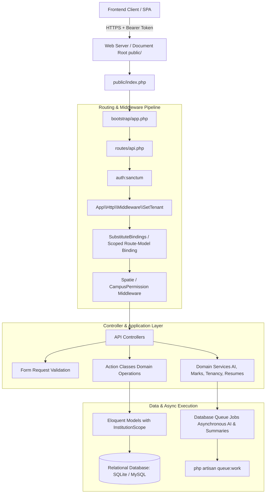
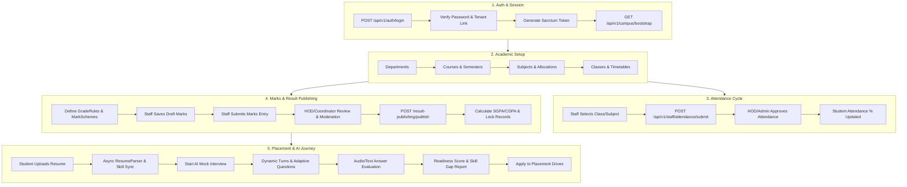
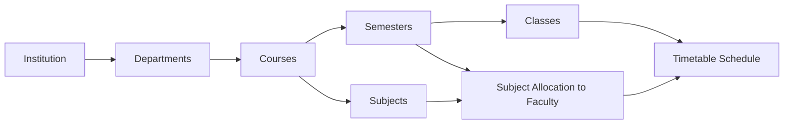
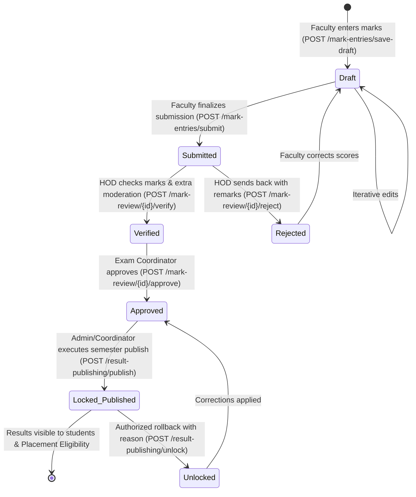
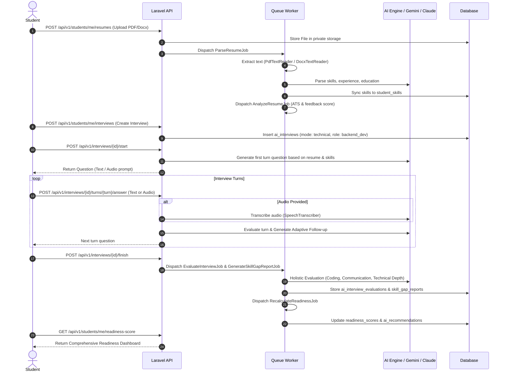
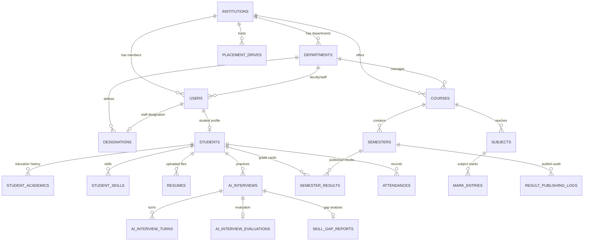

# AlphaGrew Campus Management System - Backend Workflow & Architecture

> **System Overview**: AlphaGrew is an enterprise-grade multi-tenant Campus ERP, Academic Results Processing, and AI-Driven Student Placement Preparation platform.
> **Backend Framework**: PHP 8.2+ / [Laravel 12.x](https://laravel.com)
> **Key Packages**: Laravel Sanctum 4.x (API Authentication), Spatie Laravel Permission 6.x (RBAC), SQLite / MySQL.

---

## 1. High-Level Backend Architecture

The AlphaGrew backend follows a modular, domain-driven Laravel architecture emphasizing strict multi-tenant data isolation, thin controllers, action-oriented business logic, background job queues, and fine-grained role/permission access control.



---

## 2. Multi-Tenancy & Request Lifecycle

Multi-tenancy is enforced at the core request boundary before any route parameters resolve or queries execute.

### 2.1 The Tenancy Pipeline (`SetTenant` Middleware)
Located in [`app/Http/Middleware/SetTenant.php`](file:///c:/xampp/htdocs/alphagrew/backend/app/Http/Middleware/SetTenant.php):
1. **Authentication First**: Sanctum resolves the authenticated `User` from the `Bearer` token.
2. **Super Admin Bypass**: If `$user->isSuperAdmin()`, `Tenant::bypass()` is called, permitting cross-institution administration.
3. **Tenant Binding**: If an institution-scoped user signs in:
   - Verifies `$user->institution_id !== null` (aborts `403` if missing).
   - Invokes `Tenant::set($user->institution_id)`.
4. **Precedence Over Route-Model Binding**:
   - In [`bootstrap/app.php`](file:///c:/xampp/htdocs/alphagrew/backend/bootstrap/app.php#L29-L32), `SetTenant` is prioritized **before** `SubstituteBindings`.
   - This ensures `{student}`, `{course}`, `{company}`, etc., are bound only within the caller's institution, preventing Insecure Direct Object References (IDOR).
5. **Request Termination**: Upon response completion, `Tenant::forget()` cleans up memory in long-running processes (e.g. Octane/Workers).

### 2.2 Global Model Scoping (`InstitutionScope`)
Located in [`app/Support/Tenancy/InstitutionScope.php`](file:///c:/xampp/htdocs/alphagrew/backend/app/Support/Tenancy/InstitutionScope.php):
- Eloquent models utilizing the `BelongsToInstitution` trait automatically inject `WHERE institution_id = ?` into every `select`, `update`, and `delete`.
- Auto-fills `institution_id` on model creation.

---

## 3. Role-Based Access Control (RBAC) & Designations

The security system blends fixed system roles with dynamic staff designations and Spatie permissions.

### 3.1 The Six System Roles (`UserRole` Enum)
Defined in [`app/Enums/UserRole.php`](file:///c:/xampp/htdocs/alphagrew/backend/app/Enums/UserRole.php):
1. **`super_admin`**: Platform administrator (cross-tenant, master configuration).
2. **`institution_admin`**: Campus root administrator (manages campus master data, staff, students, fees, roles).
3. **`placement_officer`**: Training & Placement Officer (TPO) managing drives, eligibility, and recruiter coordination.
4. **`staff`**: Faculty members and academic staff (teaches courses, marks attendance, enters student grades).
5. **`student`**: Enrolled learners (views grades, attendance, builds career profiles, practices AI interviews, applies to drives).
6. **`recruiter`**: Corporate partners (posts openings, schedules rounds, shortlists candidates).

### 3.2 Dynamic Staff Designations
- Institution employees (`staff` role) can hold a [`Designation`](file:///c:/xampp/htdocs/alphagrew/backend/app/Models/Designation.php) (e.g., Head of Department, Exam Coordinator, Professor).
- Designations act as customizable permission bundles mapped through Spatie's `permissions` table, allowing granular capability assignment without hardcoded roles.
- Defined system permissions are enumerated in [`app/Support/Campus/CampusPermission.php`](file:///c:/xampp/htdocs/alphagrew/backend/app/Support/Campus/CampusPermission.php).

---

## 4. End-to-End Domain Workflows



---

### Workflow 1: Authentication & Session Bootstrapping

1. **Client Submission**:
   - Endpoint: `POST /api/v1/auth/login`
   - Controller: [`AuthController::login()`](file:///c:/xampp/htdocs/alphagrew/backend/app/Http/Controllers/Api/V1/AuthController.php)
   - Payload: `{ "email": "...", "password": "..." }`
2. **Validation & Resolution**:
   - Validates email and plain text or hashed password against the `users` table.
   - Verifies whether the account is active and linked to an `institution_id`.
3. **Token Creation**:
   - Generates a Sanctum token: `$user->createToken('campus-session')->plainTextToken`.
4. **Bootstrap Payload**:
   - Endpoint: `GET /api/v1/campus/bootstrap`
   - Invokes [`CampusController::bootstrap()`](file:///c:/xampp/htdocs/alphagrew/backend/app/Http/Controllers/Api/V1/CampusController.php).
   - Injects the authenticated user object, tenant institution data, master lookups (academic years, departments, designations), and role permissions.

---

### Workflow 2: Master Data & Academic Hierarchy Setup



1. **Departments**: Admin creates departments via `POST /api/v1/departments` handled by [`DepartmentController`](file:///c:/xampp/htdocs/alphagrew/backend/app/Http/Controllers/Api/V1/DepartmentController.php). Calculates dynamic staff count, student count, and assigns an HOD.
2. **Courses & Semesters**: Admin defines degree courses (`POST /api/v1/courses`) with credit parameters, duration, and semesters (`POST /api/v1/semesters`).
3. **Subjects**: Subjects are registered (`POST /api/v1/subjects`) with course linkage, subject codes, credits, and classification (theory, practical, elective).
4. **Timetables & Classes**: Classes (`POST /api/v1/classes`) group students by semester/section, while [`TimetableController`](file:///c:/xampp/htdocs/alphagrew/backend/app/Http/Controllers/Api/Student/TimetableController.php) schedules weekday time slots.

---

### Workflow 3: Daily Attendance Management

1. **Roster Retrieval**:
   - Faculty queries `GET /api/v1/staff/attendance/students?class_id=...&subject_id=...` to load enrolled students.
2. **Marking Attendance**:
   - Endpoint: `POST /api/v1/attendance/mark` or `POST /api/v1/staff/attendance/submit`
   - Controller: [`AttendanceController`](file:///c:/xampp/htdocs/alphagrew/backend/app/Http/Controllers/AttendanceController.php)
   - Payload: Date, period/time slot, subject ID, and student attendance statuses (`present`, `absent`, `late`, `excused`).
3. **Approval & Auditing**:
   - HOD or Coordinator reviews submitted rosters and executes `POST /api/v1/attendance/approve`.
   - Attendance status flips to `approved = true`.
4. **Student & Parent Visibility**:
   - Student queries `GET /api/v1/student/attendance` and `GET /api/v1/student/attendance/statistics`.
   - Overall and subject-wise percentages are calculated. Shortfalls below institutional thresholds (e.g., 75%) flag warnings.

---

### Workflow 4: Academic Marks, Grading & Result Publishing Lifecycle

The system enforces a strict 5-stage lifecycle for examination marks before they can count towards placement or student grade sheets.



1. **Stage 1 - Scale Configuration**:
   - [`GradeRuleController`](file:///c:/xampp/htdocs/alphagrew/backend/app/Http/Controllers/Api/V1/GradeRuleController.php) sets percentage boundaries, letter grades (e.g., `O`, `A+`, `A`, `B`, `F`), and grade points (0.00 to 10.00).
   - [`MarkSchemeController`](file:///c:/xampp/htdocs/alphagrew/backend/app/Http/Controllers/Api/V1/MarkSchemeController.php) sets internal vs. external weightages (e.g., 40/60 or 50/50) and passing criteria.
2. **Stage 2 - Faculty Entry & Draft Saving**:
   - Faculty calls `POST /api/v1/mark-entries/save-draft` via [`SaveDraftMarksAction`](file:///c:/xampp/htdocs/alphagrew/backend/app/Actions/Marks/SaveDraftMarksAction.php).
   - Marks are validated within bounds and stored in `mark_entries` with `status = 'draft'`.
3. **Stage 3 - Faculty Submission**:
   - Faculty calls `POST /api/v1/mark-entries/submit` via [`SubmitMarksAction`](file:///c:/xampp/htdocs/alphagrew/backend/app/Actions/Marks/SubmitMarksAction.php).
   - Validates that all active students in the subject allocation have valid marks. Marks transition to `status = 'submitted'`.
4. **Stage 4 - Departmental Review & Moderation**:
   - HOD / Exam Coordinator views submitted entries via `GET /api/v1/mark-review/get-submitted-marks`.
   - Actions:
     - `POST /api/v1/mark-review/{id}/verify` ([`VerifyMarkEntryAction`](file:///c:/xampp/htdocs/alphagrew/backend/app/Actions/Marks/VerifyMarkEntryAction.php)): Adds moderation/grace marks and changes status to `'verified'`.
     - `POST /api/v1/mark-review/{id}/approve` ([`ApproveMarkEntriesAction`](file:///c:/xampp/htdocs/alphagrew/backend/app/Actions/Marks/ApproveMarkEntriesAction.php)): Approves entry.
     - `POST /api/v1/mark-review/{id}/reject` ([`RejectMarkEntryAction`](file:///c:/xampp/htdocs/alphagrew/backend/app/Actions/Marks/RejectMarkEntryAction.php)): Sends back with rejection reason; status resets to `'draft'`.
5. **Stage 5 - Semester Result Publishing & Locking**:
   - Endpoint: `POST /api/v1/result-publishing/publish`
   - Action: [`PublishSemesterResultsAction`](file:///c:/xampp/htdocs/alphagrew/backend/app/Actions/Marks/PublishSemesterResultsAction.php)
   - Checks semester readiness: ensures all required subjects in the semester are in `'approved'` status.
   - Computes each student's:
     - Semester Grade Point Average (SGPA) = `Σ (Subject Grade Point × Subject Credits) / Total Credits`.
     - Credits earned, pass/fail status.
   - Locks records in `semester_results` and locks underlying `mark_entries` (`status = 'locked'`).
   - Writes an immutable audit entry into `result_publishing_logs`.
   - Dispatches [`RecalculateAcademicSummary`](file:///c:/xampp/htdocs/alphagrew/backend/app/Jobs/RecalculateAcademicSummary.php) to update cumulative CGPA and active backlogs.
6. **Stage 6 - Placement & Student Visibility**:
   - Students can view results via `GET /api/v1/student/results/semester/{id}` or `GET /api/v1/student/results/all`.
   - Placement Officer queries `GET /api/v1/students/{student}/academic-summary` to filter placement eligibility.

---

### Workflow 5: Placement Drives & Recruitment Workflow

1. **Drive Creation**:
   - TPO creates placement drives: `POST /api/v1/placement/drives` via [`PlacementController`](file:///c:/xampp/htdocs/alphagrew/backend/app/Http/Controllers/Api/Staff/PlacementController.php).
   - Parameters: Company name, job role, CTC/package, drive date, eligible departments, minimum CGPA cutoff, and allowed active backlogs.
2. **Student Eligibility Check & Application**:
   - Student views available drives at `GET /api/v1/companies`.
   - Student applies via `POST /api/v1/companies/{company}/apply` ([`ApplyToCompanyAction`](file:///c:/xampp/htdocs/alphagrew/backend/app/Actions/Placement/ApplyToCompanyAction.php)).
   - System checks student's real `StudentAcademicSummary`:
     - Aborts if `student.cgpa < drive.minimum_cgpa`.
     - Aborts if `student.active_backlogs > drive.max_backlogs`.
     - Aborts if student department is not in `eligible_departments`.
3. **Rounds & Results Tracking**:
   - TPO schedules selection rounds (Aptitude, Technical Round 1, HR Interview).
   - Batch results recorded via `PlacementResult` model and exported via `GET /api/v1/placement/report`.

---

### Workflow 6: Student Career Profile & AI Mock Interview Journey



1. **Resume Processing**:
   - Resume uploaded via [`ResumeController`](file:///c:/xampp/htdocs/alphagrew/backend/app/Http/Controllers/Api/V1/Students/ResumeController.php).
   - Handled asynchronously by [`ParseResumeJob`](file:///c:/xampp/htdocs/alphagrew/backend/app/Jobs/ParseResumeJob.php) and [`AnalyzeResumeJob`](file:///c:/xampp/htdocs/alphagrew/backend/app/Jobs/AnalyzeResumeJob.php).
   - Extracted competencies are normalized and synced to `student_skills`.
2. **AI Mock Interview Execution**:
   - Mode options: `technical`, `hr`, `resume_deep_dive`, `system_design`, `mixed`.
   - Handled by [`InterviewController`](file:///c:/xampp/htdocs/alphagrew/backend/app/Http/Controllers/Api/V1/Interviews/InterviewController.php), [`InterviewPlanner`](file:///c:/xampp/htdocs/alphagrew/backend/app/Services/Ai/InterviewPlanner.php), and [`InterviewConductor`](file:///c:/xampp/htdocs/alphagrew/backend/app/Services/Ai/InterviewConductor.php).
   - Questions adapt dynamically according to answer quality via [`AdaptiveDifficulty`](file:///c:/xampp/htdocs/alphagrew/backend/app/Services/Ai/AdaptiveDifficulty.php).
3. **Comprehensive Readiness & Skill Gaps**:
   - After interview completion, background jobs compute the student's holistic readiness score (0-100) based on:
     - Profile completeness (20%)
     - Academic standing / CGPA (25%)
     - AI Interview performance (35%)
     - Resume ATS quality (20%)
   - Generates targeted recommendations (e.g., "Improve Database Indexing concepts", "Practice STAR method for HR questions").

---

## 5. Background Jobs & Queue Workers

Asynchronous queue architecture ensures snappy API response times (< 150ms).

| Job Class | Queue | Trigger | Purpose |
| :--- | :--- | :--- | :--- |
| [`ParseResumeJob`](file:///c:/xampp/htdocs/alphagrew/backend/app/Jobs/ParseResumeJob.php) | `default` | Student uploads resume | Extracts structured text from PDF/DOCX; extracts skills, projects, degrees. |
| [`AnalyzeResumeJob`](file:///c:/xampp/htdocs/alphagrew/backend/app/Jobs/AnalyzeResumeJob.php) | `default` | Successful resume parsing | Evaluates ATS score, formatting, impact verbs, and missing sections. |
| [`EvaluateInterviewJob`](file:///c:/xampp/htdocs/alphagrew/backend/app/Jobs/EvaluateInterviewJob.php) | `default` | Interview session finished | Analyzes transcript; calculates technical, communication, and behavioral scores. |
| [`GenerateSkillGapReportJob`](file:///c:/xampp/htdocs/alphagrew/backend/app/Jobs/GenerateSkillGapReportJob.php) | `default` | Interview evaluation completed | Compares candidate performance against target role competency matrix. |
| [`RecalculateAcademicSummary`](file:///c:/xampp/htdocs/alphagrew/backend/app/Jobs/RecalculateAcademicSummary.php) | `default` | Semester results published or marks unlocked | Re-aggregates student cumulative CGPA, earned credits, and active backlogs. |
| [`RecalculateReadinessJob`](file:///c:/xampp/htdocs/alphagrew/backend/app/Jobs/RecalculateReadinessJob.php) | `default` | Profile, academic, or interview update | Computes 360-degree placement readiness score and actionable insights. |

*To run queue workers locally:*
```bash
php artisan queue:listen --tries=3 --timeout=120
```

---

## 6. Database Schema Overview & Key Models

The database comprises 50+ core and pivot tables partitioned by `institution_id`.



---

## 7. Security & File Storage Guidelines

1. **Private File Storage**:
   - Resumes and sensitive verification files are stored in `storage/app/private/` outside the web server's public root.
   - File downloads use Laravel signed, short-lived URLs (`Route::middleware('signed')`):
     - `GET /api/v1/files/student-photos/{student}`
     - `GET /api/v1/files/resumes/{resume}`
2. **Input Validation**:
   - All state-changing endpoints route input through dedicated FormRequest classes or validated arrays.
   - Guarded against Mass Assignment via explicit `$fillable` models.
3. **No Hardcoded Secrets**:
   - Gemini API keys, Anthropic credentials, database passwords, and app secrets are exclusively read via `config(...)` backed by `.env`.
