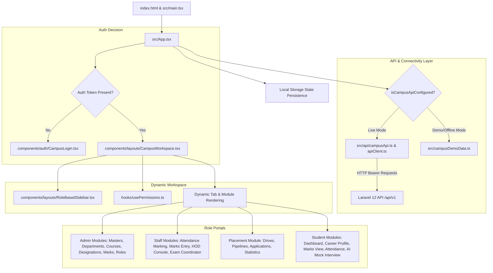
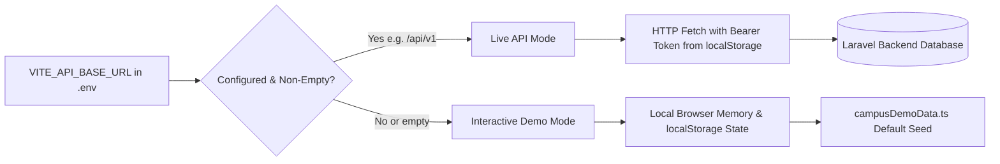
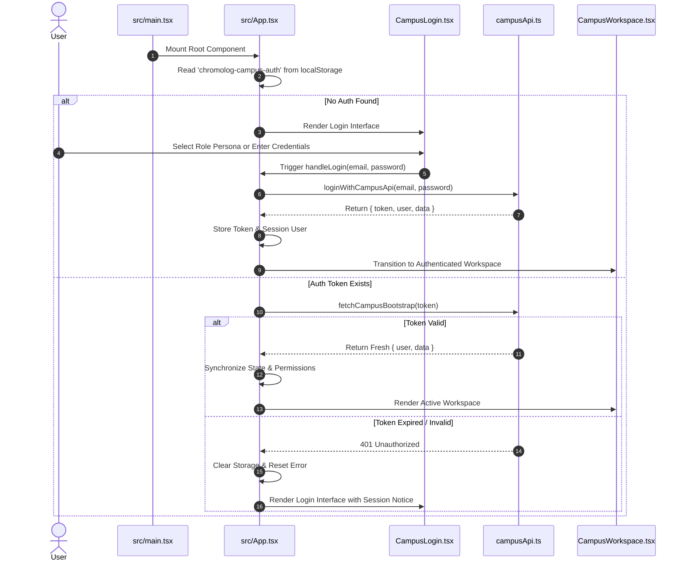
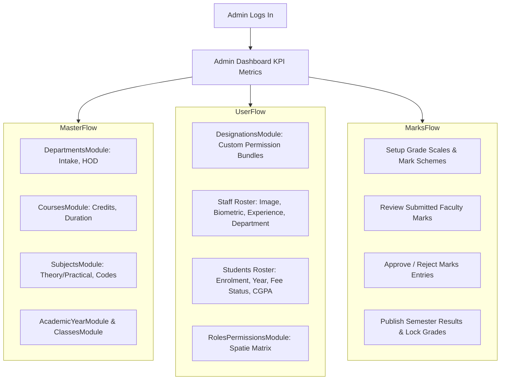
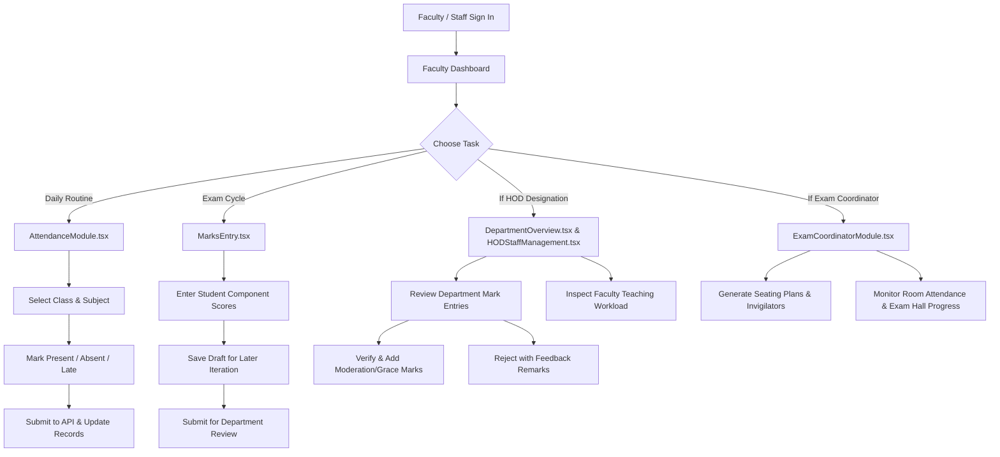
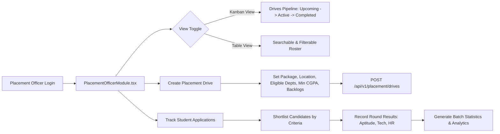
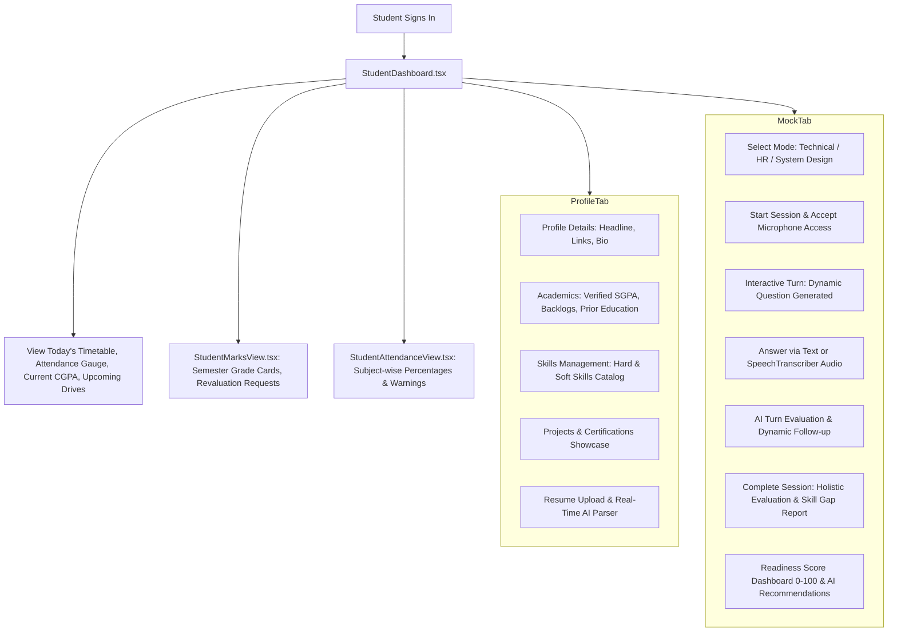

# AlphaGrew Campus Management System - Frontend Workflow & Architecture

> **System Overview**: AlphaGrew's frontend is a responsive Single-Page Application (SPA) designed for multi-role campus management, real-time analytics, student career acceleration, and AI-powered placement preparation.
> **Frontend Stack**: [React 19](https://react.dev), [TypeScript 5.8](https://www.typescriptlang.org), [Vite 6](https://vite.dev), [TailwindCSS 4](https://tailwindcss.com), [Framer Motion / Motion](https://motion.dev), [Lucide React](https://lucide.dev), [Recharts](https://recharts.org) & [Chart.js](https://www.chartjs.org).

---

## 1. High-Level Frontend Architecture

The frontend is structured around a centralized workspace architecture that dynamically adapts based on the signed-in user's role, permissions, and designations.



---

## 2. Hybrid Dual-Mode Architecture (Live API vs. Demo Mode)

AlphaGrew supports both seamless live production operation and a standalone, zero-setup interactive demonstration mode.



### 2.1 Live Mode Execution
- Controlled via `isCampusApiConfigured()` in [`frontend/src/api/campusApi.ts`](file:///c:/xampp/htdocs/alphagrew/frontend/src/api/campusApi.ts#L16).
- When `VITE_API_BASE_URL` is set:
  - Login calls `POST /api/v1/auth/login`.
  - Returned Sanctum token is saved in `localStorage.setItem('chromolog-campus-auth', ...)`.
  - [`apiClient.ts`](file:///c:/xampp/htdocs/alphagrew/frontend/src/api/apiClient.ts) and [`campusApi.ts`](file:///c:/xampp/htdocs/alphagrew/frontend/src/api/campusApi.ts) automatically attach `Authorization: Bearer <token>` to all HTTP requests.
  - State changes trigger asynchronous REST operations against Laravel.

### 2.2 Demo / Offline Mode Execution
- When `VITE_API_BASE_URL` is not configured:
  - Operates using the rich interactive seed in [`frontend/src/campusDemoData.ts`](file:///c:/xampp/htdocs/alphagrew/frontend/src/campusDemoData.ts).
  - All state updates persist to `localStorage.setItem('chromolog-campus-data', ...)`.
  - Includes quick-switch demo persona buttons on the login screen for instantaneous testing of all 6 roles.
  - An instant **"Reset Demo Data"** action allows refreshing back to default state without affecting live databases.

---

## 3. Application Lifecycle & Authentication Workflow



### Authentication Details
1. **Persona Switching in Development**:
   - [`CampusLogin.tsx`](file:///c:/xampp/htdocs/alphagrew/frontend/src/components/auth/CampusLogin.tsx) displays clickable role chips: Super Admin, Institution Admin, Faculty (Staff), HOD, Exam Coordinator, Student, and Placement Officer.
   - Clicking a persona autofills credentials (`demo123`) and tests specific user permissions immediately.
2. **Session Resilience**:
   - `App.tsx` synchronizes with browser local storage on every state mutation.
   - If a page is reloaded, `useEffect` invokes `fetchCampusBootstrap(auth.token)` to ensure the token remains valid and permission sets reflect any recent backend changes.

---

## 4. Navigation & Role-Based UI Architecture

The application layout is governed by [`CampusWorkspace.tsx`](file:///c:/xampp/htdocs/alphagrew/frontend/src/components/layouts/CampusWorkspace.tsx) and [`RoleBasedSidebar.tsx`](file:///c:/xampp/htdocs/alphagrew/frontend/src/components/layouts/RoleBasedSidebar.tsx).

### 4.1 Permission Gating (`usePermissions` Hook)
Located in [`frontend/src/hooks/usePermissions.ts`](file:///c:/xampp/htdocs/alphagrew/frontend/src/hooks/usePermissions.ts):
- Queries `GET /api/v1/permissions/all` on component mount.
- Parses module-level action flags:
  ```typescript
  hasPermission('marks', 'approve') // Returns boolean
  canAccess('courses')              // Returns boolean
  ```
- Modules are filtered in real-time, preventing users from seeing tabs or actions their role or designation does not permit.

### 4.2 Grouped Sidebar Categories
Modules are structured into 7 logical groups:
1. **Overview**: Dashboard, Activity Feed.
2. **Master Data**: Masters, Departments, Courses, Designations, Academic Years.
3. **Users & Roles**: Staff Directory, Students, RBAC Permissions Matrix.
4. **Academic**: Classes, Subjects, Attendance, Timetable, Exams, Marks, Fees.
5. **Finance**: Fee collection and student dues tracking.
6. **Placement**: Placement Drives, Applications, Company Pipelines, Statistics.
7. **Other**: Announcements, Reports & Analytics, System Settings, Profile.

---

## 5. Portal Workflows & User Journeys

---

### Portal 1: Administrator (Super Admin & Institution Admin)



#### Step-by-Step Admin Journey:
1. **Initial Setup**: Admin navigates to **Departments** (`DepartmentsModule.tsx`), registers department codes (e.g. `CSE`, `ECE`, `MECH`), designates HODs, and specifies annual intake capacity.
2. **Curriculum Definition**: Navigates to **Courses** and **Subjects**, defines degree structures (e.g. B.Tech Computer Science, 8 Semesters, 160 Credits), and assigns subjects with credit weightages.
3. **Staff & Designation Management**:
   - Opens **Designations** (`DesignationsModule.tsx`) to configure customized staff roles (e.g., "Exam Cell Incharge" with `marks.approve` and `marks.publish` permissions).
   - Onboards staff members with department linkages and emergency details.
4. **Marks Publication & Audit**:
   - Opens **Marks** (`MarksModule.tsx`).
   - Uses the **Review** tab to inspect submitted marks across all departments.
   - Triggers **Semester Result Publishing**, which computes class GPAs, locks marks, and creates an immutable audit trail.

---

### Portal 2: Staff / Faculty & HOD Workflow



#### Step-by-Step Faculty & HOD Journey:
1. **Daily Attendance Marking**:
   - Faculty navigates to **Attendance** (`AttendanceModule.tsx`).
   - Selects course, semester, section, and subject.
   - An interactive tabular roster renders with toggle buttons for each student (`Present`, `Absent`, `Late`, `Excused`).
   - Clicking **"Submit Attendance"** sends batch records to `/api/v1/attendance/mark` or `/api/v1/staff/attendance/submit`.
2. **Marks Entry**:
   - In **Marks Entry** (`MarksEntry.tsx`), faculty inputs internal assessment scores (Mid-Term 1, Mid-Term 2, Assignments, Practical).
   - Validation checks guarantee scores do not exceed configured maximums.
   - Click **"Save Draft"** to store ongoing work without notifying evaluators.
   - Click **"Submit Marks"** to lock the draft and push it to the HOD's review queue.
3. **HOD Verification**:
   - HOD accesses the departmental review queue via **Marks Review**.
   - HOD can inspect score distributions, add moderation marks if sanctioned, or reject entries with specific corrective instructions.

---

### Portal 3: Training & Placement Officer (TPO) Workflow



#### Step-by-Step Placement Journey:
1. **Drive Management**:
   - TPO opens **Placement** (`PlacementOfficerModule.tsx`).
   - Clicks **"Create Drive"** to configure recruitment details (e.g. Google - Software Engineer, 18 LPA, Drive Date: May 15, Eligible: CSE/IT, Min CGPA: 8.0, Max Backlogs: 0).
2. **Visual Pipeline**:
   - Kanban board organizes drives into **Upcoming**, **Active**, and **Completed** columns.
   - Drag-and-drop / status updating transitions drives as interview dates approach.
3. **Applicant Evaluation**:
   - TPO inspects applicants for each drive. The system cross-references each applicant's real `StudentAcademicSummary` to highlight eligible vs. ineligible candidates automatically.
4. **Analytics & Reports**:
   - Recharts visualizes placement trends, highest packages offered, average CTC, and department-wise placement percentages.

---

### Portal 4: Student Journey & AI Career Preparation



#### Step-by-Step Student Journey:
1. **Dashboard Overview**:
   - Student lands on [`StudentDashboard.tsx`](file:///c:/xampp/htdocs/alphagrew/frontend/src/components/student/StudentDashboard.tsx).
   - Displays real-time circular attendance gauge (warning in red if < 75%), published CGPA, upcoming lectures, and new placement drives.
2. **Career Profile Builder**:
   - Opens **Career Profile** (`StudentCareerProfile.tsx`).
   - Fills in portfolio links (GitHub, LinkedIn), projects, and certifications.
   - Searches and tags skills from the standardized skill catalogue.
3. **Resume AI Analysis**:
   - Uploads resume (PDF or DOCX).
   - Frontend triggers background extraction. Extracted skills are matched against job requirements, and an ATS readability score is displayed.
4. **AI Mock Interview Experience**:
   - Student launches an AI Mock Interview.
   - Chooses interview mode (e.g. *Technical - Frontend Specialist*).
   - The AI interviewer poses dynamic, contextual questions based on the student's listed skills and resume projects.
   - The student answers via text or voice recording.
   - Upon completion, the system renders a **Skill Gap Report**, an updated **Readiness Score** (0–100), and custom recommendations for interview improvement.
5. **Academic Grade Sheets**:
   - In [`StudentMarksView.tsx`](file:///c:/xampp/htdocs/alphagrew/frontend/src/components/student/StudentMarksView.tsx), students inspect finalized, published semester grade cards, internal vs. external mark splits, earned credits, and can submit revaluation requests.

---

## 6. Component Architecture & Design System

The application employs a modern design system with fluid micro-animations and consistent tokens.

### 6.1 Design Tokens & Aesthetics
- **Color Palette**: Tailored Slate & Zinc dark bases (`bg-slate-900`, `bg-slate-800`), accented with vibrant semantic highlights:
  - Indigo/Blue (`#3b82f6`): Primary navigation, interactive controls, information cards.
  - Emerald (`#10b981`): Success states, verified grades, passing marks, high attendance.
  - Amber (`#f59e0b`): Draft statuses, moderation notices, pending reviews.
  - Rose/Red (`#ef4444`): Backlogs, failed assessments, attendance shortfall alerts.
- **Typography**: Clean sans-serif hierarchy using Inter/Roboto with explicit font weight separation (`font-bold`, `font-semibold`, `text-slate-400` metadata).
- **Responsive Fluid Layout**: Mobile-first flex and grid designs, collapsible sidebars, and drawer menus for mobile viewports.

### 6.2 Micro-Animations & Interactivity
- Utilizes **Motion (`motion/react`)**:
  - Smooth page transitions with `<AnimatePresence>`.
  - Staggered card appearances on dashboard loads.
  - Modal entrances with scale-in and backdrop-blur effects.
  - Smooth sidebar expansion and collapse (`transition-all duration-300`).

---

## 7. Error Handling, Feedback & State Management

1. **Centralized Error Boundaries**:
   - API errors return user-friendly error banners with actionable resolution tips.
   - Session expirations (401) automatically redirect to the login screen without losing state context.
2. **Form Validation**:
   - Client-side validation prevents invalid submissions before hitting the API (e.g. negative marks, invalid email formats, missing required fields).
3. **Optimistic UI Updates**:
   - Actions like attendance toggles and draft saves update the local state immediately for zero-latency interaction, syncing with the backend in the background.
4. **Action Confirmation Dialogs**:
   - Destructive operations (deleting a department, student, or unpublishing results) require explicit modal confirmation to prevent accidental loss.
