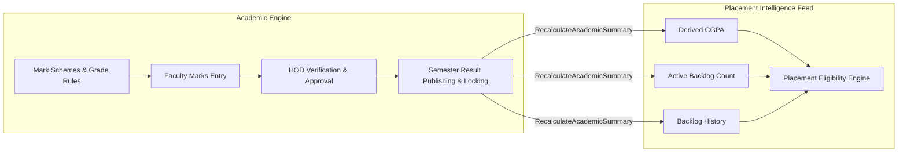
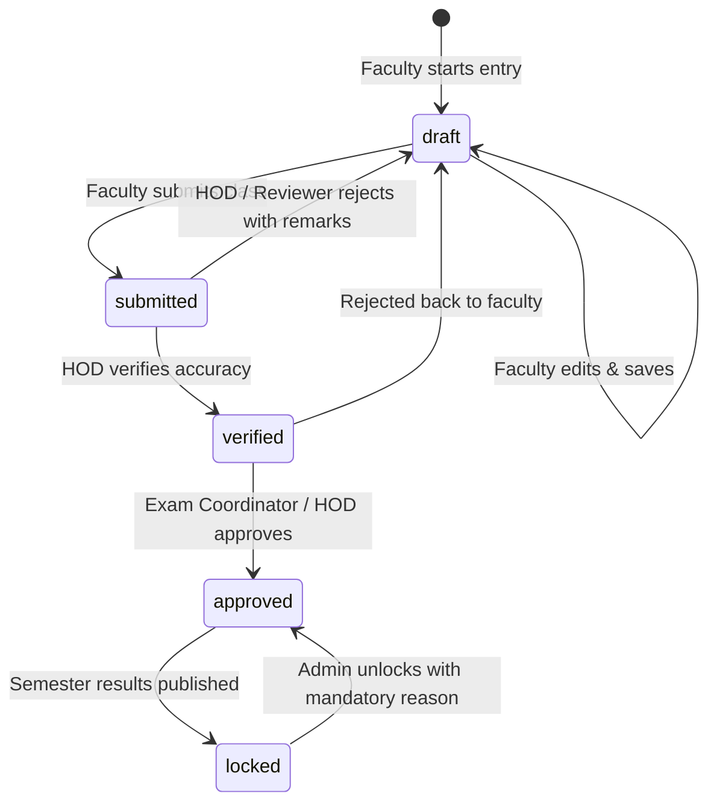

# Academic Results & Mark Processing — Backend Specification

| Item | Value |
|---|---|
| Product | Alphagrew |
| Covers | Campus Academics §5.1, Master Documentation Addendum A4–A8 (Marks & Results Lifecycle) |
| Builds on | `backend/ARCHITECTURE.md`, `campus-academics-module.md`, `student-journey-backend-spec.md` (Step 3) |
| Audience | Backend developers (Laravel API), Frontend developers (React/Vite) |
| Version | 1.0 draft, 20 October 2026 |

This document specifies the complete **Academic Results & Mark Processing Lifecycle**—a production-critical module that was built in code but omitted from the original Master Product Documentation v1.0 PDF. 

It details the end-to-end marks pipeline (from grade rules and schemes, to faculty draft, submission, verification, approval, publishing, locking, and student results), and provides the formal architectural resolution for the **undeclared `marks.approve` permission** that previously restricted approvals to system administrators.

---

## 1. Why This Module Exists & Its Critical Role

Although omitted from the original v1.0 product PDF, the marks and results engine is the **single source of truth for student academic standing across the entire platform**:



1. **Feeds Placement Eligibility Deterministically:** Placement rules (such as `CGPA ≥ 7.50 AND active_backlogs = 0`) must **never** read user-typed numbers. They are derived mathematically from locked, approved semester marks.
2. **Prevents Academic Record Tampering:** Implements an auditable, multi-stage approval pipeline with cryptographic publishing logs.

---

## 2. The Marks Lifecycle State Machine

A student's subject mark progresses through 5 discrete states. Mark entries cannot skip states.



| State | Who Can Edit? | Editable Fields | Description |
|---|---|---|---|
| `draft` | Allocated Faculty | Internal, External, Extra marks | Faculty can freely adjust marks before submission. |
| `submitted` | Read-only to Faculty | None (Reviewer can add adjustments) | Locked for faculty; awaiting departmental review. |
| `verified` | Reviewer / HOD | Verification remarks, adjustments | Checked by department head for anomalies or grade skew. |
| `approved` | Exam Coordinator | None | Formally approved; ready for semester-wide publishing. |
| `locked` | Immutable | None | Published to students; frozen. Derives official CGPA and backlogs. |

---

## 3. Resolving the `marks.approve` Permission Gap

### The Bug in the Legacy System
In `backend/app/Http/Controllers/Api/V1/MarkReviewController.php`:
```php
$this->middleware('permission:marks.approve', ['only' => ['verify', 'reject', 'approve']]);
```
- In earlier releases, `marks.approve` was enforced by middleware and database seeders, but was **never formally declared** in `CampusPermission.php` or added to the base role definitions.
- As a result, non-admin faculty holding the **HOD** or **Exam Coordinator** designations received `403 Forbidden` when attempting to verify or approve marks. Only `SuperAdmin` or `InstitutionAdmin` could approve marks, violating departmental separation of duties.

### The Architectural Resolution

1. **Permission Declaration in `CampusPermission.php`:**
   ```php
   public const MARKS_APPROVE = 'marks.approve';
   ```
2. **Designation-Based RBAC Binding:**
   The permission is granted to faculty users through their **Designation** (not base role), maintaining institution-level separation:
   - **Head of Department (HOD):** Receives `marks.approve` scoped to their department's subjects.
   - **Exam Coordinator:** Receives `marks.approve` and `marks.publish` platform-wide for the institution.
3. **Departmental Scoping Check:**
   In addition to holding `marks.approve`, a reviewer can only approve marks for subjects belonging to their assigned department:
   ```php
   if (!$user->hasRole('institution_admin') && $user->department_code !== $subject->department->code) {
       throw BusinessRuleException::forbidden("You can only verify marks for your own department ({$user->department_code}).");
   }
   ```

---

## 4. End-to-End Operational Stages

---

### Stage 1 — Grade Rules & Mark Schemes Configuration

**Actors:** Exam Coordinator, Institution Admin  
**Permissions:** `marks.create`, `marks.edit`

Before marks can be entered, the institution configures the grading scale and the subject's marking scheme.

#### 1. Grade Rules (`grade_rules`)
Maps total score percentages to letter grades, grade points, and pass/fail verdicts:

| Grade | Grade Point | Min Score % | Max Score % | Classification | Result |
|---|---|---|---|---|---|
| **O** | 10.0 | 90.0 | 100.0 | Outstanding | Pass |
| **A+** | 9.0 | 80.0 | 89.99 | Excellent | Pass |
| **A** | 8.0 | 70.0 | 79.99 | Very Good | Pass |
| **B+** | 7.0 | 60.0 | 69.99 | Good | Pass |
| **B** | 6.0 | 55.0 | 59.99 | Above Average | Pass |
| **C** | 5.0 | 50.0 | 54.99 | Average | Pass |
| **P** | 4.0 | 40.0 | 49.99 | Marginal Pass | Pass |
| **F** | 0.0 | 0.0 | 39.99 | Fail | Fail (Backlog) |
| **Ab**| 0.0 | 0.0 | 0.0 | Absent | Fail (Backlog) |

#### 2. Mark Schemes (`mark_schemes`)
Defines the breakdown between internal and external components per subject:
- `internal_max`: e.g. 40
- `external_max`: e.g. 60
- `total_max`: 100
- `internal_pass`: e.g. 16 (40% minimum)
- `external_pass`: e.g. 24 (40% minimum)
- `total_pass`: 40

#### Endpoints

| Method | Path | Permission | Description |
|---|---|---|---|
| GET | `/api/v1/grade-rules` | `marks.view` | List institution's grade rules |
| POST | `/api/v1/grade-rules` | `marks.create` | Create new grade scale rule |
| GET | `/api/v1/mark-schemes` | `marks.view` | List mark schemes by subject & semester |
| POST | `/api/v1/mark-schemes` | `marks.create` | Configure subject mark scheme |

---

### Stage 2 — Faculty Mark Entry & Draft Saving

**Actors:** Allocated Faculty  
**Permissions:** `marks.create`, `marks.edit`

Faculty members allocated to a subject (`subject_allocations`) access the enrolled student roster and enter raw scores.

#### Endpoints

| Method | Path | Permission | Description |
|---|---|---|---|
| GET | `/api/v1/mark-entries/get-students` | `marks.create` | Returns enrolled student list for subject with existing draft marks |
| POST | `/api/v1/mark-entries/save-draft` | `marks.create` | Bulk saves or updates draft mark entries |
| GET | `/api/v1/mark-entries` | `marks.view` | View entered marks filtered by exam & subject |

#### Request Schema: Save Draft Marks
```json
{
  "examId": 12,
  "subjectId": 45,
  "entries": [
    {
      "studentId": 101,
      "internalMarks": 34.5,
      "externalMarks": 48.0,
      "extraMarks": 2.0,
      "isAbsent": false,
      "remarks": "Active lab participation"
    },
    {
      "studentId": 102,
      "internalMarks": 12.0,
      "externalMarks": 0.0,
      "extraMarks": 0.0,
      "isAbsent": true,
      "remarks": "Absent for external theory exam"
    }
  ]
}
```

**Auto-Calculation Logic (`calculateTotalAndGrade()`):**
- $\text{Total Marks} = \text{internal} + \text{external} + \text{extra}$
- Percentage computed against `mark_schemes.total_max`.
- Letter grade and grade point mapped from `grade_rules`.
- Pass/Fail evaluated: if internal < internal pass OR external < external pass $\rightarrow$ Grade becomes `F`.

---

### Stage 3 — Submission for Review

**Actors:** Allocated Faculty  
**Permissions:** `marks.create`

When mark entry is complete for all students in the class, the faculty submits the marks for departmental review.

#### Endpoints

| Method | Path | Permission | Description |
|---|---|---|---|
| POST | `/api/v1/mark-entries/submit` | `marks.create` | Transitions marks from `draft` to `submitted` |

```json
{
  "examId": 12,
  "subjectId": 45,
  "declarationConfirmed": true
}
```

**Validation Rules:**
1. All enrolled students in the section must have a mark entry (or flagged absent). Missing students return `422 Unprocessable Entity: Incomplete marks entry for 3 students`.
2. Marks must not exceed `internal_max` or `external_max`.
3. Marks transition to `status = 'submitted'`, `submitted_at = now()`, `entered_by = auth()->id()`.
4. Once submitted, marks become **read-only** for the faculty member.

---

### Stage 4 — Verification, Approval & Rejection (The Review Stage)

**Actors:** HOD, Exam Coordinator  
**Permissions:** `marks.approve`, `marks.view`

Department heads and exam coordinators inspect submitted marks, check class grade distribution graphs, and perform adjustments or approvals.

#### Endpoints

| Method | Path | Permission | Description |
|---|---|---|---|
| GET | `/api/v1/mark-review/get-submitted-marks` | `marks.view` | Paginated list of marks awaiting review with summary stats |
| POST | `/api/v1/mark-review/{markEntry}/verify` | `marks.approve` | HOD verifies marks; optional moderation adjustments |
| POST | `/api/v1/mark-review/{markEntry}/approve` | `marks.approve` | Formally approves verified marks |
| POST | `/api/v1/mark-review/{markEntry}/reject` | `marks.approve` | Rejects mark back to `draft` with mandatory remarks |
| POST | `/api/v1/mark-review/bulk-approve` | `marks.approve` | Bulk approves all verified entries for a subject |

#### Verification with Moderation Adjustments
```json
{
  "remarks": "Moderation of +2 marks applied due to syllabus discrepancy in Q4",
  "adjustments": {
    "extra_marks": 2.0
  }
}
```

**Rejection Flow:**
- If marks contain widespread errors, the HOD rejects the batch back to `status = 'draft'` with mandatory rejection remarks.
- The faculty member receives an in-app alert, the marks unlock for editing, and the faculty re-submits once corrected.

---

### Stage 5 — Semester Publishing & Locking

**Actors:** Exam Coordinator, Institution Admin  
**Permissions:** `marks.publish`

Semester results cannot be published piecemeal. All subjects for a class/semester must be approved before publication is permitted.

#### Endpoints

| Method | Path | Permission | Description |
|---|---|---|---|
| GET | `/api/v1/result-publishing/status` | `marks.view` | Checks publishing readiness (counts approved vs pending subjects) |
| POST | `/api/v1/result-publishing/publish` | `marks.publish` | Locks marks and publishes semester results |
| POST | `/api/v1/result-publishing/unlock` | `marks.publish` | Administrative unlock with mandatory audit reason |
| GET | `/api/v1/result-publishing/logs` | `marks.view` | Audit log of all publishing and unlock actions |

#### Publishing Pre-Flight Check (`getPublishingStatus`)
Returns:
```json
{
  "semesterId": 4,
  "academicYearId": 2,
  "totalSubjects": 6,
  "approvedSubjects": 6,
  "canPublish": true,
  "pendingSubjects": []
}
```
If any subject has marks in `draft`, `submitted`, or `verified`, `canPublish` is `false` and publishing is strictly blocked.

#### What Happens When Results are Published (`publishResults`):
1. **Atomic Transaction:** Inside a DB transaction:
   - All `mark_entries` for the semester update to `status = 'locked'`.
   - `semester_results` rows are generated or updated for each student:
     $$\text{SGPA} = \frac{\sum (\text{grade\_point} \times \text{subject\_credits})}{\sum \text{subject\_credits}}$$
   - Total credits earned and backlog counts are stored.
2. **Audit Logging:** Inserts a row into `result_publishing_logs` with publisher user ID, IP address, timestamp, and entry counts.
3. **Dispatches Recalculation:** Fires `ResultsPublished` event, triggering the background job `RecalculateAcademicSummary` for every affected student.

---

### Stage 6 — Student Results & Eligibility Engine Recalculation

**Actors:** Student (View own), Placement Officer (Summary view)  
**Permissions:** `marks.view` (Student), `results.view_summary` (Placement Officer)

#### Endpoints

| Method | Path | Permission | Description |
|---|---|---|---|
| GET | `/api/v1/student/results/semesters` | `marks.view` | List of all published semesters for student |
| GET | `/api/v1/student/results/semester/{semesterId}` | `marks.view` | Student's detailed semester grade card |
| GET | `/api/v1/students/{student}/academic-summary` | `results.view_summary` | Placement officer read access for eligibility summary |

#### Output Schema: Student Semester Grade Card
```json
{
  "semester": { "id": 4, "name": "Semester IV", "academicYear": "2025-2026" },
  "sgpa": 8.42,
  "totalCredits": 24,
  "creditsEarned": 24,
  "resultStatus": "PASS",
  "subjects": [
    {
      "code": "CS401",
      "name": "Database Management Systems",
      "credits": 4,
      "internalMarks": 36,
      "externalMarks": 52,
      "totalMarks": 88,
      "grade": "A+",
      "gradePoint": 9.0,
      "status": "PASS"
    },
    {
      "code": "CS402",
      "name": "Operating Systems",
      "credits": 4,
      "internalMarks": 32,
      "externalMarks": 45,
      "totalMarks": 77,
      "grade": "A",
      "gradePoint": 8.0,
      "status": "PASS"
    }
  ]
}
```

---

## 5. Mathematical Calculation of the Academic Summary

When `RecalculateAcademicSummary` runs, it derives four immutable metrics stored in `student_academic_summaries`:

```sql
CREATE TABLE student_academic_summaries (
    id BIGINT UNSIGNED AUTO_INCREMENT PRIMARY KEY,
    institution_id BIGINT UNSIGNED NOT NULL,
    student_id BIGINT UNSIGNED NOT NULL,
    cgpa DECIMAL(4,2) NOT NULL DEFAULT 0.00,
    active_backlogs SMALLINT UNSIGNED NOT NULL DEFAULT 0,
    backlog_history SMALLINT UNSIGNED NOT NULL DEFAULT 0,
    attendance_percentage DECIMAL(5,2) NOT NULL DEFAULT 0.00,
    semesters_published SMALLINT UNSIGNED NOT NULL DEFAULT 0,
    calculated_at TIMESTAMP NOT NULL DEFAULT CURRENT_TIMESTAMP,
    CONSTRAINT fk_sas_institution FOREIGN KEY (institution_id) REFERENCES institutions(id) ON DELETE CASCADE,
    CONSTRAINT fk_sas_student FOREIGN KEY (student_id) REFERENCES students(id) ON DELETE CASCADE,
    UNIQUE KEY uk_sas_student (student_id)
);
```

### Formulas Enforced by the Domain Service

1. **Cumulative Grade Point Average (CGPA):**
   $$\text{CGPA} = \frac{\sum_{i=1}^{N} \left(\text{grade\_point}_i \times \text{credits}_i\right)}{\sum_{i=1}^{N} \text{credits}_i}$$
   *Only calculated over subjects in **published & locked** semesters.*

2. **Active Backlogs (Current Standing Arrears):**
   Count of distinct subjects where the student's **latest locked mark entry** has a grade verdict of `Fail` or `Absent`.

3. **Backlog History (Historical Arrears):**
   Total count of distinct subjects the student has **ever failed**, even if cleared in a subsequent re-appearance or supplementary exam.

4. **Placement Rule Enforcement:**
   When the Placement Officer's `EligibilityEvaluator` executes:
   ```php
   // Evaluates directly against derived summary table, bypassing raw mark sheets
   $summary = StudentAcademicSummary::where('student_id', $student->id)->first();
   $isEligible = ($summary->cgpa >= $rule->cgpa_min) && ($summary->active_backlogs <= $rule->max_backlogs);
   ```

---

## 6. Database Schema Reference

```sql
-- Mark Schemes & Grade Rules
CREATE TABLE grade_rules (
    id BIGINT UNSIGNED AUTO_INCREMENT PRIMARY KEY,
    institution_id BIGINT UNSIGNED NOT NULL,
    grade VARCHAR(5) NOT NULL,
    grade_point DECIMAL(4,2) NOT NULL,
    min_score DECIMAL(5,2) NOT NULL,
    max_score DECIMAL(5,2) NOT NULL,
    description VARCHAR(100) NULL,
    is_pass BOOLEAN DEFAULT TRUE,
    created_at TIMESTAMP NULL,
    updated_at TIMESTAMP NULL,
    CONSTRAINT fk_gr_institution FOREIGN KEY (institution_id) REFERENCES institutions(id) ON DELETE CASCADE,
    INDEX idx_gr_score (institution_id, min_score, max_score)
);

CREATE TABLE mark_schemes (
    id BIGINT UNSIGNED AUTO_INCREMENT PRIMARY KEY,
    institution_id BIGINT UNSIGNED NOT NULL,
    subject_id BIGINT UNSIGNED NOT NULL,
    semester_id BIGINT UNSIGNED NOT NULL,
    internal_max DECIMAL(5,2) NOT NULL,
    external_max DECIMAL(5,2) NOT NULL,
    total_max DECIMAL(5,2) NOT NULL,
    internal_pass DECIMAL(5,2) NOT NULL,
    external_pass DECIMAL(5,2) NOT NULL,
    total_pass DECIMAL(5,2) NOT NULL,
    created_at TIMESTAMP NULL,
    updated_at TIMESTAMP NULL,
    CONSTRAINT fk_ms_institution FOREIGN KEY (institution_id) REFERENCES institutions(id) ON DELETE CASCADE,
    CONSTRAINT fk_ms_subject FOREIGN KEY (subject_id) REFERENCES subjects(id) ON DELETE CASCADE,
    CONSTRAINT fk_ms_semester FOREIGN KEY (semester_id) REFERENCES semesters(id) ON DELETE CASCADE,
    UNIQUE KEY uk_ms_subject_sem (subject_id, semester_id)
);

-- Core Mark Entries & Semester Results
CREATE TABLE mark_entries (
    id BIGINT UNSIGNED AUTO_INCREMENT PRIMARY KEY,
    institution_id BIGINT UNSIGNED NOT NULL,
    exam_id BIGINT UNSIGNED NOT NULL,
    subject_id BIGINT UNSIGNED NOT NULL,
    student_id BIGINT UNSIGNED NOT NULL,
    internal_marks DECIMAL(5,2) NULL,
    external_marks DECIMAL(5,2) NULL,
    extra_marks DECIMAL(5,2) DEFAULT 0.00,
    total_marks DECIMAL(5,2) NULL,
    grade VARCHAR(5) NULL,
    grade_point DECIMAL(4,2) NULL,
    status ENUM('draft', 'submitted', 'verified', 'approved', 'locked') DEFAULT 'draft',
    remarks TEXT NULL,
    is_absent BOOLEAN DEFAULT FALSE,
    entered_by BIGINT UNSIGNED NULL,
    verified_by BIGINT UNSIGNED NULL,
    approved_by BIGINT UNSIGNED NULL,
    submitted_at TIMESTAMP NULL,
    verified_at TIMESTAMP NULL,
    approved_at TIMESTAMP NULL,
    locked_at TIMESTAMP NULL,
    created_at TIMESTAMP NULL,
    updated_at TIMESTAMP NULL,
    CONSTRAINT fk_me_institution FOREIGN KEY (institution_id) REFERENCES institutions(id) ON DELETE CASCADE,
    CONSTRAINT fk_me_student FOREIGN KEY (student_id) REFERENCES students(id) ON DELETE CASCADE,
    CONSTRAINT fk_me_subject FOREIGN KEY (subject_id) REFERENCES subjects(id) ON DELETE CASCADE,
    UNIQUE KEY uk_me_exam_sub_student (exam_id, subject_id, student_id),
    INDEX idx_me_status (institution_id, status)
);

CREATE TABLE semester_results (
    id BIGINT UNSIGNED AUTO_INCREMENT PRIMARY KEY,
    institution_id BIGINT UNSIGNED NOT NULL,
    student_id BIGINT UNSIGNED NOT NULL,
    semester_id BIGINT UNSIGNED NOT NULL,
    sgpa DECIMAL(4,2) NOT NULL,
    total_credits SMALLINT UNSIGNED NOT NULL,
    credits_earned SMALLINT UNSIGNED NOT NULL,
    result_status ENUM('PASS', 'FAIL', 'WITHHELD') DEFAULT 'PASS',
    published_at TIMESTAMP NOT NULL,
    created_at TIMESTAMP NULL,
    updated_at TIMESTAMP NULL,
    CONSTRAINT fk_sr_institution FOREIGN KEY (institution_id) REFERENCES institutions(id) ON DELETE CASCADE,
    CONSTRAINT fk_sr_student FOREIGN KEY (student_id) REFERENCES students(id) ON DELETE CASCADE,
    CONSTRAINT fk_sr_semester FOREIGN KEY (semester_id) REFERENCES semesters(id) ON DELETE CASCADE,
    UNIQUE KEY uk_sr_student_sem (student_id, semester_id)
);

CREATE TABLE result_publishing_logs (
    id BIGINT UNSIGNED AUTO_INCREMENT PRIMARY KEY,
    institution_id BIGINT UNSIGNED NOT NULL,
    semester_id BIGINT UNSIGNED NOT NULL,
    action ENUM('published', 'unlocked') NOT NULL,
    published_by BIGINT UNSIGNED NOT NULL,
    entries_count INT UNSIGNED NOT NULL,
    ip_address VARCHAR(45) NULL,
    reason TEXT NULL, -- Mandatory for unlocks
    created_at TIMESTAMP NOT NULL DEFAULT CURRENT_TIMESTAMP,
    CONSTRAINT fk_rpl_institution FOREIGN KEY (institution_id) REFERENCES institutions(id) ON DELETE CASCADE,
    CONSTRAINT fk_rpl_user FOREIGN KEY (published_by) REFERENCES users(id) ON DELETE RESTRICT
);
```

---

## 7. Verification & Test Plan

1. **Permission Enforcement Test (`MarkReviewPermissionTest.php`):**
   - Assert faculty with HOD designation holding `marks.approve` can successfully verify and approve marks.
   - Assert faculty without designation attempting verify/approve receives `403 Forbidden`.
   - Assert HOD cannot verify marks for a subject outside their own department.
2. **Publishing Gatekeeper Test (`ResultPublishingTest.php`):**
   - Seed semester with 5 approved subjects and 1 draft subject.
   - Assert calling `POST /result-publishing/publish` returns `422 Unprocessable Entity` listing the unapproved subject.
   - Approve 6th subject -> assert publish succeeds and locks all entries.
3. **Academic Summary Recalculation Test (`AcademicSummaryCalculationTest.php`):**
   - Seed student with Semester 1 results (SGPA 8.0, 20 credits) and Semester 2 results (SGPA 9.0, 20 credits).
   - Assert `RecalculateAcademicSummary` yields exact derived CGPA = 8.50.
   - Assert failing one subject increments `active_backlogs = 1`.
   - Assert passing backlogged subject in subsequent exam decrements `active_backlogs = 0` while keeping `backlog_history = 1`.
4. **Tenant Isolation Test (`MarksTenantIsolationTest.php`):**
   - Assert exam coordinator of Institution A receives `404 Not Found` when trying to view or publish marks of Institution B.
