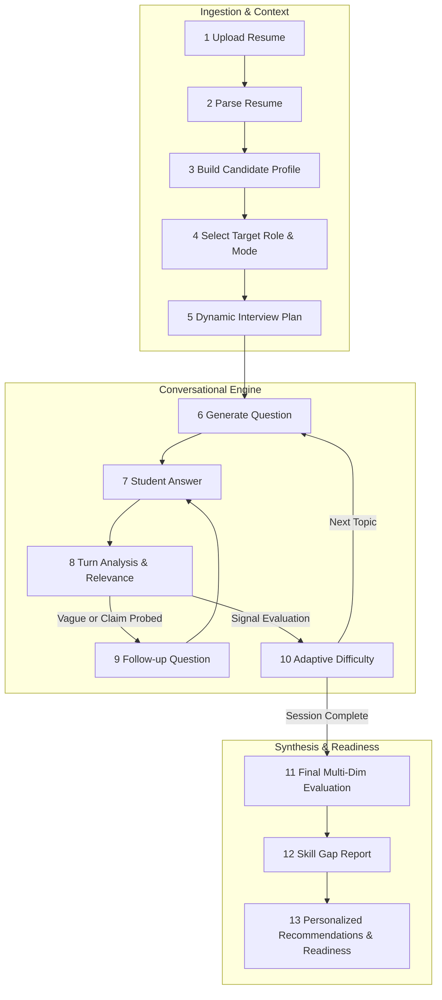
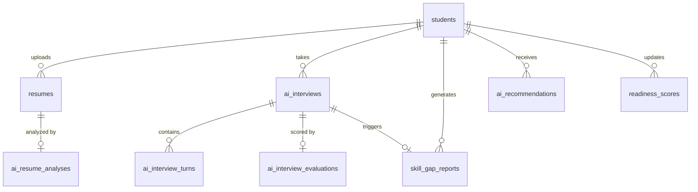
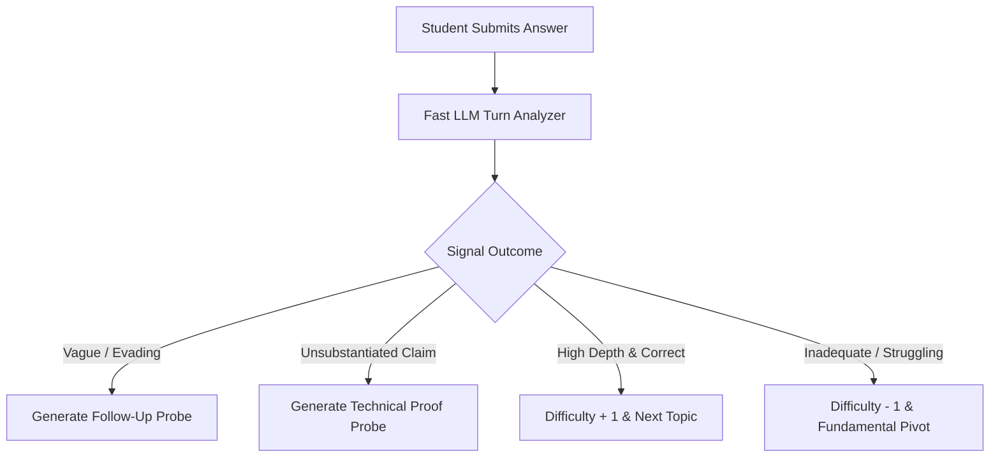

# AI Interview Journey — Backend Specification

| Item | Value |
|---|---|
| Product | Alphagrew |
| Covers | Master Documentation §7.1, §8 (AI Mock Interviews), §9 (Readiness), §20 (Prompt Architecture), §27 (AI Safety & Logging) |
| Builds on | `backend/ARCHITECTURE.md`, `student-journey-backend-spec.md` (Steps 4, 5, 8, 10, 11), `campus-academics-module.md` |
| Audience | Backend AI/API Engineers (Laravel Sanctum API, Queues, Python AI Sidecar / LLM Client) |
| Version | 1.0 draft, 20 October 2026 |

This document provides the end-to-end technical specification for the **AI Interview Journey** across all 13 stages: from resume upload, parsing, and candidate profiling, to dynamic interview planning, adaptive turn-by-turn question generation, follow-up probing, evaluation rubrics, skill gap reporting, and readiness score feeds.

---

## 1. The journey at a glance



### 13-Stage Operational Pipeline

| # | Stage | Description | Input | Output | Performance SLA |
|---|---|---|---|---|---|
| 1 | **Resume** | PDF/DOCX file upload to encrypted tenant S3 storage; file checksum & mime validation | Binary file | `resumes` record | < 1.5s |
| 2 | **Parser** | Deterministic text extraction + LLM entity extraction (education, work experience, projects, skills) | Resume file | `resumes.parsed_data` JSON | Async queued (< 10s) |
| 3 | **Candidate Profile** | Synthesis of parsed resume with institution-verified academics, badges, and verified project repos | `resumes` + `student_academics` | Unified candidate context graph | < 200ms |
| 4 | **Target Role** | Selection of target career track (e.g. Backend Engineer) or specific campus `job_posting_id`, mode, and base difficulty | Student choice | `ai_interviews` config | < 200ms |
| 5 | **Interview Plan** | LLM generates interview blueprint: competency weights, topic sequences, pacing, and time budget | Candidate context + target role | `ai_interviews.plan` JSON | < 3s (Sync) |
| 6 | **Question** | Context-aware turn generation balancing target role demands with student's verified experience | Interview plan + previous turns | `ai_interview_turns` record | < 1.8s (Streaming / JSON) |
| 7 | **Answer** | Candidate submits response via text or voice (audio file uploaded & transcribed via Whisper) | Text / Audio file | Transcribed answer | < 2s (Voice trans.) |
| 8 | **Analysis** | Fast turn evaluation: semantic relevance, technical depth, clarity, fact-checking against resume | Turn Q & A | `quick_signal` JSON | < 1.2s |
| 9 | **Follow-up** | Dynamic clarification or technical probing if answer is evasive, vague, or makes unverifiable claims | Weak/Claim signal | Follow-up question turn | < 1.5s |
| 10 | **Adaptive Difficulty** | Dynamic difficulty calibration: strong performance escalates complexity; weak performance pivots to fundamental concepts | Rolling turn scores | Calibrated difficulty (1–5) | Real-time |
| 11 | **Final Evaluation** | Comprehensive assessment across 5 core dimensions (Technical, Problem Solving, Communication, Role Fit, Behavioral) | All interview turns | `ai_interview_evaluations` | Async queued (< 15s) |
| 12 | **Skill Gap** | Benchmarks demonstrated skills against the target role competency model | Evaluation + Role Profile | `skill_gap_reports` | Async queued (< 5s) |
| 13 | **Recommendations** | Prescribes targeted practice tests, revision topics, and updates institutional readiness score | Skill gap report | `ai_recommendations` & `readiness_scores` | Async queued (< 3s) |

### Module Status Matrix: Today vs Target

| # | Step | Today (`alphagrew` repo) | Target Architecture | Status |
|---|---|---|---|---|
| 1 | **Resume Upload** | ✅ Encrypted tenant disk storage (`resumes`), SHA-256 deduplication, MIME & 5MB file validation, automatic default resume promotion (`UploadResumeAction`, `StoreResumeRequest`). | Multi-resume repository with version tracking, privacy masking, and tenant S3 isolation. | Implemented |
| 2 | **Resume Parsing** | ✅ `PdfParser` & `DocxParser` text extraction + `AiClient` structured entity extraction with schema validation; deterministic regex fallback when LLM key is absent. Automated skill sync to `student_skills` via `SyncResumeSkillsAction`. | High-accuracy hybrid OCR + LLM structured document pipeline with multi-language parsing. | Implemented |
| 3 | **Candidate Profile** | ✅ Graph synthesis combining parsed resume entities with verified college academics (CGPA, verified university coursework, standing backlogs) and verified badges (`CandidateProfileBuilder`). | Unified multi-dimensional student profile incorporating live repository signals, coursework, and verifiable credentials. | Implemented |
| 4 | **Target Role & Mode** | ✅ Selection of mode (`technical`, `hr`, `resume_deep_dive`, `system_design`, `mixed`), target role, base difficulty (1–5), or link to campus drive (`job_posting_id`). Single active session concurrency lock enforced (`CreateInterviewAction`, `CreateInterviewRequest`). | Role competency ontologies linked to employer campus job requirements and difficulty calibration. | Implemented |
| 5 | **Interview Plan** | ✅ Synchronous plan generation (`InterviewPlanner`) detailing competency weights, planned turn allocations, pacing, and time limit budgets. | Dynamic blueprint generation based on employer rubrics, candidate blindspots, and target role level. | Implemented |
| 6 | **Question Generation** | ✅ Context-aware prompt engine combining target role demands, candidate academic context, stated skills, and turn history (`QuestionGenerator`, `InterviewConductor`). Few-shot engineering prompt architecture. | Conversational AI interviewer with contextual depth, enterprise domain specialization, and few-shot constraints. | Implemented |
| 7 | **Student Answer** | ✅ Multi-modal response intake: JSON text answer OR multipart audio file (`audio/webm`, `audio/wav`). Whisper transcription via external STT engine with tenant auth header. Row lock (`lockForUpdate`) protects against double submission race conditions (`AnswerTurnAction`, `SpeechTranscriber`). | Low-latency streaming voice-to-text with filler word detection and pause analysis. | Implemented |
| 8 | **Turn Analysis** | ✅ Fast sub-second evaluation: relevance score (0–100), technical accuracy (0–100), depth signal (`shallow`, `adequate`, `profound`), and claim detection (`AnalyzeTurnAction`). | Real-time sentiment, technical precision, and factual integrity analysis. | Implemented |
| 9 | **Follow-up Probe** | ✅ Dynamic clarifying questions or technical proof probes triggered when answers are evasive or make unsubstantiated claims without technical rationale (`InterviewConductor`, `TurnFollowUpTest`). | Multi-turn probing state machine detecting superficial answers and testing depth of ownership. | Implemented |
| 10 | **Adaptive Difficulty** | ✅ Dynamic difficulty calibration ($1 \le D \le 5$). Consecutive high scores escalate complexity ($\Delta = +1$); failing answers de-escalate and pivot to foundational concepts ($\Delta = -1$) (`AdaptiveDifficulty`). | Continuous calibration matrix adapting to candidate frontier of knowledge. | Implemented |
| 11 | **Final Evaluation** | ✅ Async queued evaluation (`EvaluateInterviewJob`, `InterviewEvaluator`) across 5 core dimensions: Technical Depth (30%), Problem Solving (25%), Communication (20%), Role Fit (15%), Behavioral (10%). Per-turn breakdown and actionable recommendations. | Comprehensive holistic scorecard with benchmarked peer percentile and rubrics. | Implemented |
| 12 | **Skill Gap Report** | ✅ Async queued report (`GenerateSkillGapReportJob`, `SkillGapAnalyzer`) benchmarking candidate's demonstrated competencies against target role requirements. Identifies `exceeds`, `meets`, `gap`, `missing` skills with remediation advice. | Granular competency gap analysis against target role job descriptions with actionable learning path. | Implemented |
| 13 | **Recommendations & Readiness** | ✅ Targeted practice recommendations (`RecommendationGenerator`, `ai_recommendations`) and recalculation of institutional readiness score (`RecalculateReadinessJob`, `ReadinessCalculator`) using 4-component weighted model. Never used as an exclusionary blocker. | Closed-loop career coaching flywheel connecting mock evaluations to remedial practice and drive readiness. | Implemented |

---

## 2. Architecture & Data Model

Every interview session runs under the student's tenant institution (`institution_id`), ensuring complete tenant isolation. AI invocations pass through `App\Services\Ai\AiClient` with model fallback, audit logging (`ai_usage_logs`), and cost tracking.



### Database Schema

```sql
-- Resumes & Parsing
CREATE TABLE resumes (
    id BIGINT UNSIGNED AUTO_INCREMENT PRIMARY KEY,
    institution_id BIGINT UNSIGNED NOT NULL,
    student_id BIGINT UNSIGNED NOT NULL,
    title VARCHAR(255) NOT NULL,
    file_path VARCHAR(255) NOT NULL,
    file_name VARCHAR(255) NOT NULL,
    file_size_bytes INT UNSIGNED NOT NULL,
    file_hash VARCHAR(64) NOT NULL,
    mime_type VARCHAR(100) NOT NULL,
    parsed_data JSON NULL, -- Structured JSON of extracted sections
    status ENUM('uploaded', 'parsing', 'parsed', 'failed') DEFAULT 'uploaded',
    is_default BOOLEAN DEFAULT FALSE,
    created_at TIMESTAMP NULL,
    updated_at TIMESTAMP NULL,
    CONSTRAINT fk_resumes_institution FOREIGN KEY (institution_id) REFERENCES institutions(id) ON DELETE CASCADE,
    CONSTRAINT fk_resumes_student FOREIGN KEY (student_id) REFERENCES students(id) ON DELETE CASCADE,
    INDEX idx_resumes_student (student_id)
);

CREATE TABLE ai_resume_analyses (
    id BIGINT UNSIGNED AUTO_INCREMENT PRIMARY KEY,
    institution_id BIGINT UNSIGNED NOT NULL,
    resume_id BIGINT UNSIGNED NOT NULL,
    overall_score INT UNSIGNED NOT NULL, -- 0 to 100
    ats_compatibility_score INT UNSIGNED NOT NULL,
    section_scores JSON NOT NULL, -- {"education": 90, "skills": 80, "experience": 70, "formatting": 85}
    strengths JSON NOT NULL,
    improvements JSON NOT NULL,
    extracted_skills JSON NOT NULL, -- [{"name": "Java", "years": 2, "source": "projects"}]
    model_version VARCHAR(50) NOT NULL,
    created_at TIMESTAMP NULL,
    updated_at TIMESTAMP NULL,
    CONSTRAINT fk_ara_institution FOREIGN KEY (institution_id) REFERENCES institutions(id) ON DELETE CASCADE,
    CONSTRAINT fk_ara_resume FOREIGN KEY (resume_id) REFERENCES resumes(id) ON DELETE CASCADE,
    UNIQUE KEY uk_ara_resume (resume_id)
);

-- AI Interview Session & Turns
CREATE TABLE ai_interviews (
    id BIGINT UNSIGNED AUTO_INCREMENT PRIMARY KEY,
    institution_id BIGINT UNSIGNED NOT NULL,
    student_id BIGINT UNSIGNED NOT NULL,
    resume_id BIGINT UNSIGNED NULL,
    job_posting_id BIGINT UNSIGNED NULL, -- NULL for general practice; Set if linked to campus drive
    mode ENUM('technical', 'hr', 'resume_deep_dive', 'system_design', 'mixed') NOT NULL,
    target_role VARCHAR(100) NOT NULL, -- e.g. "Backend Engineer", "Data Analyst"
    target_experience_level ENUM('fresher', 'junior', 'intermediate') DEFAULT 'fresher',
    base_difficulty INT UNSIGNED DEFAULT 2, -- Scale 1 to 5
    current_difficulty INT UNSIGNED DEFAULT 2,
    status ENUM('planned', 'in_progress', 'evaluating', 'completed', 'abandoned', 'failed') DEFAULT 'planned',
    time_limit_minutes INT UNSIGNED DEFAULT 20,
    plan JSON NOT NULL, -- Competencies, topic sequence, target turn count
    consent_given_at TIMESTAMP NULL,
    started_at TIMESTAMP NULL,
    ended_at TIMESTAMP NULL,
    created_at TIMESTAMP NULL,
    updated_at TIMESTAMP NULL,
    CONSTRAINT fk_aii_institution FOREIGN KEY (institution_id) REFERENCES institutions(id) ON DELETE CASCADE,
    CONSTRAINT fk_aii_student FOREIGN KEY (student_id) REFERENCES students(id) ON DELETE CASCADE,
    CONSTRAINT fk_aii_resume FOREIGN KEY (resume_id) REFERENCES resumes(id) ON DELETE SET NULL,
    INDEX idx_aii_student_status (student_id, status)
);

CREATE TABLE ai_interview_turns (
    id BIGINT UNSIGNED AUTO_INCREMENT PRIMARY KEY,
    institution_id BIGINT UNSIGNED NOT NULL,
    interview_id BIGINT UNSIGNED NOT NULL,
    sequence INT UNSIGNED NOT NULL,
    kind ENUM('question', 'follow_up', 'clarification', 'system_hint') DEFAULT 'question',
    competency VARCHAR(100) NOT NULL, -- e.g. "Data Structures", "REST API Design", "Conflict Resolution"
    difficulty INT UNSIGNED NOT NULL, -- 1 to 5
    question_text TEXT NOT NULL,
    question_audio_url VARCHAR(255) NULL,
    answer_text TEXT NULL,
    answer_audio_path VARCHAR(255) NULL,
    answer_duration_seconds INT UNSIGNED NULL,
    quick_signal JSON NULL, -- Fast per-turn evaluation: relevance, depth, sentiment, score (0-100)
    asked_at TIMESTAMP NOT NULL DEFAULT CURRENT_TIMESTAMP,
    answered_at TIMESTAMP NULL,
    CONSTRAINT fk_ait_institution FOREIGN KEY (institution_id) REFERENCES institutions(id) ON DELETE CASCADE,
    CONSTRAINT fk_ait_interview FOREIGN KEY (interview_id) REFERENCES ai_interviews(id) ON DELETE CASCADE,
    UNIQUE KEY uk_ait_interview_seq (interview_id, sequence)
);

-- Evaluations, Skill Gap & Recommendations
CREATE TABLE ai_interview_evaluations (
    id BIGINT UNSIGNED AUTO_INCREMENT PRIMARY KEY,
    institution_id BIGINT UNSIGNED NOT NULL,
    interview_id BIGINT UNSIGNED NOT NULL,
    overall_score INT UNSIGNED NOT NULL, -- 0 to 100
    dimension_scores JSON NOT NULL, -- {"technicalDepth": 82, "problemSolving": 75, "communication": 88, "roleFit": 80, "behavioral": 85}
    competency_breakdown JSON NOT NULL, -- [{"competency": "Java Concurrency", "score": 85, "summary": "Strong grasp..."}]
    strengths JSON NOT NULL,
    weaknesses JSON NOT NULL,
    per_turn_evaluations JSON NOT NULL, -- Detailed feedback per question-answer pair
    recommendations JSON NOT NULL,
    rubric_version VARCHAR(20) NOT NULL DEFAULT '1.0',
    model_name VARCHAR(50) NOT NULL,
    evaluated_at TIMESTAMP NOT NULL DEFAULT CURRENT_TIMESTAMP,
    created_at TIMESTAMP NULL,
    updated_at TIMESTAMP NULL,
    CONSTRAINT fk_aie_institution FOREIGN KEY (institution_id) REFERENCES institutions(id) ON DELETE CASCADE,
    CONSTRAINT fk_aie_interview FOREIGN KEY (interview_id) REFERENCES ai_interviews(id) ON DELETE CASCADE,
    UNIQUE KEY uk_aie_interview (interview_id)
);

CREATE TABLE skill_gap_reports (
    id BIGINT UNSIGNED AUTO_INCREMENT PRIMARY KEY,
    institution_id BIGINT UNSIGNED NOT NULL,
    student_id BIGINT UNSIGNED NOT NULL,
    interview_id BIGINT UNSIGNED NULL,
    target_role VARCHAR(100) NOT NULL,
    overall_match_percentage DECIMAL(5,2) NOT NULL,
    skill_breakdown JSON NOT NULL, -- [{"skill": "Docker", "requiredLevel": "intermediate", "demonstratedLevel": "none", "gap": "critical"}]
    generated_at TIMESTAMP NOT NULL DEFAULT CURRENT_TIMESTAMP,
    created_at TIMESTAMP NULL,
    updated_at TIMESTAMP NULL,
    CONSTRAINT fk_sgr_institution FOREIGN KEY (institution_id) REFERENCES institutions(id) ON DELETE CASCADE,
    CONSTRAINT fk_sgr_student FOREIGN KEY (student_id) REFERENCES students(id) ON DELETE CASCADE,
    CONSTRAINT fk_sgr_interview FOREIGN KEY (interview_id) REFERENCES ai_interviews(id) ON DELETE SET NULL,
    INDEX idx_sgr_student (student_id)
);
```

---

## 3. Endpoints & API Specifications

All student self-service routes live under `/api/v1/students/me/...` and enforce `auth:sanctum` and `tenant`.

### Phase A: Resume Ingestion & Parsing (Steps 1 to 3)

| Method | Path | Permission | Request Body | Response |
|---|---|---|---|---|
| POST | `/api/v1/students/me/resumes` | `resumes.manage` | Multipart: `file` (PDF/DOCX ≤ 5MB), `title` | 201 `ResumeResource` (`status: "parsing"`) |
| GET | `/api/v1/students/me/resumes` | `resumes.manage` | — | 200 `[ResumeResource]` (Newest first, includes ATS score) |
| GET | `/api/v1/students/me/resumes/{resume}` | `resumes.manage` | — | 200 `ResumeDetailResource` (Includes parsed JSON & sections) |
| GET | `/api/v1/students/me/resumes/{resume}/analysis` | `resumes.manage` | — | 200 `ResumeAnalysisResource` (ATS compatibility & tips) |
| GET | `/api/v1/students/me/resumes/{resume}/download` | `resumes.manage` | — | 200 `{ url: string, expiresAt: ISO8601 }` (Signed 5-minute URL) |
| GET | `/api/v1/files/resumes/{resume}` | Signed URL route | — | 200 Streamed binary file (`Content-Disposition: inline`) |
| POST | `/api/v1/students/me/resumes/{resume}/analysis` | `resumes.manage` | — | 202 `{ data: { status: "queued" } }` (Re-queue ATS analysis) |
| DELETE | `/api/v1/students/me/resumes/{resume}` | `resumes.manage` | — | 200 `{ message: "Resume deleted" }` |

#### Resume Parser Queued Job (`ParseResumeJob`)
1. Extract raw text via `PdfParser` / `DocxParser` (with OCR fallback for scanned PDFs).
2. Clean text, strip non-printable tokens, and send to LLM structured parser with schema constraint:
```json
{
  "education": [{ "institution": "...", "degree": "...", "graduationYear": 2027, "score": "8.5 CGPA" }],
  "skills": [{ "name": "Java", "category": "Languages", "proficiencyHint": "intermediate" }],
  "experience": [{ "organisation": "...", "role": "...", "startDate": "...", "highlights": [...] }],
  "projects": [{ "title": "FastQueue", "techStack": ["Go", "Raft"], "description": "...", "metrics": "10k req/s" }]
}
```
3. Upsert extracted skills into `student_skills` tagged with `source: 'resume'` and `verified: false`.
4. Trigger `AnalyzeResumeJob` to evaluate ATS compatibility, action verbs, and quantify project outcomes.

---

### Phase B: Interview Session Execution (Steps 4 to 10)

| Method | Path | Permission | Request Body | Response |
|---|---|---|---|---|
| POST | `/api/v1/students/me/interviews` | `interviews.practice` | See schema below | 201 `InterviewSessionResource` (`status: "planned"`) |
| GET | `/api/v1/students/me/interviews` | `interviews.practice` | Query: `status=&page=1&perPage=15` | 200 Paginated `[InterviewSessionResource]` |
| GET | `/api/v1/interviews/{interview}` | owner (`interviews.practice`) | — | 200 `InterviewDetailResource` (Session state + all turns) |
| POST | `/api/v1/interviews/{interview}/start` | owner (`interviews.practice`) | `{ consentAccepted: true }` | 200 `{ data: { firstTurn: TurnResource } }` |
| POST | `/api/v1/interviews/{interview}/turns/{turn}/answer` | owner (`interviews.practice`) | Text: `{ answerText: "..." }` OR Multipart: `audio` (WebM/WAV) | 200 `{ data: { nextTurn: TurnResource \| null, isCompleted: bool } }` |
| POST | `/api/v1/interviews/{interview}/answers` | owner (`interviews.practice`) | JSON / Multipart: `{ turnId, text \| answerText, audio? }` | 200 `{ data: { nextTurn: TurnResource \| null, isCompleted: bool } }` |
| POST | `/api/v1/interviews/{interview}/finish` | owner (`interviews.practice`) | `{ reason?: "user_ended" }` | 202 `{ data: { status: "evaluating" } }` |

#### Request Schema: Initialize Interview Session
```json
{
  "mode": "technical", // 'technical' | 'hr' | 'resume_deep_dive' | 'system_design' | 'mixed'
  "targetRole": "Backend Engineer",
  "targetExperienceLevel": "fresher",
  "baseDifficulty": 2, // 1 (Introductory) to 5 (Staff/Principal)
  "resumeId": 42,
  "jobPostingId": null,
  "timeLimitMinutes": 25
}
```

---

## 4. The Conversational & Adaptive Logic Engine

### 4.1 Interview Planning (`App\Services\Ai\InterviewPlanner`)

Before turn 1, `InterviewPlanner` generates the session blueprint from candidate data:
1. **Inputs:**
   - Candidate Resume projects + technical skills.
   - College verified academics (CGPA, verified coursework).
   - Target Role requirements.
2. **Output Plan JSON:**
   ```json
   {
     "totalTargetTurns": 8,
     "competencies": [
       { "name": "Java Concurrency & Memory", "weight": 25, "plannedTurns": 2 },
       { "name": "Resume Project Architecture (FastQueue)", "weight": 30, "plannedTurns": 2 },
       { "name": "Database Indexing & Query Tuning", "weight": 25, "plannedTurns": 2 },
       { "name": "Behavioral / Engineering Ownership", "weight": 20, "plannedTurns": 2 }
     ]
   }
   ```

### 4.2 Turn Generation Prompt Architecture

Every turn is generated using a structured prompt with few-shot guidance:

```markdown
SYSTEM:
You are an expert, empathetic, but rigorous senior technical interviewer at a top technology company.
You are interviewing a candidate for the role of: {targetRole}.
Candidate Context:
- Academic background: {degree}, CGPA: {cgpa}
- Key Projects: {projects_summary}
- Stated Skills: {skills_list}

Interview Strategy:
- Current Target Competency: {competency}
- Current Adaptive Difficulty: {difficulty} / 5
- Previous Turns: {turn_history}

RULES:
1. Ask ONE clear, focused question at a time. Never ask compound multi-part questions.
2. If the previous answer was vague or claimed high performance without technical rationale, ask a targeted follow-up.
3. Challenge architectural assumptions respectfully.
4. Keep question tone conversational, professional, and encouraging.
```

### 4.3 Real-Time Analysis & Quick Signal (`AnalyzeTurnAction`)

When the student submits an answer, `AnalyzeTurnAction` runs a fast evaluation (< 1.2s):
- **Relevance Score (0–100):** Did the candidate answer the question asked?
- **Technical Accuracy (0–100):** Are technical assertions valid?
- **Depth Signal:** `shallow`, `adequate`, `profound`.
- **Claim Detection:** Did the answer cite an unverified project metric (e.g. *"I scaled the database to handle 1M requests"* -> trigger verification follow-up).



### 4.4 Adaptive Difficulty State Machine

Difficulty adapts dynamically between 1 and 5:

$$\text{Difficulty}_{t+1} = \text{clamp}\left(\text{Difficulty}_t + \Delta, 1, 5\right)$$

Where $\Delta$ is determined by the last two turns:
- **$\Delta = +1$:** Two consecutive answers with technical score $\ge 85$ and depth = `profound`.
- **$\Delta = -1$:** Answer technical score $< 50$ or candidate explicitly states they don't know. The next question pivots to basic conceptual knowledge or provides a progressive hint.
- **$\Delta = 0$:** Standard satisfactory response ($50 \le \text{score} < 85$).

---

## 5. Synthesis: Evaluation, Skill Gap & Recommendations (Steps 11 to 13)

### Phase C: Reports & Intelligence Endpoints

| Method | Path | Permission | Request Body | Response |
|---|---|---|---|---|
| GET | `/api/v1/interviews/{interview}/evaluation` | owner (`interviews.practice`) | — | 200 `InterviewEvaluationResource` (Detailed scores & rubric breakdown) |
| GET | `/api/v1/interviews/{interview}/report` | owner (`interviews.practice`) | — | 200 `InterviewEvaluationResource` (Alias for `/evaluation`) |
| GET | `/api/v1/interviews/{interview}/skill-gap` | owner (`interviews.practice`) | — | 200 `SkillGapReportResource` |
| GET | `/api/v1/students/me/recommendations` | `profile.view` | Query: `status=open\|done\|dismissed` | 200 `[AiRecommendationResource]` (Sorted by priority) |
| PATCH | `/api/v1/students/me/recommendations/{recommendation}` | `profile.view` | `{ "status": "open" \| "done" \| "dismissed" }` | 200 `AiRecommendationResource` |
| GET | `/api/v1/students/me/readiness-score` | `profile.view` | — | 200 `StudentReadinessResource` (Current score + 20-point history) |
| GET | `/api/v1/students/me/readiness` | `profile.view` | — | 200 `StudentReadinessResource` (Alias for `/readiness-score`) |
| GET | `/api/v1/students/me/readiness/history` | `profile.view` | — | 200 `[{ overall, trigger, calculatedAt }]` |

### 5.1 Multi-Dimensional Evaluation Rubrics (`EvaluateInterviewJob`)

The final report evaluates 5 core dimensions scored on a 0–100 scale:

| Dimension | Weight | Criteria Evaluated |
|---|---|---|
| **Technical Depth** | 30% | Deep understanding of programming languages, internal runtimes, complexity, and systems architecture. |
| **Problem Solving** | 25% | Structured approach, breaking down ambiguity, edge-case analysis, optimization tradeoffs. |
| **Communication** | 20% | Clarity, structured articulation (e.g. STAR method for behavioral), listening to interviewer prompts. |
| **Role Fit** | 15% | Alignment of knowledge with the industry standards for the target job profile. |
| **Behavioral Alignment**| 10% | Ownership, conflict management, adaptability, engineering empathy. |

### 5.2 Skill Gap Generation (`App\Services\Ai\SkillGapAnalyzer`)

Compares candidate's demonstrated competency against target role requirements:

```json
{
  "targetRole": "Backend Engineer",
  "overallMatchPercentage": 74.5,
  "competencies": [
    {
      "skill": "Java Concurrency",
      "expectedLevel": "intermediate",
      "demonstratedLevel": "advanced",
      "status": "exceeds"
    },
    {
      "skill": "PostgreSQL Indexing & Optimization",
      "expectedLevel": "intermediate",
      "demonstratedLevel": "basic",
      "status": "gap",
      "remediation": "Focus on EXPLAIN ANALYZE, B-Tree vs Hash indexes, and connection pool sizing."
    },
    {
      "skill": "Docker & Containerization",
      "expectedLevel": "intermediate",
      "demonstratedLevel": "none",
      "status": "missing",
      "remediation": "Complete hands-on containerization practice before campus drive."
    }
  ]
}
```

### 5.3 Feeding the Institutional Readiness Score (`RecalculateReadinessJob`)

Upon evaluation completion, `InterviewEvaluated` event fires, triggering `RecalculateReadinessJob`.
The student's readiness score incorporates:
- **Resume Score:** 20%
- **Academic Summary (CGPA / Backlogs):** 25%
- **Assessment Attempts:** 25%
- **AI Mock Interview Evaluation:** 30%

> [!IMPORTANT]
> The readiness score is designed as a career coaching indicator to guide student practice. It is **never** presented as an employability verdict or used as an exclusionary blocker (PDF §9).

---

## 6. Events, Queued Jobs & Observability

| Event | Dispatched When | Queued Job | Action Taken |
|---|---|---|---|
| `ResumeUploaded` | Step 1: Resume file stored | `ParseResumeJob` | Runs OCR / PDF parsing & extracts entity JSON |
| `ResumeParsed` | Step 2: Parsing finishes | `AnalyzeResumeJob` | Calculates ATS scores & writes resume improvement tips |
| `InterviewFinished` | Step 10: Student completes session | `EvaluateInterviewJob` | Runs multi-turn LLM synthesis & writes scorecard |
| `InterviewEvaluated` | Step 11: Evaluation stored | `GenerateSkillGapReportJob`, `RecalculateReadinessJob` | Generates practice recommendations & updates readiness |

### Token Usage & Audit Logging
Every LLM API invocation writes an audit record to `ai_usage_logs`:
- `institution_id` (Tenant attribution)
- `user_id` (Student)
- `feature` (`interview_turn`, `interview_evaluation`, `resume_parse`)
- `model` (`gpt-4o`, `claude-3-5-sonnet`, `gemini-1.5-pro`)
- `prompt_tokens`, `completion_tokens`, `latency_ms`, `estimated_cost_usd`

---

## 7. Test Plan & Acceptance Checklist

1. **Deterministic Parser Test (`ResumeParserTest.php`):**
   - Provide standard PDF/DOCX fixture resumes with varied layouts.
   - Assert structured JSON outputs contain valid education, skills, and projects.
2. **Adaptive Difficulty Test (`AdaptiveInterviewEngineTest.php`):**
   - Simulate 5 sequential high-scoring turns -> assert difficulty level increases from 2 to 4.
   - Simulate failing turn -> assert difficulty decreases and competency pivots to foundational concepts.
3. **Turn Follow-Up Logic Test (`TurnFollowUpTest.php`):**
   - Mock evasive student answer -> assert `kind: "follow_up"` is returned with clarifying probe.
4. **Tenant Isolation Test (`AiInterviewTenantIsolationTest.php`):**
   - Assert Student in Institution A cannot access, view, or submit answers to an interview in Institution B (returns 404).
5. **Readiness Score Update Test (`ReadinessIntegrationTest.php`):**
   - Assert `InterviewEvaluated` event triggers score recalculation and increments student readiness history.
