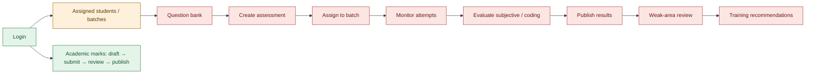

# 03 — End-to-End Workflow Analysis

| Item | Value |
|---|---|
| Baseline | Master Documentation v1.0 §7 journeys, expanded with the missing steps (super admin, institution admin, faculty, AI system, edge cases) |
| Code snapshot | `HEAD 17c5de5` + uncommitted frontend, 22 October 2026 |
| Method | Each step traced page → API → controller/action → model/table → notification → next page. "Live" means the step was exercised over HTTP against a seeded API; otherwise the evidence is code and tests. |

Step status: **Exists** · **Partial** · **Missing**. In the diagrams: green = exists, amber = partial, red = missing.

Paths: `B/` = `backend/app/`, `F/` = `frontend/src/`.

---

## 1. Super Admin

```mermaid
flowchart LR
  classDef ok fill:#e4f4e9,stroke:#1d7a3e,color:#14532d
  classDef part fill:#fdf1dc,stroke:#9a5b00,color:#5c3700
  classDef miss fill:#fbe6e4,stroke:#b02a2a,color:#6b1515
  A[Login]:::ok --> B[Create institution]:::miss --> C[Assign plan / limits]:::miss --> D[Create institution admin]:::miss --> E[Monitor usage & AI credits]:::miss --> F[Suspend / reactivate tenant]:::part --> G[Audit logs]:::miss
```

| # | Step | Page | API | Backend | Status | Notes |
|---|---|---|---|---|---|---|
| 1 | Create the platform account | — | — | `routes/console.php` `alphagrew:super-admin` | Exists | CLI only, by design |
| 2 | Login | `F/components/auth/CampusLogin.tsx` | `POST /auth/login` | `B/Http/Controllers/Api/V1/AuthController.php`; `SetTenant` bypasses scope | Exists | Lands in the institution-admin menu (`navByRole.super_admin = admin`) |
| 3 | Create institution | — | — | — | Missing | No `institutions` API |
| 4 | Assign plan / limits | — | — | — | Missing | No `plans`, `subscriptions`, `tenant_usage` |
| 5 | Create institution admin | — | — | — | Missing | Admins can only be seeded |
| 6 | Monitor usage / AI credits | — | — | `ai_usage_logs` written by `B/Services/Ai/AiClient.php` | Missing | Data exists, no view or limits |
| 7 | Suspend / reactivate | — | — | `Institution::isActive()` checked at login | Partial | Status can only be changed in the DB |
| 8 | Audit logs | — | — | `LogsActivity` → `activity_logs` | Missing | No viewer; super-admin actions not specially logged |

Checks — **State machine:** institution `active ↔ suspended` (needs `onboarding`, `closed`). **Notifications:** none. **Permissions:** Gate bypass for admins. **Audit:** missing. **Edge cases:** suspending must revoke tokens of that institution's users (not implemented).

---

## 2. Institution Admin

```mermaid
flowchart LR
  classDef ok fill:#e4f4e9,stroke:#1d7a3e,color:#14532d
  classDef part fill:#fdf1dc,stroke:#9a5b00,color:#5c3700
  classDef miss fill:#fbe6e4,stroke:#b02a2a,color:#6b1515
  A[Login]:::ok --> B[Settings & branding]:::miss --> C[Academic year]:::ok --> D[Departments]:::ok --> E[Courses / subjects]:::ok --> F[Batches & semesters]:::part --> G[Grading & placement rules]:::part --> H[Bulk import students]:::miss --> I[Faculty / trainers]:::part --> J[Placement officers]:::ok --> K[Role & designation assignment]:::ok --> L[Reports]:::part
```

| # | Step | Page | API | Backend | Status | Notes |
|---|---|---|---|---|---|---|
| 1 | Login | `CampusLogin.tsx` | `POST /auth/login` | `AuthController` | Exists | Live: role `institution_admin`, 101 permissions |
| 2 | Settings & branding | `F/components/admin/SystemSettingsModule.tsx` | — | — | Missing | Screen uses local state only |
| 3 | Academic year | `AcademicYearModule.tsx` | `/semesters/list/academic-years`, `/semesters` | `SemesterController` | Exists | |
| 4 | Departments | `DepartmentsModule.tsx` | `/departments` CRUD | `Api/V1/DepartmentController.php` | Exists | |
| 5 | Courses / subjects | `CoursesModule.tsx`, `SubjectsModule.tsx` | `/courses`, `/subjects` | `CourseController`, `SubjectController` | Exists | |
| 6 | Batches / classes | `ClassesModule.tsx` | — | — | Missing | `classes.batch` is free text; screen is local only |
| 7 | Semesters | `AcademicYearModule.tsx` | `/semesters` | `SemesterController` | Exists | |
| 8 | Grading rules, mark schemes | `MarksModule.tsx` | `/grade-rules`, `/mark-schemes` | `GradeRuleController`, `MarkSchemeController` | Partial | API complete; admin save functions not called from UI |
| 9 | Placement rules (one-offer, dream offer) | — | — | — | Missing | Policy not defined until PRD v1.1 |
| 10 | Bulk import students | — | — | — | Missing | Only one-by-one create (`POST /students`) |
| 11 | Add faculty / trainers | Staff tab (`CampusWorkspace`) | `POST /staff` | `StaffController`, `SaveStaffMemberAction` | Partial | Works; no "trainer" designation preset; HOD management screens stubbed |
| 12 | Add placement officers | Staff tab | `POST /staff` with `role: placement_officer` | `SaveStaffMemberAction` | Exists | `RoleModelTest` |
| 13 | Role / designation assignment | `DesignationsModule.tsx` | `/designations`, `/designations/{id}/assign-permissions` | `DesignationController`, `DesignationObserver` | Exists | |
| 14 | Reports | Admin dashboard | `/reports/summary` | `CampusController@summary` | Partial | No exports, department reports stubbed |

Checks — **State machine:** academic year `planned → active → closed` and batch `active → graduated` not modelled (rollover missing). **Notifications:** none (no welcome/invite emails). **Permissions:** route middleware per module ✅. **Audit:** `activity_logs` only. **Edge cases:** duplicate codes rejected per institution ✅ (`TenantRule::unique`); deleting a department with students not guarded.

---

## 3. Placement Officer

| # | Step | Page | API | Backend | Status | Notes |
|---|---|---|---|---|---|---|
| 1 | Login | `CampusLogin.tsx` | `POST /auth/login` | `AuthController` | Exists | Live: role `placement_officer`, 20 permissions, own menu |
| 2 | Company + contacts | `F/components/staff/PlacementOfficerModule.tsx` | `POST /staff/placement/drives` | `B/Http/Controllers/Api/Staff/PlacementController.php@createDrive` → `Company::create` | Partial | Company and drive are one row; no contacts |
| 3 | Job | same | same | same | Partial | `job_postings` exists but the API never writes it |
| 4 | Drive (dates, rounds, venue/online) | same | `PUT /staff/placement/drives/{id}` | same | Partial | Single date, no rounds |
| 5 | Eligibility rules | — | — | `eligibility_rules` table only | Missing | Only `eligible_departments` JSON |
| 6 | Preview eligible list | — | — | — | Missing | |
| 7 | Publish & notify students | — | — | — | Missing | No notification fired |
| 8 | Applications with deadline | `PlacementOfficerModule.tsx` | `GET /staff/placement/applications` | `PlacementController@getApplications` | Partial | ⚠️ cross-institution leak (gap T-1); status inferred, no deadline check |
| 9 | Withdrawal handling | — | — | — | Missing | |
| 10 | Assessment round | — | — | — | Missing | No assessment engine |
| 11 | Shortlist | — | — | `companies.shortlisted` counter | Missing | |
| 12 | Interview scheduling | — | — | — | Missing | |
| 13 | Round results | — | — | `placement_results` unused | Missing | |
| 14 | Offer issue / accept / decline / deadline | — | — | — | Missing | |
| 15 | Placement record | — | — | `students.placed_company` text | Missing | |
| 16 | One-offer / dream-offer policy | — | — | — | Missing | |
| 17 | Reports / exports | `PlacementOfficerModule.tsx` | `/staff/placement/statistics`, `/placement/report` | `PlacementController` | Partial | Statistics live; export unused by UI |

Checks — **State machines:** drive, job, application and offer state machines absent (`ApplicationStatus` enum exists but unused). **Notifications:** none at any step. **Permissions:** `placement.*` ✅. **Audit:** no history of status changes. **Edge cases:** duplicate apply handled (`firstOrCreate`); deadline passed, ineligible apply (other than department), withdrawal, offer expiry — all unhandled.

---

## 4. Faculty / Trainer

| # | Step | Page | API | Backend | Status | Notes |
|---|---|---|---|---|---|---|
| 1 | Login | `CampusLogin.tsx` | `POST /auth/login` | `AuthController` | Exists | Staff = base permissions + designation |
| 2 | Assigned students / batches | Students tab | `GET /students` (department-scoped) | `StudentRepository::visibleTo` | Partial | Scoped by department, not by assigned classes (`subject_allocations` unused) |
| 3–10 | Question bank → assessments → attempts → evaluation → results → weak areas → recommendations | — | — | — | Missing | Assessment engine not started |
| A | Academic marks entry → submit → verify/approve → publish → student results | `MarksModule.tsx`, `StudentMarksView.tsx` | `/mark-entries/*`, `/mark-review/*`, `/result-publishing/*`, `/student/results/*` | `B/Actions/Marks/*`, `MarkGrader`, `PublishingReadiness` | Exists | `MarkEntryTest`, `ResultPublishingTest`, `MarkReviewPermissionTest`; publishing recalculates CGPA via `StudentResultsChanged` |
| B | Attendance marking | `F/components/staff/AttendanceMarking.tsx` | `/staff/attendance/*` | Stub controller | Partial | Shows prototype notice; real `AttendanceController` unused |

Checks — **State machine:** mark entry `draft → submitted → verified → approved → locked` ✅ (`MarkStatus`). **Notifications:** `MarksRejected` only. **Audit:** `result_publishing_logs` ✅.

---

## 5. Student (web)

```mermaid
flowchart LR
  classDef ok fill:#e4f4e9,stroke:#1d7a3e,color:#14532d
  classDef part fill:#fdf1dc,stroke:#9a5b00,color:#5c3700
  classDef miss fill:#fbe6e4,stroke:#b02a2a,color:#6b1515
  A[Invite / register]:::part --> B[Verify email]:::miss --> C[Profile + completion %]:::ok --> D[Academics]:::ok --> E[Skills / projects / certs / experience]:::ok --> F[Documents]:::miss --> G[Resume upload]:::ok --> H[Parsing review & correction]:::miss --> I[AI resume analysis]:::part --> J[Readiness score]:::ok --> K[Assessments]:::miss --> L[Skill gap]:::part --> M[Practice]:::part --> N[AI mock interview]:::ok --> O[Job feed: eligible + matched]:::miss --> P[Apply]:::part --> Q[Track status]:::miss --> R[Rounds]:::miss --> S[Offer accept / decline]:::miss --> T[Placed]:::miss
```

| # | Step | Page | API | Backend | Status | Notes |
|---|---|---|---|---|---|---|
| 1 | Register (institution code) | No screen | `POST /auth/register` | `RegisterRequest`, `CreateStudentAction` | Partial | Live 201; wrong code 422. No invite links, no register screen |
| 2 | Verify email | — | — | — | Missing | |
| 3 | Profile + completion % | `F/components/student/StudentCareerProfile.tsx` | `GET/PUT /students/me/profile`, `/profile/photo` | `StudentProfileController`, `ProfileCompleteness` | Exists | Live 200, completeness 35% |
| 4 | Academics | same | `/students/me/academics`, `/education` | `StudentAcademicsController`, `AcademicSummaryCalculator` | Exists | Staff verification UI missing |
| 5 | Skills, projects, certifications, experience | same | `/students/me/{skills,projects,certifications,experience}` | `StudentProfileItemController`, `SkillResolver` | Exists | Live 201/200 |
| 6 | Documents | — | — | — | Missing | |
| 7 | Resume upload | `F/components/student/StudentAiInterviewView.tsx` | `POST /students/me/resumes` | `ResumeController`, `ParseResumeJob` | Exists | Live 201; unreadable PDF → clear error |
| 8 | Parsing review & correction | — | — | — | Missing | Parsed data not shown for correction |
| 9 | AI resume analysis | same | `POST/GET /resumes/{id}/analysis` | `AnalyzeResumeJob`, `AiClient` | Partial | Not verified with a live provider |
| 10 | Readiness score | same | `/students/me/readiness-score` | `RecalculateReadinessJob` | Exists | Live 200 |
| 11 | Assessments | — | — | — | Missing | Live 404 |
| 12 | Skill gap | same | `/interviews/{id}/skill-gap` | `GenerateSkillGapReportJob` | Partial | Only after an interview |
| 13 | Practice | same | `/students/me/recommendations` | `AiRecommendation` | Partial | No practice tests |
| 14 | AI mock interview | same | see §7 | see §7 | Exists | UI uncommitted |
| 15 | Job feed (eligible + matched) | Placement tab | `GET /companies` | `CampusDataService` filter by department | Missing | Live `/students/me/jobs` 404 |
| 16 | Apply | Placement tab | `POST /companies/{id}/apply` | `ApplyToCompanyAction` | Partial | Live 200; department-only eligibility |
| 17 | Track status | — | — | — | Missing | |
| 18 | Assessment / interview rounds | — | — | — | Missing | |
| 19 | Offer accept / decline | — | — | — | Missing | |
| 20 | Placed | — | — | `students.placed_company` | Missing | |

Checks — **State machines:** resume (`ResumeStatus`) ✅, interview (`InterviewStatus`) ✅, application/offer ❌. **Notifications:** none delivered (notification screen is sample data). **Permissions:** `/students/me/*` limited to the signed-in student ✅. **Edge cases:** duplicate education level rejected ✅; re-apply idempotent ✅; deadline and eligibility checks ❌; concurrent edits not guarded (last write wins).

---

## 6. Recruiter

```mermaid
flowchart LR
  classDef ok fill:#e4f4e9,stroke:#1d7a3e,color:#14532d
  classDef part fill:#fdf1dc,stroke:#9a5b00,color:#5c3700
  classDef miss fill:#fbe6e4,stroke:#b02a2a,color:#6b1515
  A[Register]:::miss --> B[Verification by institution]:::miss --> C[Company profile]:::miss --> D[Job]:::miss --> E[Requirements]:::miss --> F[Candidate pool - authorized fields]:::miss --> G[Filter]:::miss --> H[Assessment]:::miss --> I[Interview]:::miss --> J[Select]:::miss --> K[Offer]:::miss
```

| # | Step | Status | Notes |
|---|---|---|---|
| 1 | Register / login | Missing | `UserRole::Recruiter` exists; `AuthController@login` refuses it on purpose |
| 2–11 | Verification → offer | Missing | `RecruiterDashboard.tsx` exists but targets the old Express prototype and is not rendered |

---

## 7. AI Interview (system)

```mermaid
flowchart LR
  classDef ok fill:#e4f4e9,stroke:#1d7a3e,color:#14532d
  classDef part fill:#fdf1dc,stroke:#9a5b00,color:#5c3700
  classDef miss fill:#fbe6e4,stroke:#b02a2a,color:#6b1515
  A[Resume]:::ok --> B[Parser]:::ok --> C[Candidate context]:::ok --> D[Target role]:::ok --> E[Plan]:::ok --> F[Question]:::ok --> G[Answer: text]:::ok --> G2[Answer: browser voice / STT]:::part --> H[Analysis]:::ok --> I[Follow-up]:::ok --> J[Adaptive difficulty]:::ok --> K[Timeout / resume]:::ok --> L[Final evaluation]:::ok --> M[Skill gap]:::ok --> N[Recommendations]:::ok --> O[Credit metering]:::part --> P[Transcript retention]:::miss
```

| # | Step | Backend | Status | Notes |
|---|---|---|---|---|
| 1 | Create session (role, mode, difficulty, resume) | `B/Actions/Interviews/CreateInterviewAction.php`, `InterviewPlanner` | Exists | Live 201 |
| 2 | Consent | `StartInterviewAction` (`consent_given_at`), `StartInterviewRequest` (`consentAccepted`) | Exists | |
| 3 | Candidate context | `B/Services/Ai/CandidateProfileBuilder.php` | Exists | |
| 4 | Question generation | `QuestionGenerator`, `Support/Interviews/QuestionBank` fallback | Exists | Live: questions served with no AI key |
| 5 | Answer (text) | `AnswerTurnAction`, `AnalyzeTurnAction` | Exists | Live 200 → next question |
| 6 | Answer (voice) | `answer_audio_path`, `config/ai.php` transcription | Partial | No browser recording in UI |
| 7 | Follow-ups, adaptive difficulty | `InterviewConductor`, `AdaptiveDifficulty` | Exists | `AdaptiveInterviewEngineTest`, `TurnFollowUpTest` |
| 8 | Timeout / disconnect | `interviews:close-idle` (scheduler) | Exists | Needs cron in production |
| 9 | Final evaluation | `FinishInterviewAction` → `EvaluateInterviewJob` → `InterviewEvaluator` (AI or heuristic, `rubric_version`, `model_name`) | Exists | Live report score 59 without a provider |
| 10 | Skill gap, recommendations, readiness | `GenerateSkillGapReportJob`, `RecalculateReadinessJob` | Exists | |
| 11 | Credit metering | `ai_usage_logs` (tokens, cost) | Partial | No limits / credits |
| 12 | Transcript retention | — | Missing | No purge policy |
| 13 | Human override of AI score | — | Missing | PDF §8 "configurable and auditable" |

Checks — **State machine:** `planned → in_progress → evaluating → completed` (+ `abandoned`, `failed`) ✅. **Permissions:** owner only; other users 403 (live) and other institutions 404 (`AiInterviewTenantIsolationTest`). **Notifications:** none ("report ready" not sent). **Edge cases:** answering a finished interview → 409 (`BusinessRuleException::conflict`); provider down → question-bank / heuristic fallback ✅.

---

## 8. Cross-cutting summary

| Concern | Finding |
|---|---|
| State machines implemented | Mark entry, resume, AI interview. **Missing:** application, drive, job, offer, assessment attempt, recruiter verification, institution lifecycle |
| Notifications | Only `MarksRejected`. No event in placement, onboarding or AI journeys notifies anyone |
| Permissions per step | Enforced by route middleware + policies for all real endpoints |
| Audit logging | `activity_logs` (model changes), `result_publishing_logs`, `job_application_events` (unused). No unified audit trail |
| Edge cases | Duplicate submissions mostly idempotent; deadlines, eligibility, withdrawals, cancellations and concurrent edits largely unhandled |
