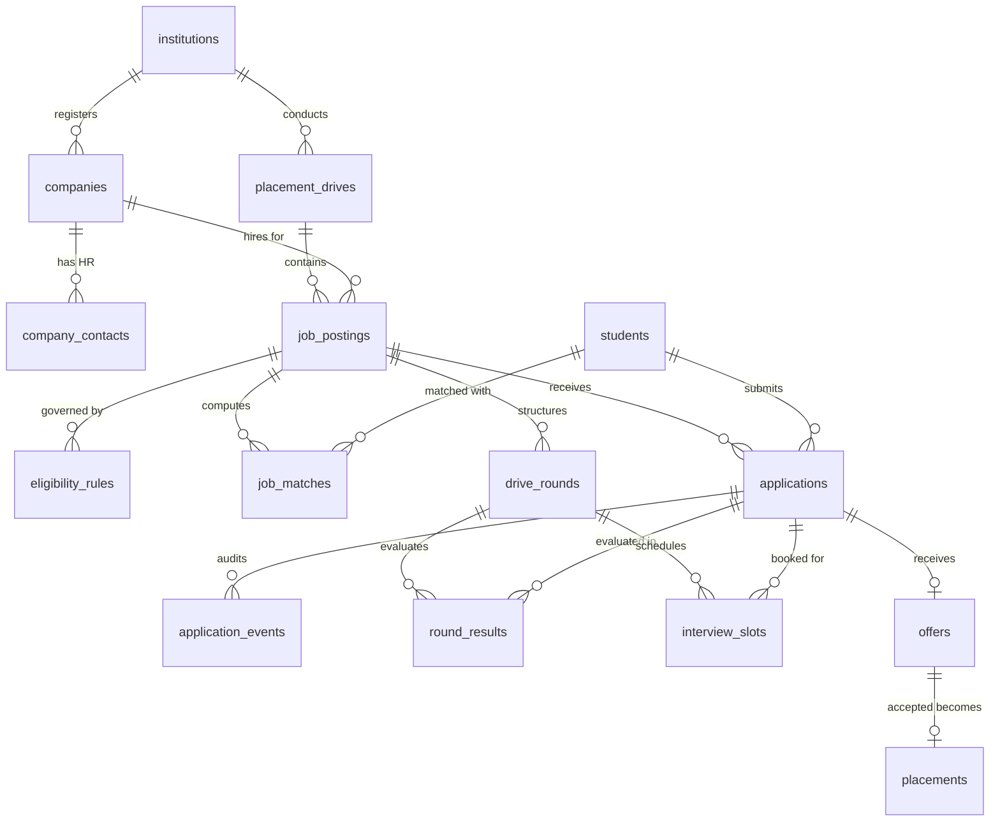
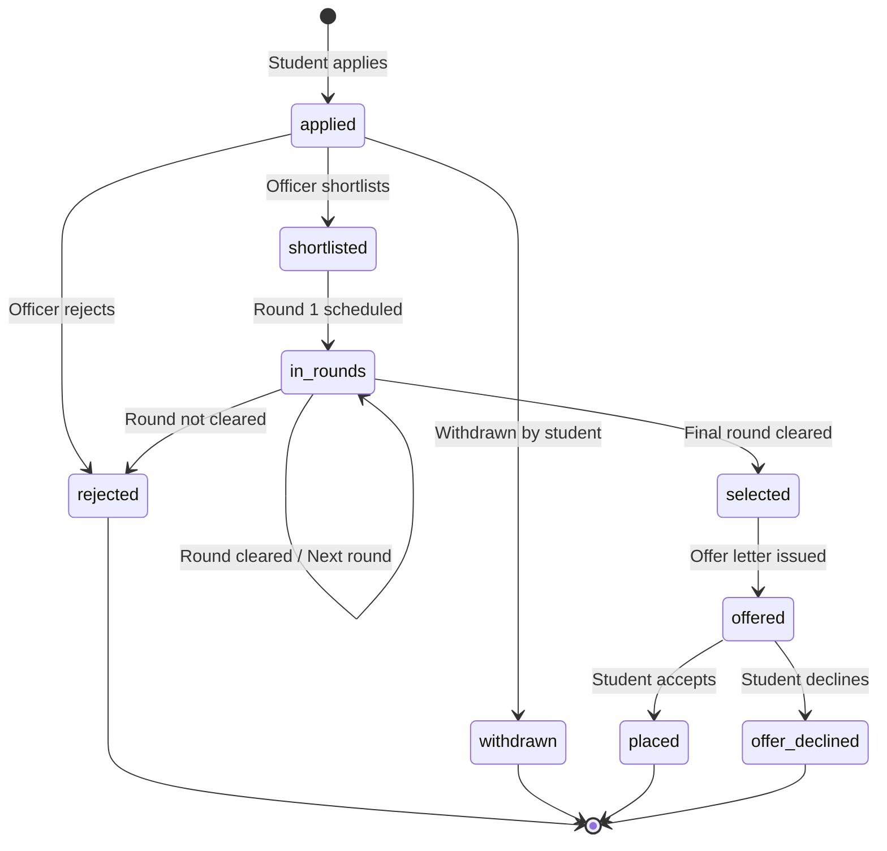
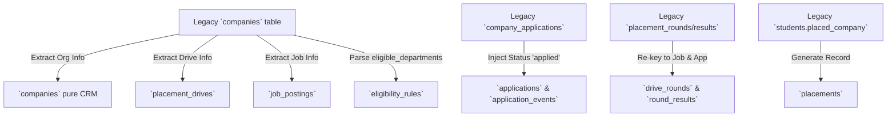
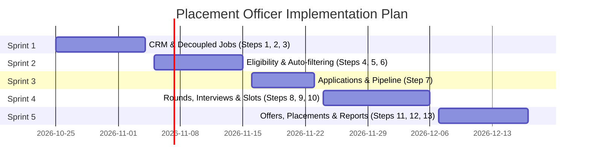

# Placement Officer Journey — Backend Specification

| Item | Value |
|---|---|
| Product | Alphagrew |
| Covers | Master Documentation §7.2 Placement Officer / Career Services, end to end |
| Builds on | PRD addenda in `documentation/prd/` (roles, data model, campus academics), `backend/ARCHITECTURE.md`, and companion [Student Journey Spec](student-journey-backend-spec.md) |
| Audience | Backend developers (Laravel API), Frontend developers (React/Vite) |
| Version | 1.0 draft, 20 October 2026 |

This document provides a comprehensive technical specification for the **Placement Officer journey** across all 13 core operational steps: from login and drive creation, to declarative eligibility evaluation, application management, round/interview orchestration, offer processing, placement records, and institutional reporting.

---

## 1. The journey at a glance

```mermaid
flowchart LR
  subgraph Setup & Sourcing
    P1[1 Login & Setup] --> P2[2 Company CRM] --> P3[3 Create Drive & Job]
  end
  subgraph Eligibility & Targeting
    P3 --> P4[4 Define Eligibility] --> P5[5 Auto-filter Eligible] --> P6[6 Notify Students]
  end
  subgraph Selection Pipeline
    P6 --> P7[7 Applications Pipeline] --> P8[8 Assessment Rounds] --> P9[9 Shortlist Candidates] --> P10[10 Interviews & Slots]
  end
  subgraph Conversion & Analytics
    P10 --> P11[11 Results & Offers] --> P12[12 Placement Record] --> P13[13 Reports & Analytics]
  end
```



### Module Status Matrix: Today vs Target

| # | Step | Today (`alphagrew` repo) | Target Architecture | Priority |
|---|---|---|---|---|
| 1 | **Login & Setup** | ⚠️ Role `placement_officer` exists; dashboard reads hardcoded stats from `PlacementController::getStatistics` | Tenant-scoped dashboard with real metrics aggregated from `placements`, `job_postings`, and `applications` | P0 |
| 2 | **Create Company** | ⚠️ Overloaded `companies` table (company + job + drive in one row); `PlacementOfficerModule.tsx` manages local mock array | Pure organisation model `companies` + child `company_contacts` (HR details, designations, verified status) | P0 |
| 3 | **Create Job & Drive** | ⚠️ Flattened in `companies` (`role`, `package_offered`, `drive_date`); `createDrive` returns fake ID 4 | Decoupled `placement_drives` (seasons/campaigns) and `job_postings` (roles, CTC in paise, openings, deadline) | P0 |
| 4 | **Define Eligibility** | ⚠️ Free-text / JSON `companies.eligible_departments` only | Declarative rule engine (`eligibility_rules`) evaluating CGPA, backlogs, attendance %, batch, prior scores | P0 |
| 5 | **Auto-filter Eligible** | ❌ Hardcoded in UI / missing in backend | Pure service `EligibilityEvaluator` matching live student academic summaries; waiver management | P0 |
| 6 | **Notify Students** | ❌ Static noticeboard / dummy notifications controller | Multi-channel dispatch (database notifications, email, broadcast notices) for newly eligible drives and deadlines | P1 |
| 7 | **Applications** | ⚠️ `company_applications` has no `status`, no audit trail, no round assignment | Full state machine in `applications` (`applied` → `shortlisted` → `in_rounds` → `selected` → `offered` → `placed`) + append-only `application_events` | P0 |
| 8 | **Assessment** | ⚠️ `placement_rounds` table exists in DB migration but unused; `PlacementController` returns mock arrays | `drive_rounds` linked to assessment engine attempts or external test score imports (CSV/Excel) | P0 / P1 |
| 9 | **Shortlist** | ⚠️ Handled via client state only; no persistent round transition | Auto-cutoff evaluation and manual promotion between sequential rounds | P0 |
| 10 | **Interviews & Slots** | ⚠️ Dummy list in `PlacementOfficerModule.tsx` | `interview_slots` table with slot generation, interview panel assignment, meeting links, and conflict prevention | P0 |
| 11 | **Results & Offers** | ⚠️ Static boolean `offer_letter` in `PlacementController::getApplications` | `offers` table with CTC breakdown (paise), joining date, letter PDF upload, and expiry timestamps | P0 |
| 12 | **Placement Record** | ⚠️ Flat text column `students.placed_company` typed by admin | Formal `placements` table; automated enforcement of institutional placement policy (one-offer vs dream jobs) | P0 |
| 13 | **Reports & Analytics** | ⚠️ Hardcoded numbers in `PlacementController::getResultsByBatch` and dummy export URL | Live reporting engine: batchwise, departmentwise, salary distribution, and NIRF/NAAC/NBA compliance exports | P1 |

---

## 2. Legacy Gaps & Architectural Transformation

### 2.1 The Current Gaps in Code

1. **The Overloaded `companies` Table**
   In migration `2026_04_06_082623_create_companies_table.php`, a single row conflates the legal employer, the hiring drive, and the specific open position:
   ```sql
   -- Current schema conflating 3 distinct concepts:
   companies (id, name, role, package_offered, drive_date, status, location, type, applicants, shortlisted, eligible_departments)
   ```
   *Consequence:* If Google visits for "Software Engineer" and "Product Manager" in the same season, the system requires duplicate company entries ("Google - SWE", "Google - PM"), corrupting institutional CRM records and historical reporting.

2. **Un-statused Applications**
   The existing `company_applications` table only maps `(student_id, company_id)`. It lacks `status`, timestamps for stage progression, rejection reasons, or links to individual job postings.

3. **Orphaned Migrations (`placement_rounds` & `placement_results`)**
   Migration `2026_04_11_130000_add_production_fields_and_placement_module.php` created `placement_rounds` and `placement_results`, but:
   - They foreign-key to `companies.id` instead of specific jobs.
   - Neither `PlacementController` nor any model/service reads or writes them.
   - `PlacementOfficerModule.tsx` and `PlacementController.php` operate entirely on static hardcoded PHP arrays.

4. **Hardcoded Mock Controller**
   `backend/app/Http/Controllers/Api/Staff/PlacementController.php` returns mock arrays for `getDrives`, `getApplications`, `getStatistics`, and `getResultsByBatch`. Routes are wrapped with the `sample-data` middleware.

### 2.2 Target Normalized Architecture



---

## 3. Conventions & Standards

Following `backend/ARCHITECTURE.md` and the existing PRD addenda:

- **Base URL & Auth:** `/api/v1/placement/...`, protected by `auth:sanctum` and `tenant` middleware.
- **Tenancy:** Every table contains `institution_id` (foreign key to `institutions`, non-null, indexed). Models use `BelongsToInstitution`. Route-model binding automatically fails with `404 Not Found` across tenant boundaries.
- **Role & Permissions:** The primary role is `placement_officer` (or `institution_admin`). Permissions are defined in `CampusPermission`:
  - `placement.view`
  - `placement.manage`
  - `placement.create`
  - `placement.schedule_round`
  - `placement.view_results`
  - `placement.publish_results`
  - `companies.view`, `companies.create`, `companies.edit`, `companies.delete`
  - `reports.view`, `reports.generate`
- **Currency & Numbers:** All financial values (CTC, stipend, bonuses) are stored as integer **paise** (`ctc_min_paise`, `ctc_max_paise`, `stipend_paise`). API responses provide both integer paise and formatted display strings (e.g. `ctcPaise: 85000000`, `ctcLpaFormatted: "8.50 LPA"`).
- **Responses:** Standard JSON format with `camelCase` keys:
  - Single: `{ "data": { ... } }`
  - Paginated List: `{ "data": [ ... ], "meta": { "currentPage": 1, "perPage": 25, "total": 120, "lastPage": 5 } }`
- **Error Codes:**
  - `401 Unauthenticated` — Missing or invalid token.
  - `403 Forbidden` — Missing permission or tenant violation.
  - `404 Not Found` — Resource missing or belongs to another institution.
  - `409 Conflict` — State conflict (e.g. slot double-booking, duplicate application).
  - `422 Unprocessable Entity` — Validation failure or invalid state machine transition.

---

## 4. Detailed Specification: Steps 1 to 13

---

### Step 1 — Login & Placement Workspace Setup

**Today:** The Placement Officer logs in with credentials; `PlacementOfficerModule.tsx` calls `GET /api/v1/staff/placement/drives` and `GET /api/v1/staff/placement/statistics`, which return hardcoded data.

**Target:** Upon login, the Placement Officer enters a dedicated portal. The workspace loads live tenant-scoped placement statistics, current active drives, and pending action items (unreviewed applications, upcoming interview rounds, expiring offers).

#### Endpoints

| Method | Path | Permission | Description | Response |
|---|---|---|---|---|
| POST | `/api/v1/auth/login` | public | Standard Sanctum auth returning role and permissions | 200 `{ token, user, role: "placement_officer", permissions: [...] }` |
| GET | `/api/v1/placement/dashboard/metrics` | `placement.view` | Aggregated placement KPIs for current academic year | 200 `{ data: PlacementDashboardMetricsResource }` |
| GET | `/api/v1/placement/dashboard/action-items` | `placement.view` | Pending tasks (applications to review, slots to confirm) | 200 `{ data: [ActionItemResource] }` |

#### Data Structure: `PlacementDashboardMetricsResource`
```json
{
  "data": {
    "academicYear": "2026-2027",
    "totalStudents": 450,
    "eligibleStudents": 380,
    "placedStudents": 295,
    "placementPercentage": 77.63,
    "totalOffers": 340,
    "uniqueCompaniesVisited": 42,
    "highestPackagePaise": 240000000,
    "highestPackageFormatted": "24.00 LPA",
    "averagePackagePaise": 62500000,
    "averagePackageFormatted": "6.25 LPA",
    "medianPackagePaise": 55000000,
    "medianPackageFormatted": "5.50 LPA",
    "activeDrivesCount": 5,
    "upcomingInterviewsCount": 18
  }
}
```

**Rules:**
- Metrics recalculate on cached keys (`placement:metrics:{institutionId}:{academicYearId}`) with 15-minute TTL or invalidated upon offer acceptance (`OfferAccepted` event).
- Student placement rate formula: `(COUNT(DISTINCT placements.student_id) / total_registered_eligible_students) * 100`.

---

### Step 2 — Company CRM & Contact Management

**Today:** Overloaded `companies` table contains company info, job details, and drive date in one row. `PlacementOfficerModule.tsx` maintains an in-memory React state array for companies.

**Target:** Decouple employer accounts into a permanent CRM directory for the institution. A company profile stores company identity, tier, domain, and contacts (campus recruiter, HR lead).

#### Endpoints

| Method | Path | Permission | Request Body / Params | Response |
|---|---|---|---|---|
| GET | `/api/v1/placement/companies` | `companies.view` | `search=`, `industry=`, `tier=`, `status=active\|inactive`, `page=1` | 200 Paginated `CompanyResource` |
| POST | `/api/v1/placement/companies` | `companies.create` | `name`, `industry`, `website`, `logo` (multipart), `description`, `tier (dream\|core\|mass)`, `address` | 201 `CompanyResource` |
| GET | `/api/v1/placement/companies/{company}` | `companies.view` | — | 200 `CompanyDetailResource` (includes past drives & contacts) |
| PUT | `/api/v1/placement/companies/{company}` | `companies.edit` | Updated company attributes | 200 `CompanyResource` |
| DELETE | `/api/v1/placement/companies/{company}` | `companies.delete` | — | 200 `{ message: "Company archived successfully" }` |
| GET | `/api/v1/placement/companies/{company}/contacts` | `companies.view` | — | 200 `[CompanyContactResource]` |
| POST | `/api/v1/placement/companies/{company}/contacts` | `companies.edit` | `name`, `email`, `phone`, `designation`, `isPrimary (bool)` | 201 `CompanyContactResource` |
| PUT | `/api/v1/placement/companies/{company}/contacts/{contact}` | `companies.edit` | Updated contact info | 200 `CompanyContactResource` |
| DELETE | `/api/v1/placement/companies/{company}/contacts/{contact}` | `companies.edit` | — | 200 `{ message: "Contact deleted" }` |

#### Database Schema: `companies` (Refactored) & `company_contacts`

```sql
CREATE TABLE companies (
    id BIGINT UNSIGNED AUTO_INCREMENT PRIMARY KEY,
    institution_id BIGINT UNSIGNED NOT NULL,
    name VARCHAR(255) NOT NULL,
    slug VARCHAR(255) NOT NULL,
    industry VARCHAR(100) NULL,
    website VARCHAR(255) NULL,
    logo_path VARCHAR(255) NULL,
    description TEXT NULL,
    tier ENUM('regular', 'dream', 'super_dream', 'mass') DEFAULT 'regular',
    status ENUM('active', 'inactive', 'blacklisted') DEFAULT 'active',
    created_at TIMESTAMP NULL,
    updated_at TIMESTAMP NULL,
    deleted_at TIMESTAMP NULL,
    CONSTRAINT fk_companies_institution FOREIGN KEY (institution_id) REFERENCES institutions(id) ON DELETE CASCADE,
    UNIQUE KEY uk_companies_inst_slug (institution_id, slug),
    INDEX idx_companies_status (institution_id, status)
);

CREATE TABLE company_contacts (
    id BIGINT UNSIGNED AUTO_INCREMENT PRIMARY KEY,
    institution_id BIGINT UNSIGNED NOT NULL,
    company_id BIGINT UNSIGNED NOT NULL,
    name VARCHAR(255) NOT NULL,
    email VARCHAR(255) NOT NULL,
    phone VARCHAR(50) NULL,
    designation VARCHAR(100) NULL,
    is_primary BOOLEAN DEFAULT FALSE,
    created_at TIMESTAMP NULL,
    updated_at TIMESTAMP NULL,
    CONSTRAINT fk_contacts_institution FOREIGN KEY (institution_id) REFERENCES institutions(id) ON DELETE CASCADE,
    CONSTRAINT fk_contacts_company FOREIGN KEY (company_id) REFERENCES companies(id) ON DELETE CASCADE,
    INDEX idx_contacts_company (company_id)
);
```

**Rules:**
- `name` is unique per institution.
- Deleting a company with active job postings or ongoing drives is rejected (`409 Conflict: Cannot delete company with active recruitment drives`).
- If `is_primary = true` is set on a contact, existing contacts for that company have `is_primary` reset to `false`.

---

### Step 3 — Create Placement Drives & Job Postings

**Today:** `PlacementController::createDrive` expects `company_name`, `position`, `salary`, `eligibility`, `date`, and `batch_eligible`, and returns a mock ID.

**Target:**
1. **`placement_drives`**: Represents the hiring campaign (e.g. "Campus Recruitment Season 2026", "TCS Digital Drive 2026").
2. **`job_postings`**: Represents specific openings under that drive (e.g., "Full-Stack Engineer", "Cloud Associate").

#### Endpoints

| Method | Path | Permission | Request Body | Response |
|---|---|---|---|---|
| GET | `/api/v1/placement/drives` | `placement.view` | `status=draft\|published\|completed`, `academic_year_id=`, `page=1` | 200 Paginated `PlacementDriveResource` |
| POST | `/api/v1/placement/drives` | `placement.create` | `title`, `companyId`, `academicYearId`, `driveType (on_campus\|off_campus\|pooled)`, `startsOn`, `endsOn`, `description?` | 201 `PlacementDriveResource` |
| GET | `/api/v1/placement/drives/{drive}` | `placement.view` | — | 200 `PlacementDriveDetailResource` (includes job postings) |
| PUT | `/api/v1/placement/drives/{drive}` | `placement.manage` | Updated drive fields | 200 `PlacementDriveResource` |
| GET | `/api/v1/placement/drives/{drive}/jobs` | `placement.view` | — | 200 `[JobPostingResource]` |
| POST | `/api/v1/placement/drives/{drive}/jobs` | `placement.create` | See table below | 201 `JobPostingResource` |
| GET | `/api/v1/placement/jobs/{jobPosting}` | `placement.view` | — | 200 `JobPostingDetailResource` |
| PUT | `/api/v1/placement/jobs/{jobPosting}` | `placement.manage` | Updated job posting fields | 200 `JobPostingResource` |
| POST | `/api/v1/placement/jobs/{jobPosting}/publish` | `placement.manage` | — | 200 `{ message: "Job published to eligible students" }` |
| POST | `/api/v1/placement/jobs/{jobPosting}/close` | `placement.manage` | — | 200 `{ message: "Job applications closed" }` |

#### Database Schema: `placement_drives` & `job_postings`

```sql
CREATE TABLE placement_drives (
    id BIGINT UNSIGNED AUTO_INCREMENT PRIMARY KEY,
    institution_id BIGINT UNSIGNED NOT NULL,
    company_id BIGINT UNSIGNED NOT NULL,
    academic_year_id BIGINT UNSIGNED NOT NULL,
    title VARCHAR(255) NOT NULL,
    drive_type ENUM('on_campus', 'off_campus', 'pooled', 'virtual') DEFAULT 'on_campus',
    status ENUM('draft', 'published', 'in_progress', 'completed', 'cancelled') DEFAULT 'draft',
    starts_on DATE NOT NULL,
    ends_on DATE NULL,
    created_by BIGINT UNSIGNED NOT NULL,
    created_at TIMESTAMP NULL,
    updated_at TIMESTAMP NULL,
    CONSTRAINT fk_drives_institution FOREIGN KEY (institution_id) REFERENCES institutions(id) ON DELETE CASCADE,
    CONSTRAINT fk_drives_company FOREIGN KEY (company_id) REFERENCES companies(id) ON DELETE CASCADE,
    CONSTRAINT fk_drives_academic_year FOREIGN KEY (academic_year_id) REFERENCES academic_years(id) ON DELETE CASCADE,
    CONSTRAINT fk_drives_created_by FOREIGN KEY (created_by) REFERENCES users(id) ON DELETE RESTRICT
);

CREATE TABLE job_postings (
    id BIGINT UNSIGNED AUTO_INCREMENT PRIMARY KEY,
    institution_id BIGINT UNSIGNED NOT NULL,
    drive_id BIGINT UNSIGNED NOT NULL,
    company_id BIGINT UNSIGNED NOT NULL,
    title VARCHAR(255) NOT NULL,
    description TEXT NOT NULL,
    employment_type ENUM('full_time', 'internship', 'internship_to_full_time', 'contract') DEFAULT 'full_time',
    location VARCHAR(255) NOT NULL,
    openings INT UNSIGNED NULL,
    ctc_min_paise BIGINT UNSIGNED NOT NULL,
    ctc_max_paise BIGINT UNSIGNED NOT NULL,
    stipend_paise BIGINT UNSIGNED NULL,
    service_bond_months INT UNSIGNED DEFAULT 0,
    required_skills JSON NULL, -- e.g. [{"skillId": 12, "name": "Laravel", "minLevel": "intermediate"}]
    apply_deadline DATETIME NOT NULL,
    status ENUM('draft', 'open', 'closed', 'cancelled') DEFAULT 'draft',
    created_at TIMESTAMP NULL,
    updated_at TIMESTAMP NULL,
    CONSTRAINT fk_jobs_institution FOREIGN KEY (institution_id) REFERENCES institutions(id) ON DELETE CASCADE,
    CONSTRAINT fk_jobs_drive FOREIGN KEY (drive_id) REFERENCES placement_drives(id) ON DELETE CASCADE,
    CONSTRAINT fk_jobs_company FOREIGN KEY (company_id) REFERENCES companies(id) ON DELETE CASCADE,
    INDEX idx_jobs_status_deadline (institution_id, status, apply_deadline)
);
```

**Rules (`PublishJobPostingAction`):**
1. Cannot publish a job posting without at least one eligibility rule defined (§Step 4).
2. Cannot publish if `apply_deadline` is in the past.
3. On publish:
   - Status changes from `draft` → `open`.
   - Fires `JobPostingPublished` event.
   - Dispatches `RefreshJobMatches` queued job.
   - Dispatches student notifications to eligible candidates.

---

### Step 4 — Define Eligibility Rules

**Today:** Only `companies.eligible_departments` JSON exists. No criteria for minimum CGPA, backlog counts, attendance percentages, 10th/12th marks, or graduation year.

**Target:** Declarative rule engine (`eligibility_rules`). Each rule targets a verified student attribute and is evaluated deterministically.

#### Supported Eligibility Criteria Fields

| Field | Description | Source in Database | Operators Allowed | Example Value |
|---|---|---|---|---|
| `cgpa` | Current cumulative GPA | `student_academic_summaries.cgpa` | `gte`, `lte`, `between` | `7.00` |
| `active_backlogs` | Standing arrears count | `student_academic_summaries.active_backlogs` | `lte`, `eq` | `0` |
| `backlog_history` | Total historical arrears | `student_academic_summaries.backlog_history` | `lte`, `eq` | `2` |
| `attendance_percentage` | Course attendance % | `student_academic_summaries.attendance_percentage` | `gte` | `75.0` |
| `department` | Student major / branch | `students.department_id` | `in`, `not_in`, `eq` | `[1, 2]` (CSE, IT) |
| `batch` | Graduation year | `batches.year` / `students.batch` | `eq`, `in` | `2027` |
| `class_10_percentage` | High school score | `student_academics` (`level = 'class_10'`) | `gte` | `60.0` |
| `class_12_percentage` | Secondary school score | `student_academics` (`level = 'class_12'`) | `gte` | `65.0` |
| `gender` | Diversity requirement | `student_profiles.gender` | `eq`, `in` | `'female'` |
| `placement_status` | Institutional policy | Derived from `placements` | `eq` | `'unplaced'` |

#### Endpoints

| Method | Path | Permission | Request Body | Response |
|---|---|---|---|---|
| GET | `/api/v1/placement/jobs/{jobPosting}/eligibility-rules` | `placement.view` | — | 200 `[EligibilityRuleResource]` |
| POST | `/api/v1/placement/jobs/{jobPosting}/eligibility-rules` | `placement.manage` | `{ rules: [{ field, operator, value }] }` | 201 `[EligibilityRuleResource]` |
| DELETE | `/api/v1/placement/eligibility-rules/{rule}` | `placement.manage` | — | 200 `{ message: "Rule deleted" }` |
| POST | `/api/v1/placement/jobs/{jobPosting}/eligibility-preview` | `placement.view` | `{ rules?: [...] }` (optional draft rules) | 200 `{ data: { totalEligibleCount: 142, totalIneligibleCount: 58, sampleEligible: [...] } }` |

#### Database Schema: `eligibility_rules`

```sql
CREATE TABLE eligibility_rules (
    id BIGINT UNSIGNED AUTO_INCREMENT PRIMARY KEY,
    institution_id BIGINT UNSIGNED NOT NULL,
    job_posting_id BIGINT UNSIGNED NOT NULL,
    field ENUM('cgpa', 'active_backlogs', 'backlog_history', 'attendance_percentage', 'department', 'batch', 'class_10_percentage', 'class_12_percentage', 'gender', 'placement_status') NOT NULL,
    operator ENUM('gte', 'lte', 'eq', 'neq', 'in', 'not_in', 'between') NOT NULL,
    value JSON NOT NULL, -- e.g. 7.5 or [1, 3, 5] or {"min": 60, "max": 100}
    created_at TIMESTAMP NULL,
    updated_at TIMESTAMP NULL,
    CONSTRAINT fk_rules_institution FOREIGN KEY (institution_id) REFERENCES institutions(id) ON DELETE CASCADE,
    CONSTRAINT fk_rules_job FOREIGN KEY (job_posting_id) REFERENCES job_postings(id) ON DELETE CASCADE,
    INDEX idx_rules_job (job_posting_id)
);
```

---

### Step 5 — Auto-Filter Eligible Students

**Today:** The placement officer has to manually verify whether students meet criteria or relies on students self-filtering.

**Target:** Pure domain service `App\Services\Placement\EligibilityEvaluator` that runs across the student population and evaluates every rule. The placement officer views the exact pool of eligible candidates, sees failing reasons for ineligible ones, and can issue special administrative waivers.

#### Endpoints

| Method | Path | Permission | Query Parameters | Response |
|---|---|---|---|---|
| GET | `/api/v1/placement/jobs/{jobPosting}/eligible-students` | `placement.view` | `status=eligible\|ineligible\|all`, `department_id=`, `search=`, `page=1` | 200 Paginated `EligibleStudentCandidateResource` |
| POST | `/api/v1/placement/jobs/{jobPosting}/waivers` | `placement.manage` | `{ studentId, reason, fieldsWaived: ['active_backlogs'] }` | 201 `EligibilityWaiverResource` |
| DELETE | `/api/v1/placement/jobs/{jobPosting}/waivers/{waiver}` | `placement.manage` | — | 200 `{ message: "Waiver revoked" }` |
| GET | `/api/v1/placement/jobs/{jobPosting}/eligible-students/export` | `reports.generate` | `format=xlsx\|csv` | 200 Binary download or signed URL |

#### Evaluator Service Signature & Output
```php
namespace App\Services\Placement;

class EligibilityEvaluator
{
    /**
     * Evaluate eligibility of a student against a job posting's rules.
     */
    public function evaluate(Student $student, JobPosting $jobPosting): EligibilityResult
    {
        // Evaluates rules deterministically:
        // returns EligibilityResult(
        //    isEligible: bool,
        //    passedRules: [...],
        //    failedRules: [
        //        ['field' => 'cgpa', 'operator' => 'gte', 'expected' => 7.5, 'actual' => 7.12],
        //        ['field' => 'active_backlogs', 'operator' => 'lte', 'expected' => 0, 'actual' => 1]
        //    ]
        // );
    }
}
```

#### Database Schema: `job_eligibility_waivers`

```sql
CREATE TABLE job_eligibility_waivers (
    id BIGINT UNSIGNED AUTO_INCREMENT PRIMARY KEY,
    institution_id BIGINT UNSIGNED NOT NULL,
    job_posting_id BIGINT UNSIGNED NOT NULL,
    student_id BIGINT UNSIGNED NOT NULL,
    granted_by BIGINT UNSIGNED NOT NULL,
    reason TEXT NOT NULL,
    waived_fields JSON NOT NULL,
    created_at TIMESTAMP NULL,
    updated_at TIMESTAMP NULL,
    CONSTRAINT fk_waivers_institution FOREIGN KEY (institution_id) REFERENCES institutions(id) ON DELETE CASCADE,
    CONSTRAINT fk_waivers_job FOREIGN KEY (job_posting_id) REFERENCES job_postings(id) ON DELETE CASCADE,
    CONSTRAINT fk_waivers_student FOREIGN KEY (student_id) REFERENCES students(id) ON DELETE CASCADE,
    CONSTRAINT fk_waivers_granted_by FOREIGN KEY (granted_by) REFERENCES users(id) ON DELETE RESTRICT,
    UNIQUE KEY uk_job_student_waiver (job_posting_id, student_id)
);
```

---

### Step 6 — Notify Eligible Students

**Today:** No communication tool in placement backend. `NotificationsController` in student routes returns hardcoded sample data.

**Target:** Targeted multi-channel notification engine. The Placement Officer broadcasts announcements or send targeted invitations to the auto-filtered student cohort.

#### Endpoints

| Method | Path | Permission | Request Body | Response |
|---|---|---|---|---|
| POST | `/api/v1/placement/jobs/{jobPosting}/notify` | `placement.manage` | See schema below | 202 `{ data: { queuedRecipientsCount: 142, notificationId: "uuid" } }` |
| GET | `/api/v1/placement/jobs/{jobPosting}/notifications` | `placement.view` | — | 200 `[JobNotificationLogResource]` |

#### Request Schema: Dispatch Notification
```json
{
  "targetCohort": "eligible_unapplied", // options: 'all_eligible', 'eligible_unapplied', 'applied', 'shortlisted'
  "channels": ["in_app", "email"],
  "subject": "Campus Drive Alert: Google is hiring Software Engineers",
  "message": "Dear {student_name}, you meet all eligibility criteria for Google (Package: 14 LPA). The deadline to apply is {deadline}.",
  "sendReminderBeforeDeadlineHours": 24
}
```

**Implementation:**
- Dispatched via queued job `SendPlacementJobAlertJob`.
- Inserts rows into Laravel's standard `notifications` table (`type: App\Notifications\Placement\JobPostingAlertNotification`).
- Logs send status in `job_notification_logs` (tracking sent, delivered, opened counts).

---

### Step 7 — Review Applications Pipeline

**Today:** `company_applications` holds `student_id` and `company_id`. No application status, no resume attachment, no filtering capability.

**Target:** Unified recruitment pipeline with full status management, resume viewing, timeline events, and candidate notes.

#### State Machine



#### Endpoints

| Method | Path | Permission | Request Body / Params | Response |
|---|---|---|---|---|
| GET | `/api/v1/placement/jobs/{jobPosting}/applications` | `placement.view` | `status=`, `department_id=`, `search=`, `sort=cgpa\|applied_at`, `page=1` | 200 Paginated `PlacementApplicationResource` |
| GET | `/api/v1/placement/applications/{application}` | `placement.view` | — | 200 `PlacementApplicationDetailResource` (includes history timeline & resume URL) |
| PATCH | `/api/v1/placement/applications/{application}/status` | `placement.manage` | `{ status: "shortlisted"|"rejected", note: "Cleared initial screening" }` | 200 `PlacementApplicationResource` |
| POST | `/api/v1/placement/jobs/{jobPosting}/applications/bulk-status` | `placement.manage` | `{ applicationIds: [1, 2, 3], status: "shortlisted", note?: "..." }` | 200 `{ data: { updatedCount: 3 } }` |
| GET | `/api/v1/placement/applications/{application}/resume` | `placement.view` | — | 302 Redirect to short-lived signed S3 download URL |
| POST | `/api/v1/placement/applications/{application}/notes` | `placement.manage` | `{ content: "Strong problem solving skills shown in profile" }` | 201 `ApplicationNoteResource` |

#### Database Schema: `applications` & `application_events`

```sql
CREATE TABLE applications (
    id BIGINT UNSIGNED AUTO_INCREMENT PRIMARY KEY,
    institution_id BIGINT UNSIGNED NOT NULL,
    job_posting_id BIGINT UNSIGNED NOT NULL,
    student_id BIGINT UNSIGNED NOT NULL,
    resume_id BIGINT UNSIGNED NOT NULL,
    current_round_id BIGINT UNSIGNED NULL,
    status ENUM('applied', 'withdrawn', 'shortlisted', 'in_rounds', 'rejected', 'selected', 'offered', 'placed', 'offer_declined') DEFAULT 'applied',
    rejection_reason VARCHAR(255) NULL,
    eligibility_snapshot JSON NOT NULL, -- Frozen copy of student CGPA, backlogs, etc. at apply time
    applied_at TIMESTAMP NOT NULL DEFAULT CURRENT_TIMESTAMP,
    withdrawn_at TIMESTAMP NULL,
    decided_at TIMESTAMP NULL,
    created_at TIMESTAMP NULL,
    updated_at TIMESTAMP NULL,
    CONSTRAINT fk_apps_institution FOREIGN KEY (institution_id) REFERENCES institutions(id) ON DELETE CASCADE,
    CONSTRAINT fk_apps_job FOREIGN KEY (job_posting_id) REFERENCES job_postings(id) ON DELETE CASCADE,
    CONSTRAINT fk_apps_student FOREIGN KEY (student_id) REFERENCES students(id) ON DELETE CASCADE,
    CONSTRAINT fk_apps_resume FOREIGN KEY (resume_id) REFERENCES resumes(id) ON DELETE RESTRICT,
    UNIQUE KEY uk_apps_job_student (job_posting_id, student_id),
    INDEX idx_apps_status (institution_id, status)
);

CREATE TABLE application_events (
    id BIGINT UNSIGNED AUTO_INCREMENT PRIMARY KEY,
    application_id BIGINT UNSIGNED NOT NULL,
    actor_id BIGINT UNSIGNED NULL, -- NULL = System/Automated
    from_status VARCHAR(50) NULL,
    to_status VARCHAR(50) NOT NULL,
    note TEXT NULL,
    created_at TIMESTAMP NOT NULL DEFAULT CURRENT_TIMESTAMP,
    CONSTRAINT fk_app_events_application FOREIGN KEY (application_id) REFERENCES applications(id) ON DELETE CASCADE,
    INDEX idx_app_events_app (application_id)
);
```

---

### Step 8 — Assessment Configuration & Result Processing

**Today:** The `placement_rounds` and `placement_results` tables exist in raw migrations, but have no association with actual online tests or external test provider scores.

**Target:**
1. Configure sequential rounds for a job posting (`drive_rounds`).
2. For test rounds (Aptitude, Coding, Technical MCQ), link to the Alphagrew Assessment Engine or an external assessment link.
3. Automatically ingest scores or upload test results in bulk from an Excel/CSV spreadsheet.

#### Endpoints

| Method | Path | Permission | Request Body | Response |
|---|---|---|---|---|
| GET | `/api/v1/placement/jobs/{jobPosting}/rounds` | `placement.view` | — | 200 `[DriveRoundResource]` |
| POST | `/api/v1/placement/jobs/{jobPosting}/rounds` | `placement.manage` | `sequence`, `name`, `type (aptitude\|coding\|technical_interview\|hr_interview\|gd)`, `cutoffPercentage?`, `assessmentId?`, `externalTestUrl?`, `startsAt`, `endsAt` | 201 `DriveRoundResource` |
| PUT | `/api/v1/placement/drive-rounds/{round}` | `placement.manage` | Updated round details | 200 `DriveRoundResource` |
| DELETE | `/api/v1/placement/drive-rounds/{round}` | `placement.manage` | — | 200 `{ message: "Round deleted" }` |
| POST | `/api/v1/placement/drive-rounds/{round}/import-results` | `placement.schedule_round` | multipart file (`results.xlsx` / `results.csv`), columns: `registrationNumber`, `score`, `status (cleared\|not_cleared)` | 200 `{ data: { importedCount: 85, failedCount: 0 } }` |
| GET | `/api/v1/placement/drive-rounds/{round}/results` | `placement.view_results` | `status=`, `page=1` | 200 Paginated `RoundResultResource` |

#### Database Schema: `drive_rounds` & `round_results`

```sql
CREATE TABLE drive_rounds (
    id BIGINT UNSIGNED AUTO_INCREMENT PRIMARY KEY,
    institution_id BIGINT UNSIGNED NOT NULL,
    job_posting_id BIGINT UNSIGNED NOT NULL,
    sequence INT UNSIGNED NOT NULL DEFAULT 1,
    name VARCHAR(100) NOT NULL, -- e.g. "Online Aptitude & Coding Test", "Technical Interview Round 1"
    type ENUM('aptitude', 'technical_test', 'coding', 'group_discussion', 'technical_interview', 'hr_interview', 'other') NOT NULL,
    assessment_id BIGINT UNSIGNED NULL, -- Foreign key to internal assessments engine if online
    external_test_url VARCHAR(255) NULL,
    cutoff_percentage DECIMAL(5,2) NULL,
    starts_at DATETIME NULL,
    ends_at DATETIME NULL,
    venue VARCHAR(255) NULL, -- e.g. "Computer Lab 3" or "Online"
    created_at TIMESTAMP NULL,
    updated_at TIMESTAMP NULL,
    CONSTRAINT fk_rounds_institution FOREIGN KEY (institution_id) REFERENCES institutions(id) ON DELETE CASCADE,
    CONSTRAINT fk_rounds_job FOREIGN KEY (job_posting_id) REFERENCES job_postings(id) ON DELETE CASCADE,
    UNIQUE KEY uk_rounds_job_seq (job_posting_id, sequence)
);

CREATE TABLE round_results (
    id BIGINT UNSIGNED AUTO_INCREMENT PRIMARY KEY,
    institution_id BIGINT UNSIGNED NOT NULL,
    round_id BIGINT UNSIGNED NOT NULL,
    application_id BIGINT UNSIGNED NOT NULL,
    attempt_id BIGINT UNSIGNED NULL, -- Internal assessment attempt ID if linked
    score DECIMAL(5,2) NULL,
    percentile DECIMAL(5,2) NULL,
    status ENUM('pending', 'cleared', 'not_cleared', 'absent', 'disqualified') DEFAULT 'pending',
    feedback TEXT NULL,
    decided_by BIGINT UNSIGNED NULL,
    decided_at TIMESTAMP NULL,
    created_at TIMESTAMP NULL,
    updated_at TIMESTAMP NULL,
    CONSTRAINT fk_results_institution FOREIGN KEY (institution_id) REFERENCES institutions(id) ON DELETE CASCADE,
    CONSTRAINT fk_results_round FOREIGN KEY (round_id) REFERENCES drive_rounds(id) ON DELETE CASCADE,
    CONSTRAINT fk_results_application FOREIGN KEY (application_id) REFERENCES applications(id) ON DELETE CASCADE,
    CONSTRAINT fk_results_decided_by FOREIGN KEY (decided_by) REFERENCES users(id) ON DELETE SET NULL,
    UNIQUE KEY uk_results_round_app (round_id, application_id),
    INDEX idx_results_status (round_id, status)
);
```

---

### Step 9 — Shortlist & Round Advancement

**Today:** Managed via client React state arrays or paper spreadsheets.

**Target:** Automated cutoff promotion engine with manual override controls.

#### Endpoints

| Method | Path | Permission | Request Body | Response |
|---|---|---|---|---|
| POST | `/api/v1/placement/drive-rounds/{round}/evaluate-cutoff` | `placement.manage` | `{ cutoffScore?: 75.0, topN?: 50 }` | 200 `{ data: { eligibleToAdvance: 45, failedCount: 30 } }` |
| POST | `/api/v1/placement/drive-rounds/{round}/advance` | `placement.manage` | `{ applicationIds: [12, 15, 19], nextRoundId: 5 }` | 200 `{ message: "Candidates advanced to Round 2", advancedCount: 3 }` |
| POST | `/api/v1/placement/drive-rounds/{round}/notify-shortlist` | `placement.manage` | `{ notifyCleared: true, notifyRejected: true }` | 202 `{ message: "Notifications queued" }` |
| GET | `/api/v1/placement/drive-rounds/{round}/export-shortlist` | `reports.generate` | `format=xlsx` | 200 Binary spreadsheet for company interview panel |

**Rules:**
1. Advancing candidates updates `applications.current_round_id = nextRoundId`.
2. Candidates not marked `cleared` when a round concludes transition to application status `rejected` with `rejection_reason = "Did not clear {round_name}"`.
3. An audit record is written into `application_events` for each candidate advanced or rejected.

---

### Step 10 — Interviews & Slot Scheduling

**Today:** `PlacementOfficerModule.tsx` contains static interview cards ("TCS Systems Engineer 09:00 AM Conference Hall A").

**Target:** Granular interview scheduling system with panel assignments, automated slot distribution, and conflict prevention.

#### Endpoints

| Method | Path | Permission | Request Body | Response |
|---|---|---|---|---|
| GET | `/api/v1/placement/drive-rounds/{round}/slots` | `placement.view` | `date=`, `status=`, `interviewer=` | 200 `[InterviewSlotResource]` |
| POST | `/api/v1/placement/drive-rounds/{round}/slots/generate` | `placement.schedule_round` | `{ date, startTime: "09:00", endTime: "17:00", slotDurationMinutes: 30, breakTimes: [{start: "13:00", end: "14:00"}], panelsCount: 3, mode: "online"|"in_person", location?: "Seminar Hall 1" }` | 201 `{ data: { createdSlotsCount: 39 } }` |
| POST | `/api/v1/placement/drive-rounds/{round}/slots/assign` | `placement.schedule_round` | `{ assignments: [{ slotId: 101, applicationId: 42 }] }` | 200 `[InterviewSlotResource]` |
| PUT | `/api/v1/placement/interview-slots/{slot}` | `placement.schedule_round` | `startsAt`, `durationMinutes`, `meetingUrl`, `location`, `interviewerName`, `interviewerEmail` | 200 `InterviewSlotResource` |
| DELETE | `/api/v1/placement/interview-slots/{slot}` | `placement.schedule_round` | — | 200 `{ message: "Slot cancelled" }` |
| PATCH | `/api/v1/placement/interview-slots/{slot}/attendance` | `placement.schedule_round` | `{ attendance: "attended"|"no_show"|"rescheduled" }` | 200 `InterviewSlotResource` |

#### Database Schema: `interview_slots`

```sql
CREATE TABLE interview_slots (
    id BIGINT UNSIGNED AUTO_INCREMENT PRIMARY KEY,
    institution_id BIGINT UNSIGNED NOT NULL,
    round_id BIGINT UNSIGNED NOT NULL,
    application_id BIGINT UNSIGNED NULL, -- NULL until assigned to a candidate
    panel_number INT UNSIGNED DEFAULT 1,
    interviewer_name VARCHAR(255) NULL,
    interviewer_email VARCHAR(255) NULL,
    starts_at DATETIME NOT NULL,
    duration_minutes INT UNSIGNED NOT NULL DEFAULT 30,
    mode ENUM('in_person', 'online', 'telephonic') DEFAULT 'in_person',
    location VARCHAR(255) NULL, -- Room number or building
    meeting_url VARCHAR(500) NULL, -- Zoom/Google Meet/MS Teams link
    status ENUM('scheduled', 'assigned', 'confirmed', 'completed', 'no_show', 'cancelled') DEFAULT 'scheduled',
    created_at TIMESTAMP NULL,
    updated_at TIMESTAMP NULL,
    CONSTRAINT fk_slots_institution FOREIGN KEY (institution_id) REFERENCES institutions(id) ON DELETE CASCADE,
    CONSTRAINT fk_slots_round FOREIGN KEY (round_id) REFERENCES drive_rounds(id) ON DELETE CASCADE,
    CONSTRAINT fk_slots_application FOREIGN KEY (application_id) REFERENCES applications(id) ON DELETE SET NULL,
    INDEX idx_slots_schedule (round_id, starts_at)
);
```

**Conflict Prevention Rule:**
When assigning a student to an interview slot, the system verifies that the student does not have another active interview slot within the window `[starts_at, starts_at + duration_minutes]`. If a collision occurs, the API returns `409 Conflict: Student already has an interview scheduled at this time for {conflicting_company_name}`.

---

### Step 11 — Final Results & Offer Generation

**Today:** `PlacementController::getApplications` includes mock boolean `offer_letter: true`. No offer documents, no CTC tracking, and no response expiry logic.

**Target:** Comprehensive offer management. The Placement Officer records selection outcomes, creates formal job offers with compensation breakdowns, uploads offer letters, and tracks student acceptance.

#### Endpoints

| Method | Path | Permission | Request Body | Response |
|---|---|---|---|---|
| GET | `/api/v1/placement/jobs/{jobPosting}/offers` | `placement.view_results` | `status=issued\|accepted\|declined\|expired` | 200 `[OfferResource]` |
| POST | `/api/v1/placement/applications/{application}/offers` | `placement.publish_results` | Multipart form (see below) | 201 `OfferResource` |
| PUT | `/api/v1/placement/offers/{offer}` | `placement.publish_results` | Updated offer details | 200 `OfferResource` |
| DELETE | `/api/v1/placement/offers/{offer}` | `placement.publish_results` | `{ reason: "Company revoked opening" }` | 200 `{ message: "Offer revoked" }` |
| POST | `/api/v1/placement/offers/{offer}/publish` | `placement.publish_results` | — | 200 `{ message: "Offer sent to student" }` |
| GET | `/api/v1/placement/offers/{offer}/letter` | `placement.view` | — | 302 Redirect to signed S3 download URL |

#### Request Schema: Issue Offer
```json
{
  "ctcPaise": 95000000, // 9.5 LPA in paise
  "baseSalaryPaise": 80000000,
  "variablePayPaise": 10000000,
  "joiningBonusPaise": 5000000,
  "designation": "Associate Software Engineer",
  "joiningDate": "2027-07-01",
  "location": "Bengaluru, Karnataka",
  "respondBy": "2026-11-15T18:00:00Z",
  "offerLetter": "(binary PDF file ≤ 10MB)"
}
```

#### Database Schema: `offers`

```sql
CREATE TABLE offers (
    id BIGINT UNSIGNED AUTO_INCREMENT PRIMARY KEY,
    institution_id BIGINT UNSIGNED NOT NULL,
    application_id BIGINT UNSIGNED NOT NULL,
    student_id BIGINT UNSIGNED NOT NULL,
    job_posting_id BIGINT UNSIGNED NOT NULL,
    company_id BIGINT UNSIGNED NOT NULL,
    designation VARCHAR(255) NOT NULL,
    ctc_paise BIGINT UNSIGNED NOT NULL,
    base_salary_paise BIGINT UNSIGNED NULL,
    variable_pay_paise BIGINT UNSIGNED NULL,
    joining_bonus_paise BIGINT UNSIGNED NULL,
    location VARCHAR(255) NOT NULL,
    joining_date DATE NULL,
    letter_path VARCHAR(255) NULL, -- S3 storage path
    status ENUM('draft', 'issued', 'accepted', 'declined', 'expired', 'revoked') DEFAULT 'draft',
    respond_by DATETIME NOT NULL,
    responded_at TIMESTAMP NULL,
    decline_reason TEXT NULL,
    created_at TIMESTAMP NULL,
    updated_at TIMESTAMP NULL,
    CONSTRAINT fk_offers_institution FOREIGN KEY (institution_id) REFERENCES institutions(id) ON DELETE CASCADE,
    CONSTRAINT fk_offers_app FOREIGN KEY (application_id) REFERENCES applications(id) ON DELETE CASCADE,
    CONSTRAINT fk_offers_student FOREIGN KEY (student_id) REFERENCES students(id) ON DELETE CASCADE,
    CONSTRAINT fk_offers_job FOREIGN KEY (job_posting_id) REFERENCES job_postings(id) ON DELETE CASCADE,
    CONSTRAINT fk_offers_company FOREIGN KEY (company_id) REFERENCES companies(id) ON DELETE CASCADE,
    UNIQUE KEY uk_offers_app (application_id),
    INDEX idx_offers_status (institution_id, status)
);
```

---

### Step 12 — Placement Record & Institutional Policy Enforcement

**Today:** An admin manually types the company name into `students.placed_company` and sets `students.status = 'placed'`.

**Target:**
1. Accepting an offer creates an immutable record in `placements`.
2. Automatic enforcement of institutional placement policies.
3. Support for registering verified Off-Campus Placements.

#### Institutional Placement Policies

The institution's placement policy is configured in `institutions.settings.placement_policy`:

```json
{
  "policyType": "dream_tier_upgrade", // options: 'strict_one_offer', 'dream_tier_upgrade', 'unrestricted'
  "minimumCtcMultiplierForUpgrade": 1.5, // E.g. Can only apply to dream jobs paying ≥ 1.5x current CTC
  "maxOffersPerStudent": 2,
  "autoWithdrawOtherApplicationsOnAccept": true
}
```

#### Endpoints

| Method | Path | Permission | Request Body | Response |
|---|---|---|---|---|
| GET | `/api/v1/placement/records` | `placement.view` | `batch_id=`, `department_id=`, `search=`, `page=1` | 200 Paginated `PlacementRecordResource` |
| POST | `/api/v1/placement/records/manual-entry` | `placement.manage` | `{ studentId, companyName, designation, ctcPaise, offerDate, proofDocument (pdf) }` | 201 `PlacementRecordResource` (Off-campus hire) |
| GET | `/api/v1/placement/policy` | `placement.view` | — | 200 `{ data: PlacementPolicyConfig }` |
| PUT | `/api/v1/placement/policy` | `placement.manage` | Updated policy JSON | 200 `{ data: PlacementPolicyConfig }` |

#### Database Schema: `placements`

```sql
CREATE TABLE placements (
    id BIGINT UNSIGNED AUTO_INCREMENT PRIMARY KEY,
    institution_id BIGINT UNSIGNED NOT NULL,
    student_id BIGINT UNSIGNED NOT NULL,
    offer_id BIGINT UNSIGNED NULL, -- NULL for manual off-campus records
    company_id BIGINT UNSIGNED NULL,
    job_posting_id BIGINT UNSIGNED NULL,
    company_name VARCHAR(255) NOT NULL, -- Stored explicitly for historical integrity
    designation VARCHAR(255) NOT NULL,
    ctc_paise BIGINT UNSIGNED NOT NULL,
    placement_type ENUM('on_campus', 'off_campus', 'ppo') DEFAULT 'on_campus',
    joining_date DATE NULL,
    batch_year INT UNSIGNED NOT NULL,
    placed_at TIMESTAMP NOT NULL DEFAULT CURRENT_TIMESTAMP,
    created_at TIMESTAMP NULL,
    updated_at TIMESTAMP NULL,
    CONSTRAINT fk_placements_institution FOREIGN KEY (institution_id) REFERENCES institutions(id) ON DELETE CASCADE,
    CONSTRAINT fk_placements_student FOREIGN KEY (student_id) REFERENCES students(id) ON DELETE CASCADE,
    CONSTRAINT fk_placements_offer FOREIGN KEY (offer_id) REFERENCES offers(id) ON DELETE SET NULL,
    INDEX idx_placements_batch (institution_id, batch_year)
);
```

**Policy Enforcement Rules (`RecordPlacementAction`):**
1. When an offer is accepted:
   - Row inserted into `placements`.
   - `students.status` updated to `'placed'`.
   - If `autoWithdrawOtherApplicationsOnAccept == true`: all other active applications for this student (`status IN ('applied', 'shortlisted', 'in_rounds')`) transition to `withdrawn` with note *"Automatically withdrawn upon accepting offer from {company_name}"*.
   - If `policyType == 'dream_tier_upgrade'`: the student's eligibility evaluator unlocks only future postings where `job_postings.ctc_min_paise >= (accepted_ctc * minimumCtcMultiplierForUpgrade)`.

---

### Step 13 — Analytics, Accreditation & Reporting

**Today:** `PlacementController::getResultsByBatch` returns hardcoded numbers; `exportReport` returns a dummy static link.

**Target:** Real-time analytics engine providing accredited compliance outputs (NIRF, NAAC, NBA) and exportable reports (XLSX, PDF).

#### Endpoints

| Method | Path | Permission | Query Parameters | Response |
|---|---|---|---|---|
| GET | `/api/v1/placement/reports/overview-kpis` | `reports.view` | `academic_year_id=`, `department_id=` | 200 `PlacementKpiReportResource` |
| GET | `/api/v1/placement/reports/department-summary` | `reports.view` | `academic_year_id=` | 200 `[DepartmentPlacementSummaryResource]` |
| GET | `/api/v1/placement/reports/batch-trend` | `reports.view` | `years=3` | 200 `[BatchTrendResource]` |
| GET | `/api/v1/placement/reports/salary-distribution` | `reports.view` | `academic_year_id=` | 200 `{ brackets: [ { label: "< 4 LPA", count: 20 }, ... ] }` |
| GET | `/api/v1/placement/reports/nirf` | `reports.view` | `academic_year_id=` | 200 `NirfPlacementDataResource` |
| POST | `/api/v1/placement/reports/export` | `reports.generate` | `{ reportType: "comprehensive"|"nirf"|"company_wise", format: "xlsx"|"pdf", filters: {...} }` | 202 `{ data: { downloadUrl: "...", jobId: "..." } }` |

#### NIRF / NAAC Export Schema
Conforms to NIRF Higher Education Table 5 (Placement & Higher Studies):
- Academic Year
- Total Intake (sanctioned)
- Number of Students Graduating in Minimum Stipulated Time
- Number of Students Placed
- Median Salary of Placed Graduates (INR)
- Number of Students Selected for Higher Studies

---

## 5. Migration Strategy for Legacy Data

To transition cleanly without disrupting current operations, the following idempotent migrations and Artisan commands will be executed:



### Migration Steps

| Step | From | To | Migration / Script Details |
|---|---|---|---|
| 1 | `companies` rows | `companies` (CRM) + `placement_drives` + `job_postings` | Each legacy company row is split: `name`, `industry`, `website` go to `companies`; `drive_date` goes to `placement_drives`; `role`, `package_offered`, `location` go to `job_postings`. |
| 2 | `companies.eligible_departments` | `eligibility_rules` | JSON array of department IDs mapped to an `eligibility_rules` row with `field = 'department'`, `operator = 'in'`. |
| 3 | `company_applications` | `applications` + `application_events` | Rows migrated to `applications` with `status = 'applied'` and initial event row in `application_events`. |
| 4 | `placement_rounds` & `placement_results` | `drive_rounds` & `round_results` | Re-keyed from `company_id` to the newly created `job_postings.id` and corresponding `applications.id`. |
| 5 | `students.placed_company` | `placements` | Where a matching company exists, creates an off-campus or legacy placement record; otherwise logs for manual review. |
| 6 | Deprecate Old Routes | New API V1 Routes | Remove `sample-data` middleware from `staff/placement` routes and redirect frontend calls to `/api/v1/placement/...`. |

---

## 6. Events, Queued Jobs & Notifications

| Event | Dispatched When | Queued Jobs Triggered | Notifications Sent |
|---|---|---|---|
| `JobPostingPublished` | Step 3: Officer publishes a job posting | `RefreshJobMatchesJob`, `BroadcastJobAlertJob` | In-app & Email to all auto-filtered eligible students |
| `JobApplicationSubmitted` | Step 7: Student applies | `NotifyPlacementOfficerJob` | Placement Officer dashboard action item |
| `ApplicationStatusChanged` | Step 7: Status moves to shortlisted/rejected | `LogApplicationEventJob` | Student notified: *"Application status updated for {company}"* |
| `DriveRoundScheduled` | Step 8: Assessment or interview round announced | `GenerateCandidateRoundRosterJob` | Student notified with schedule and test instructions |
| `InterviewSlotAssigned` | Step 10: Candidate assigned to a slot | `SendCalendarInvitesJob` | Student & Interviewer receive meeting links and calendar invites |
| `OfferIssued` | Step 11: Officer issues an offer letter | `GenerateOfferLetterJob` | Student alert: *"Congratulations! You have received an offer from {company}"* |
| `OfferAccepted` | Step 12: Student accepts offer | `EnforcePlacementPolicyJob`, `RecalculateDashboardMetricsJob` | Officer notified; other open applications auto-withdrawn |

---

## 7. Build Order & Sprint Plan

Following the modular architecture of the codebase, implementation is split into 5 focused sprints:



| Sprint | Modules / Slices | Deliverables |
|---|---|---|
| **Sprint 1** | **CRM, Drives & Jobs** (Steps 1–3) | Tables: `companies`, `company_contacts`, `placement_drives`, `job_postings`. Actions: `SaveCompanyAction`, `CreatePlacementDriveAction`, `PublishJobPostingAction`. FormRequests, Resources, and Feature Tests. |
| **Sprint 2** | **Eligibility Engine & Auto-Filter** (Steps 4–6) | Tables: `eligibility_rules`, `job_eligibility_waivers`. Services: `EligibilityEvaluator` (pure unit-tested engine). Actions: `EvaluateEligibleStudentsAction`, `DispatchJobAlertAction`. |
| **Sprint 3** | **Applications Pipeline** (Step 7) | Tables: `applications`, `application_events`. Actions: `ChangeApplicationStatusAction`, `BulkUpdateApplicationStatusAction`. S3 signed URL generator for resumes. |
| **Sprint 4** | **Assessment, Rounds & Interviews** (Steps 8–10) | Tables: `drive_rounds`, `round_results`, `interview_slots`. Bulk Excel result importer, Slot generator, Conflict prevention validator. |
| **Sprint 5** | **Offers, Placements & Reports** (Steps 11–13) | Tables: `offers`, `placements`. Actions: `IssueOfferAction`, `AcceptOfferAction` (policy enforcement). Reports: KPI aggregations, NIRF export, Excel report streaming. |

---

## 8. Test Plan & Acceptance Checklist

### Key Feature Test Scenarios (`backend/tests/Feature/Placement/`)

1. **Tenant Isolation Test (`PlacementTenantIsolationTest.php`):**
   - Assert Placement Officer in Institution A cannot view, create, or modify companies, drives, jobs, or applications of Institution B (must return 404/403).
2. **Eligibility Evaluator Unit Test (`EligibilityEvaluatorTest.php`):**
   - Provide student matrix (varying CGPA, active backlogs, attendance %, departments, batches).
   - Assert strict deterministic rule evaluation matching PDF §10 criteria.
3. **Application State Machine Test (`ApplicationPipelineTest.php`):**
   - Assert illegal transitions (e.g. `applied` directly to `placed` without `offered`) throw `BusinessRuleException::unprocessable` (422).
   - Assert every status update writes a corresponding row to `application_events`.
4. **Interview Slot Conflict Test (`InterviewSlotConflictTest.php`):**
   - Assert assigning student to two overlapping interview slots returns `409 Conflict`.
5. **Placement Policy Enforcement Test (`PlacementPolicyEnforcementTest.php`):**
   - Assert accepting an offer under `strict_one_offer` policy auto-withdraws all other open applications and blocks subsequent applications.
   - Assert `dream_tier_upgrade` allows applications only to jobs exceeding the CTC multiplier threshold.
6. **Accreditation Report Accuracy Test (`PlacementReportingTest.php`):**
   - Verify median and average CTC calculations in paise correctly translate to LPA display strings without rounding errors.
