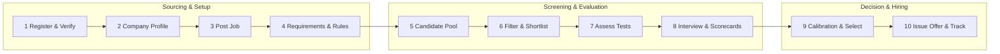
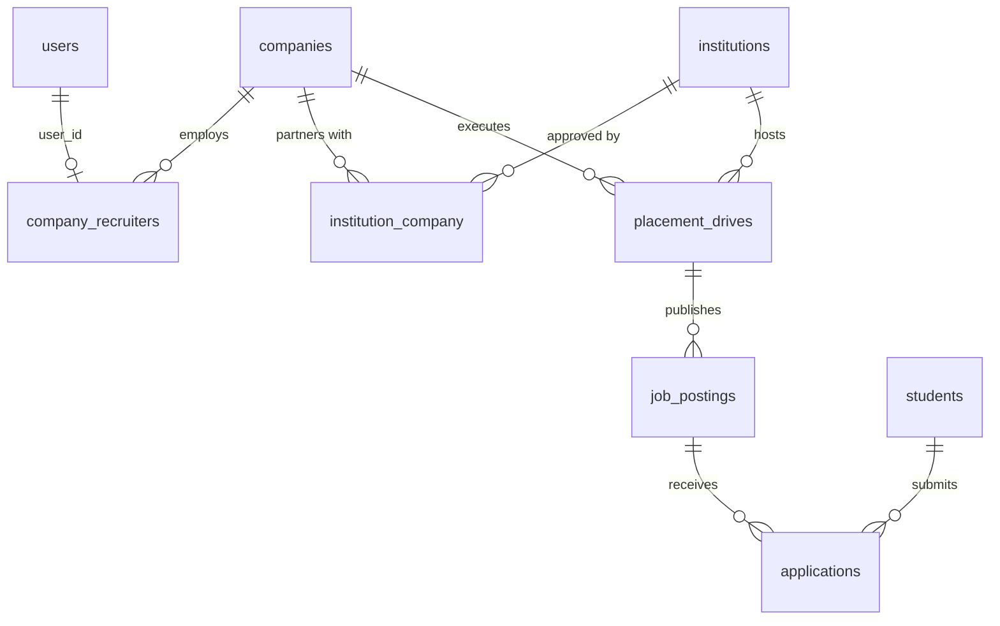
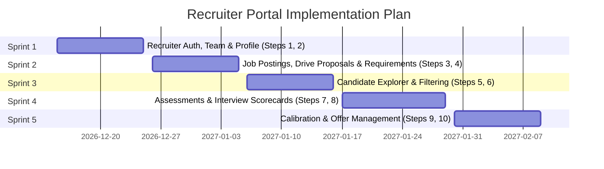

# Recruiter Journey — Backend Specification

| Item | Value |
|---|---|
| Product | Alphagrew |
| Covers | Master Documentation §7.3 Recruiter Portal & Sourcing Journey, end to end |
| Builds on | PRD addenda in `documentation/prd/` (User Roles R2/R5/R9, Data Model D5, Campus Academics) and companion [Placement Officer Journey Spec](placement-officer-journey-backend-spec.md) |
| Audience | Backend developers (Laravel API), Frontend developers (React/Vite) |
| Version | 1.0 draft, 20 October 2026 |

This document provides a comprehensive technical specification for the **Recruiter Journey** across all 10 core operational stages: from registration and company profile setup, through multi-campus job posting, candidate pool screening, automated/manual assessment, interview scoring, calibration/selection, and formal offer issuance.

---

## 1. The journey at a glance



### Module Status Matrix: Today vs Target

| # | Step | Today (`alphagrew` repo) | Target Architecture | Priority (PDF §32) |
|---|---|---|---|---|
| 1 | **Register / Verify** | ⚠️ `UserRole::Recruiter` enum exists; login refused by policy (PRD Roles R5) | Dual onboarding: College Placement Officer invitation OR self-registration with corporate domain verification + institutional linking | P1 |
| 2 | **Company Profile** | ⚠️ Overloaded `companies` table holds drive dates & packages; no recruiter profile | Multi-campus enterprise profile (`companies`) with branding, office locations, media, perks, and team member management (`company_recruiters`) | P1 |
| 3 | **Job** | ⚠️ Hardcoded in `companies.role` / `package_offered` | Multi-campus `job_postings` with campus drive proposals (`placement_drives`), role categories, and work arrangements | P1 |
| 4 | **Requirements** | ⚠️ Free-text `eligible_departments` only | Structured technical competencies (`required_skills`), compensation breakdown in paise (`ctc_min_paise`, base, bonuses), and academic constraints | P1 |
| 5 | **Candidate Pool** | ❌ No recruiter access | Privacy-preserving candidate explorer (`RecruiterCandidateResource`) masking contact details until shortlist, respecting student visibility flags | P1 |
| 6 | **Filter** | ❌ No filtering API | Multi-dimensional filter engine (CGPA, verified skill badges, AI match score, readiness score), candidate triage (`shortlisted`, `rejected`, `on_hold`) | P1 |
| 7 | **Assess** | ⚠️ `placement_rounds` table exists but unused | Integrated assessment engine OR external test URL link (HackerRank/Mettl); automated test score ingestion and proctoring analytics | P1 |
| 8 | **Interview** | ⚠️ Static cards in frontend | Multi-round panel scheduling (`interview_slots`), video meeting integrations, and structured 5-dimension hiring rubrics | P1 |
| 9 | **Select** | ❌ Not implemented | Candidate calibration matrix, peer benchmarking, committee debrief dashboard, and final selection sign-off | P1 |
| 10 | **Offer** | ⚠️ Boolean `offer_letter: true` in mock controller | Formal offer issuance (`offers`), CTC breakdown in paise, offer letter PDF upload, response deadlines, and acceptance tracking | P1 |

---

## 2. Recruiter Tenancy & Security Architecture

Unlike students and college staff who are strictly bound to a single educational tenant (`institution_id`), **Recruiters belong to an Employer Entity (`companies`)**.



### 2.1 The Recruiter Boundary Rules (PDF §6 & Master Doc Criterion 27)

1. **Company Scoping (`company_id`):** A recruiter user has `users.institution_id = NULL` and is linked to a company through `company_recruiters`. All actions are scoped to their employer's data.
2. **Campus Access Boundary:** A recruiter can only interact with an institution if:
   - The company has an active partnership in `institution_company (status = 'approved')`, OR
   - The institution's Placement Officer approved a campus hiring drive (`placement_drives.status = 'published'`).
3. **Candidate Data Isolation (Criterion 27):** Recruiters **never** have open-directory access to browse the entire student body of a college. They can **only** view candidates who have submitted an application (`applications`) to their company's job postings, or students who have consented to open sourcing for partner companies.
4. **Student Privacy Protection (PDF §6):** Student profiles are exposed through `RecruiterCandidateResource`:
   - Any profile section where `student_profiles.visibility[section] = false` is omitted from the JSON payload.
   - Contact details (`phone`, `personal_email`, `communication_address`) are **masked** (e.g. `+91 98*****21`, `s***@college.edu`) until the recruiter promotes the candidate to `shortlisted` or `in_rounds`. This prevents off-platform poaching and circumvention of the campus placement office.

---

## 3. Conventions & Standards

Following `backend/ARCHITECTURE.md`:

- **Base URL & Auth:** `/api/v1/recruiter/...`, authenticated via Laravel Sanctum (`auth:sanctum`), authorized via custom middleware `recruiter.team`.
- **Role & Permissions:** User has `role = UserRole::Recruiter`. Permissions in `CampusPermission`:
  - `recruiter.profile.manage`
  - `recruiter.jobs.manage`
  - `recruiter.candidates.view`
  - `recruiter.candidates.evaluate`
  - `recruiter.assessments.manage`
  - `recruiter.interviews.schedule`
  - `recruiter.interviews.score`
  - `recruiter.offers.issue`
- **Currency & Compensation:** All financial parameters (CTC, base salary, bonuses, stipends) are stored and transmitted as integer **paise** (`ctc_min_paise`, `ctc_max_paise`, `base_salary_paise`, `stipend_paise`). API responses provide both integer paise and human-friendly display strings (e.g. `ctcPaise: 120000000`, `ctcLpaFormatted: "12.00 LPA"`).
- **Responses:** Standard JSON format with `camelCase` keys.

---

## 4. Detailed Specification: Steps 1 to 10

---

### Step 1 — Register & Corporate Verification

**Today:** `UserRole::Recruiter` exists in code, but recruiter login is blocked with `403 Forbidden` pending portal implementation.

**Target:** Dual onboarding pathways for recruiters:
1. **Invited Recruiter:** Placement Officer invites an HR contact via email link (`POST /student-invites` pattern), automatically verifying the recruiter and pre-linking their company with the institution.
2. **Self-Registration:** Recruiter signs up using their corporate work email (e.g. `@google.com`, `@tcs.com`). The platform blocks generic free email providers (`gmail.com`, `yahoo.com`, `outlook.com`), verifies email ownership, and places the company profile into verification.

#### Endpoints

| Method | Path | Permission | Request Body | Response |
|---|---|---|---|---|
| POST | `/api/v1/recruiter/auth/register` | public | `name, email, password, companyName, companyWebsite, workPhone, designation` | 201 `{ token, user, company: CompanyResource }` |
| POST | `/api/v1/recruiter/auth/accept-invite` | public | `inviteToken, password, name, designation, phone` | 201 `{ token, user, company: CompanyResource }` |
| POST | `/api/v1/recruiter/auth/verify-work-email` | auth | `{ otp: "123456" }` | 200 `{ message: "Work email verified successfully" }` |
| POST | `/api/v1/recruiter/team/invites` | `recruiter.profile.manage` | `{ email, name, role: "recruiter"\|"interviewer"\|"hiring_manager" }` | 202 `{ message: "Team invitation dispatched" }` |
| GET | `/api/v1/recruiter/team/members` | `recruiter.profile.manage` | — | 200 `[CompanyTeamMemberResource]` |

#### Database Schema: `company_recruiters` & `institution_company`

```sql
CREATE TABLE company_recruiters (
    id BIGINT UNSIGNED AUTO_INCREMENT PRIMARY KEY,
    company_id BIGINT UNSIGNED NOT NULL,
    user_id BIGINT UNSIGNED NOT NULL,
    designation VARCHAR(100) NOT NULL,
    team_role ENUM('admin', 'recruiter', 'hiring_manager', 'interviewer') DEFAULT 'recruiter',
    is_primary_contact BOOLEAN DEFAULT FALSE,
    invited_by BIGINT UNSIGNED NULL,
    verified_at TIMESTAMP NULL,
    created_at TIMESTAMP NULL,
    updated_at TIMESTAMP NULL,
    CONSTRAINT fk_cr_company FOREIGN KEY (company_id) REFERENCES companies(id) ON DELETE CASCADE,
    CONSTRAINT fk_cr_user FOREIGN KEY (user_id) REFERENCES users(id) ON DELETE CASCADE,
    UNIQUE KEY uk_cr_company_user (company_id, user_id)
);

CREATE TABLE institution_company (
    id BIGINT UNSIGNED AUTO_INCREMENT PRIMARY KEY,
    institution_id BIGINT UNSIGNED NOT NULL,
    company_id BIGINT UNSIGNED NOT NULL,
    status ENUM('pending', 'approved', 'rejected', 'blacklisted') DEFAULT 'pending',
    mou_signed BOOLEAN DEFAULT FALSE,
    relationship_manager_id BIGINT UNSIGNED NULL, -- Placement Officer user ID
    approved_at TIMESTAMP NULL,
    created_at TIMESTAMP NULL,
    updated_at TIMESTAMP NULL,
    CONSTRAINT fk_ic_institution FOREIGN KEY (institution_id) REFERENCES institutions(id) ON DELETE CASCADE,
    CONSTRAINT fk_ic_company FOREIGN KEY (company_id) REFERENCES companies(id) ON DELETE CASCADE,
    UNIQUE KEY uk_ic_inst_company (institution_id, company_id)
);
```

---

### Step 2 — Company Profile & Enterprise Branding

**Today:** The legacy `companies` table contains flat fields (`name`, `website`, `industry`, `logo_url`) intermixed with campus drive dates.

**Target:** Full corporate employer branding profile seen by students across partner institutions, featuring company overview, tech stack, office locations, culture highlights, and social links.

#### Endpoints

| Method | Path | Permission | Request Body | Response |
|---|---|---|---|---|
| GET | `/api/v1/recruiter/company/profile` | `recruiter.profile.manage` | — | 200 `CompanyProfileResource` |
| PUT | `/api/v1/recruiter/company/profile` | `recruiter.profile.manage` | See schema below | 200 `CompanyProfileResource` |
| POST | `/api/v1/recruiter/company/logo` | `recruiter.profile.manage` | multipart `logo` (PNG/JPG/SVG ≤ 2MB) | 200 `{ logoUrl: "https://..." }` |
| POST | `/api/v1/recruiter/company/banner` | `recruiter.profile.manage` | multipart `banner` (PNG/JPG ≤ 5MB) | 200 `{ bannerUrl: "https://..." }` |
| GET | `/api/v1/recruiter/partner-institutions` | `recruiter.profile.manage` | — | 200 `[PartnerInstitutionResource]` |
| POST | `/api/v1/recruiter/partner-institutions/request-partnership` | `recruiter.profile.manage` | `{ institutionId, introductionMessage }` | 201 `{ message: "Partnership request submitted" }` |

#### Request Schema: Update Company Profile
```json
{
  "name": "Google India Pvt Ltd",
  "tagline": "Organizing the world's information and making it universally accessible",
  "about": "Google is a global technology leader focused on improving the ways people connect with information...",
  "industry": "Software & Internet Services",
  "companySize": "10000+",
  "website": "https://google.com",
  "linkedinUrl": "https://linkedin.com/company/google",
  "headquarters": "Mountain View, CA",
  "locations": ["Bengaluru", "Hyderabad", "Gurugram", "Mumbai"],
  "culturePerks": [
    "Hybrid Work Policy",
    "Comprehensive Health Coverage",
    "Continuous Learning Allowance",
    "Free Meals & Transport"
  ],
  "techStack": ["Go", "C++", "Java", "Python", "Kubernetes", "Angular"]
}
```

---

### Step 3 — Post Job & Propose Campus Drives

**Today:** Overloaded `companies` row has `role` and `package_offered`. The placement officer types these values manually.

**Target:**
1. Recruiter drafts or publishes standardized job openings (`job_postings`).
2. Recruiter can publish a job posting to **specific partner institutions** or submit a formal **Campus Drive Request** specifying preferred dates and target graduation batches.

#### Endpoints

| Method | Path | Permission | Request Body | Response |
|---|---|---|---|---|
| GET | `/api/v1/recruiter/jobs` | `recruiter.jobs.manage` | `status=draft\|open\|closed`, `institution_id=`, `page=1` | 200 Paginated `RecruiterJobPostingResource` |
| POST | `/api/v1/recruiter/jobs` | `recruiter.jobs.manage` | See schema in Step 4 | 201 `RecruiterJobPostingResource` |
| GET | `/api/v1/recruiter/jobs/{jobPosting}` | `recruiter.jobs.manage` | — | 200 `RecruiterJobDetailResource` (includes round structure & metrics) |
| PUT | `/api/v1/recruiter/jobs/{jobPosting}` | `recruiter.jobs.manage` | Updated attributes | 200 `RecruiterJobPostingResource` |
| POST | `/api/v1/recruiter/jobs/{jobPosting}/propose-drive` | `recruiter.jobs.manage` | `{ institutionId, proposedDates: ["2026-11-10", "2026-11-11"], driveType: "on_campus"\|"virtual", expectedHiresCount: 15, notes?: "..." }` | 201 `DriveProposalResource` |
| POST | `/api/v1/recruiter/jobs/{jobPosting}/close` | `recruiter.jobs.manage` | — | 200 `{ message: "Job applications closed" }` |

---

### Step 4 — Define Requirements, Skill Profiles & Compensation

**Today:** No structured tech competencies, salary breakdowns, or rule engines exist for recruiters.

**Target:** Comprehensive configuration of job requisites:
- **Role Profile:** Title, role category, openings count, employment type (`full_time`, `internship`, `ppo`).
- **Technical Competencies (`required_skills`):** Skills selected from the platform's standardized catalogue, tagged with required minimum proficiency and relative importance weighting.
- **Academic Eligibility Constraints:** Strict minimum cutoffs that integrate with college academic databases.
- **Compensation Breakdown (Paise):** Transparent component model.

#### Request Schema: Create Job Posting with Detailed Requirements
```json
{
  "title": "Associate Software Engineer - Backend",
  "roleCategory": "Software Development",
  "employmentType": "full_time",
  "openings": 12,
  "location": "Bengaluru (Hybrid)",
  "description": "We are seeking talented fresh graduates with strong foundations in data structures...",
  "responsibilities": "Design and build microservices; collaborate with frontend teams; write unit tests...",
  "applyDeadline": "2026-11-05T23:59:59Z",
  "compensation": {
    "ctcMinPaise": 120000000,
    "ctcMaxPaise": 140000000,
    "baseSalaryPaise": 100000000,
    "variablePayPaise": 15000000,
    "joiningBonusPaise": 5000000,
    "stipendPaise": 4000000, // For initial 6-month internship
    "serviceBondMonths": 0
  },
  "requiredSkills": [
    { "skillId": 14, "name": "Java", "minLevel": "intermediate", "weight": 40 },
    { "skillId": 28, "name": "Data Structures & Algorithms", "minLevel": "advanced", "weight": 35 },
    { "skillId": 42, "name": "SQL & Relational Databases", "minLevel": "intermediate", "weight": 25 }
  ],
  "eligibilityRules": [
    { "field": "cgpa", "operator": "gte", "value": 7.50 },
    { "field": "active_backlogs", "operator": "eq", "value": 0 },
    { "field": "backlog_history", "operator": "lte", "value": 1 },
    { "field": "department", "operator": "in", "value": ["CSE", "IT", "ECE"] },
    { "field": "batch", "operator": "eq", "value": 2027 },
    { "field": "class_10_percentage", "operator": "gte", "value": 65.0 },
    { "field": "class_12_percentage", "operator": "gte", "value": 65.0 }
  ]
}
```

---

### Step 5 — Candidate Pool & Privacy-Preserving Profiles

**Today:** Recruiter has no portal access.

**Target:** Recruiter browses all students who applied to their job posting. The candidate profile view strictly obeys student privacy flags and anti-poaching policies.

#### Privacy Enforcement Rules (`RecruiterCandidateResource`)

1. **Section Visibility (PDF §6):** Evaluates `student_profiles.visibility`. If `visibility['projects'] == false`, the `projects` key is omitted from the recruiter payload.
2. **Contact Details Masking:** 
   - While application status is `applied`, `phone`, `personal_email`, and residential address are masked.
   - Once the candidate is advanced to `shortlisted` or `in_rounds`, the recruiter receives full authorized contact details.
3. **Verified Academic Seal:** Academic metrics (CGPA, active backlogs, passing marks) carry a `verifiedByInstitution: true` badge derived directly from locked semester results, preventing candidate resume fraud.

#### Endpoints

| Method | Path | Permission | Query Parameters | Response |
|---|---|---|---|---|
| GET | `/api/v1/recruiter/jobs/{jobPosting}/candidates` | `recruiter.candidates.view` | `status=`, `search=`, `min_cgpa=`, `department=`, `institution_id=`, `sort=match\|cgpa\|applied_at`, `page=1` | 200 Paginated `RecruiterCandidateSummaryResource` |
| GET | `/api/v1/recruiter/candidates/{applicationId}` | `recruiter.candidates.view` | — | 200 `RecruiterCandidateDetailResource` |
| GET | `/api/v1/recruiter/candidates/{applicationId}/resume` | `recruiter.candidates.view` | — | 302 Temporary signed S3 download URL (15-min expiry) |
| GET | `/api/v1/recruiter/candidates/{applicationId}/match-breakdown` | `recruiter.candidates.view` | — | 200 `{ data: JobMatchExplanationResource }` |

#### Data Structure: `RecruiterCandidateDetailResource`
```json
{
  "data": {
    "applicationId": 1042,
    "status": "applied",
    "appliedAt": "2026-10-22T10:15:00Z",
    "candidate": {
      "id": 512,
      "name": "Ananya Roy",
      "headline": "Aspiring Backend Developer | Java & Distributed Systems",
      "institutionName": "Apex Institute of Technology",
      "department": "Computer Science & Engineering",
      "batch": 2027,
      "photoUrl": "https://...",
      "contact": {
        "isMasked": true,
        "email": "a***@student.apex.edu",
        "phone": "+91 98*****41",
        "unlockNotice": "Full contact details unlock when candidate is shortlisted."
      },
      "academics": {
        "cgpa": 8.74,
        "activeBacklogs": 0,
        "attendancePercentage": 88.5,
        "verifiedByInstitution": true
      },
      "verifiedSkills": [
        { "name": "Java", "level": "advanced", "badge": "Assessment Verified" },
        { "name": "Spring Boot", "level": "intermediate", "badge": "Course Verified" },
        { "name": "MySQL", "level": "intermediate", "badge": "Course Verified" }
      ],
      "projects": [
        {
          "title": "High-Throughput Message Queue in Go",
          "techStack": ["Go", "Raft", "gRPC"],
          "url": "https://github.com/ananya/fastqueue"
        }
      ],
      "matchScore": {
        "overallMatchPercent": 92.5,
        "matchedSkillsCount": 3,
        "missingSkills": []
      }
    }
  }
}
```

---

### Step 6 — Filter, Triage & Screen Candidates

**Today:** No triage tools.

**Target:** Dynamic multi-faceted filtering, AI candidate matching, collaborative reviewer tags, and bulk candidate management.

#### Endpoints

| Method | Path | Permission | Request Body | Response |
|---|---|---|---|---|
| POST | `/api/v1/recruiter/applications/{applicationId}/triage` | `recruiter.candidates.evaluate` | `{ status: "shortlisted"\|"rejected"\|"on_hold", rejectionReason?: "Missing Core Tech Stack", internalNote?: "Strong coding portfolio" }` | 200 `RecruiterCandidateDetailResource` |
| POST | `/api/v1/recruiter/jobs/{jobPosting}/bulk-triage` | `recruiter.candidates.evaluate` | `{ applicationIds: [101, 102, 103], status: "shortlisted", note?: "Cleared CV screening" }` | 200 `{ data: { updatedCount: 3 } }` |
| POST | `/api/v1/recruiter/applications/{applicationId}/tags` | `recruiter.candidates.evaluate` | `{ tags: ["top_tier_coder", "strong_system_design"] }` | 200 `{ data: { tags: [...] } }` |
| GET | `/api/v1/recruiter/jobs/{jobPosting}/candidates/export` | `recruiter.candidates.view` | `format=xlsx\|csv&status=shortlisted` | 200 Binary spreadsheet stream |

#### Database Schema: `candidate_recruiter_tags` & `candidate_internal_notes`

```sql
CREATE TABLE candidate_recruiter_notes (
    id BIGINT UNSIGNED AUTO_INCREMENT PRIMARY KEY,
    application_id BIGINT UNSIGNED NOT NULL,
    company_id BIGINT UNSIGNED NOT NULL,
    recruiter_user_id BIGINT UNSIGNED NOT NULL,
    note TEXT NOT NULL,
    is_private_to_author BOOLEAN DEFAULT FALSE,
    created_at TIMESTAMP NULL,
    updated_at TIMESTAMP NULL,
    CONSTRAINT fk_crn_app FOREIGN KEY (application_id) REFERENCES applications(id) ON DELETE CASCADE,
    CONSTRAINT fk_crn_company FOREIGN KEY (company_id) REFERENCES companies(id) ON DELETE CASCADE,
    CONSTRAINT fk_crn_user FOREIGN KEY (recruiter_user_id) REFERENCES users(id) ON DELETE CASCADE,
    INDEX idx_crn_app (application_id)
);
```

---

### Step 7 — Assessment Setup & Evaluation

**Today:** The schema has `placement_rounds` and `placement_results`, but recruiters cannot create tests, link platforms, or inspect submissions.

**Target:** Dual assessment mode:
1. **Integrated Test:** Recruiter builds an assessment using Alphagrew's questions catalogue (Aptitude, Domain MCQ, Online Coding). The platform auto-evaluates test attempts and flags proctoring violations.
2. **External Test Integration:** Recruiter provides their existing testing platform URL (HackerRank, HackerEarth, Coderbyte, Mettl). Test scores are uploaded via bulk CSV or automated webhook.

#### Endpoints

| Method | Path | Permission | Request Body | Response |
|---|---|---|---|---|
| GET | `/api/v1/recruiter/jobs/{jobPosting}/assessment-rounds` | `recruiter.assessments.manage` | — | 200 `[RecruiterRoundResource]` |
| POST | `/api/v1/recruiter/jobs/{jobPosting}/assessment-rounds` | `recruiter.assessments.manage` | `{ name: "Online Coding & Aptitude Test", type: "coding", assessmentId?: 105, externalTestUrl?: "https://hackerrank.com/...", startsAt, endsAt, durationMinutes: 90, cutoffPercentage: 70.0 }` | 201 `RecruiterRoundResource` |
| GET | `/api/v1/recruiter/assessment-rounds/{roundId}/analytics` | `recruiter.assessments.manage` | — | 200 `AssessmentRoundAnalyticsResource` (completion rate, percentile distribution, avg score) |
| GET | `/api/v1/recruiter/assessment-rounds/{roundId}/attempts/{attemptId}` | `recruiter.assessments.manage` | — | 200 `CandidateAttemptDetailResource` (code submissions, test cases passed, tab-switch flags) |
| POST | `/api/v1/recruiter/assessment-rounds/{roundId}/import-scores` | `recruiter.assessments.manage` | multipart CSV/XLSX (`candidateEmail`, `score`, `percentile`, `status`) | 200 `{ data: { importedCount: 115, updatedCount: 0 } }` |
| POST | `/api/v1/recruiter/assessment-rounds/{roundId}/advance-cutoff` | `recruiter.assessments.manage` | `{ minCutoffScore: 75.0, maxCandidates: 40 }` | 200 `{ data: { advancedCount: 38 } }` |

---

### Step 8 — Interview Panels & Structured Scorecards

**Today:** No interview scheduling or scoring interface exists for company panels.

**Target:** Interview orchestration with assigned interviewer panels, calendar scheduling, integrated meeting links, and structured dimension-based evaluation rubrics.

#### Structured Evaluation Rubric (1 to 5 scale)
- **Problem Solving & Algorithms:** Analytical thinking, edge cases, optimization.
- **Technical Competence & Architecture:** Core language depth, system design, best practices.
- **Coding & Implementation Quality:** Code readability, modularity, error handling.
- **Communication & Collaboration:** Articulation of thought process, receptive to hints.
- **Values & Cultural Alignment:** Drive, initiative, teamwork, integrity.

#### Overall Hiring Recommendation
- `strong_hire` (Exceptional, benchmark leader)
- `hire` (Meets all hiring bars)
- `lean_hire` (Meets bars with minor reservations)
- `no_hire` (Fails core technical or behavioral criteria)

#### Endpoints

| Method | Path | Permission | Request Body | Response |
|---|---|---|---|---|
| GET | `/api/v1/recruiter/jobs/{jobPosting}/interview-rounds` | `recruiter.interviews.schedule` | — | 200 `[InterviewRoundResource]` |
| POST | `/api/v1/recruiter/interview-rounds/{roundId}/slots` | `recruiter.interviews.schedule` | `{ panelId, startsAt, durationMinutes: 45, meetingUrl: "https://meet.google.com/...", location?: "Virtual" }` | 201 `InterviewSlotResource` |
| POST | `/api/v1/recruiter/interview-slots/{slotId}/assign` | `recruiter.interviews.schedule` | `{ applicationId: 1042 }` | 200 `InterviewSlotResource` |
| GET | `/api/v1/recruiter/interview-slots/{slotId}/scorecard` | `recruiter.interviews.score` | — | 200 `InterviewScorecardResource` |
| POST | `/api/v1/recruiter/interview-slots/{slotId}/scorecard` | `recruiter.interviews.score` | See schema below | 201 `InterviewScorecardResource` |

#### Request Schema: Submit Interview Scorecard
```json
{
  "overallRecommendation": "hire",
  "dimensionScores": {
    "problemSolving": 4,
    "technicalCompetence": 5,
    "codeQuality": 4,
    "communication": 4,
    "cultureFit": 5
  },
  "strengths": "Deep command over Java concurrency and database indexing; very structured approach to problem solving.",
  "areasOfImprovement": "Could practice more distributed systems trade-offs.",
  "interviewerNotes": "Candidate proposed a clean O(N log N) solution right away and optimized space complexity.",
  "isRecommendedForNextRound": true
}
```

#### Database Schema: `interview_scorecards`

```sql
CREATE TABLE interview_scorecards (
    id BIGINT UNSIGNED AUTO_INCREMENT PRIMARY KEY,
    interview_slot_id BIGINT UNSIGNED NOT NULL,
    application_id BIGINT UNSIGNED NOT NULL,
    interviewer_user_id BIGINT UNSIGNED NOT NULL,
    overall_recommendation ENUM('strong_hire', 'hire', 'lean_hire', 'no_hire') NOT NULL,
    dimension_scores JSON NOT NULL, -- {"problemSolving": 4, "technicalCompetence": 5, ...}
    strengths TEXT NULL,
    areas_of_improvement TEXT NULL,
    interviewer_notes TEXT NULL,
    is_recommended_for_next_round BOOLEAN DEFAULT FALSE,
    submitted_at TIMESTAMP NOT NULL DEFAULT CURRENT_TIMESTAMP,
    created_at TIMESTAMP NULL,
    updated_at TIMESTAMP NULL,
    CONSTRAINT fk_isc_slot FOREIGN KEY (interview_slot_id) REFERENCES interview_slots(id) ON DELETE CASCADE,
    CONSTRAINT fk_isc_app FOREIGN KEY (application_id) REFERENCES applications(id) ON DELETE CASCADE,
    CONSTRAINT fk_isc_interviewer FOREIGN KEY (interviewer_user_id) REFERENCES users(id) ON DELETE CASCADE,
    UNIQUE KEY uk_isc_slot_interviewer (interview_slot_id, interviewer_user_id)
);
```

---

### Step 9 — Calibration, Committee Debrief & Final Selection

**Today:** No calibration or candidate comparison capability.

**Target:** Consolidated calibration dashboard. The hiring committee reviews the candidate's complete journey across all rounds side-by-side, normalizes interviewer scoring biases, and finalizes selections.

#### Endpoints

| Method | Path | Permission | Query Parameters | Response |
|---|---|---|---|---|
| GET | `/api/v1/recruiter/jobs/{jobPosting}/calibration-board` | `recruiter.candidates.evaluate` | `round_id=`, `sort=score\|recommendation` | 200 `CalibrationBoardResource` |
| POST | `/api/v1/recruiter/jobs/{jobPosting}/finalize-selection` | `recruiter.candidates.evaluate` | `{ selectedApplicationIds: [101, 105, 120], waitlistApplicationIds: [108, 114] }` | 200 `{ message: "Selection finalized", selectedCount: 3, waitlistCount: 2 }` |
| GET | `/api/v1/recruiter/jobs/{jobPosting}/compare` | `recruiter.candidates.view` | `application_ids=101,105,108` | 200 `CandidateComparisonMatrixResource` |

#### Calibration Data Matrix View
Displays for each finalist:
- Institution Name & Department
- CGPA & Academic Seal
- Test Round Percentile
- Round 1 Technical Score (Avg rating + Recommendation)
- Round 2 System Design Score (Avg rating + Recommendation)
- Committee Decision: `selected`, `waitlist`, `rejected`

---

### Step 10 — Offer Generation, Tracking & Onboarding Handoff

**Today:** Mock boolean `offer_letter: true` in legacy controller with zero formal document attachment or response handling.

**Target:** Formal offer lifecycle management:
1. Recruiter drafts and publishes offer packages with itemized compensation (paise).
2. Attaches official PDF offer letter with digital signature.
3. Sets binding student response expiry deadline (`respond_by`).
4. Real-time status tracking (`issued` → `accepted` / `declined` / `expired`).
5. Upon student acceptance, an official placement is recorded in the college database and the signed offer acceptance receipt is made available to the recruiter.

#### Endpoints

| Method | Path | Permission | Request Body | Response |
|---|---|---|---|---|
| GET | `/api/v1/recruiter/jobs/{jobPosting}/offers` | `recruiter.offers.issue` | `status=issued\|accepted\|declined\|expired` | 200 `[RecruiterOfferResource]` |
| POST | `/api/v1/recruiter/applications/{applicationId}/offers` | `recruiter.offers.issue` | Multipart form (see below) | 201 `RecruiterOfferResource` |
| PUT | `/api/v1/recruiter/offers/{offerId}` | `recruiter.offers.issue` | Updated offer parameters | 200 `RecruiterOfferResource` |
| POST | `/api/v1/recruiter/offers/{offerId}/publish` | `recruiter.offers.issue` | — | 200 `{ message: "Offer published to candidate" }` |
| DELETE | `/api/v1/recruiter/offers/{offerId}/revoke` | `recruiter.offers.issue` | `{ reason: "Misrepresentation discovered" }` | 200 `{ message: "Offer revoked" }` |
| GET | `/api/v1/recruiter/offers/{offerId}/acceptance-receipt` | `recruiter.offers.issue` | — | 302 Signed S3 URL of student-signed acceptance document |

#### Request Schema: Issue Offer Package
```json
{
  "designation": "Associate Software Engineer",
  "joiningDate": "2027-07-05",
  "workLocation": "Bengaluru, Karnataka",
  "respondBy": "2026-11-20T18:00:00Z",
  "compensation": {
    "ctcPaise": 135000000, // 13.50 LPA
    "baseSalaryPaise": 105000000,
    "variablePayPaise": 15000000,
    "joiningBonusPaise": 15000000,
    "stockOptionsValuePaise": 0
  },
  "offerLetterPdf": "(binary PDF file ≤ 10MB)"
}
```

---

## 5. Recruiter Events & Asynchronous Jobs

| Event | Dispatched When | Listeners & Queued Jobs | Notifications Dispatched |
|---|---|---|---|
| `RecruiterRegistered` | Step 1: Recruiter signs up | `SendWorkEmailVerificationJob` | Verification link with corporate OTP |
| `DriveProposalSubmitted` | Step 3: Recruiter proposes drive to college | `NotifyPlacementOfficerOfDriveProposalJob` | Alert to College Placement Officer dashboard |
| `CandidateShortlistedByRecruiter` | Step 6: Recruiter shortlists candidate | `NotifyCandidateShortlistedJob`, `UnlockCandidateContactDetailsJob` | Candidate alerted: *"You have been shortlisted by {company}"* |
| `AssessmentRoundPublished` | Step 7: Recruiter opens test window | `ScheduleAssessmentWindowJob`, `NotifyTestCandidatesJob` | Candidates receive test link, instructions & schedule |
| `InterviewSlotConfirmed` | Step 8: Recruiter assigns slot to candidate | `DispatchCalendarInvitesJob` (Google Calendar / Outlook ICS) | Recruiter panel & student receive calendar invites with meeting link |
| `ScorecardSubmitted` | Step 8: Panelist completes evaluation | `RecalculateCandidateRoundScoreJob` | Hiring Manager alert when all panelists finish |
| `CandidateSelectedByRecruiter` | Step 9: Committee finalizes hire | `NotifyPlacementOfficerOfSelectionJob` | College Placement Office notified of candidate selection |
| `OfferPublishedByRecruiter` | Step 10: Recruiter publishes offer package | `DeliverOfferLetterJob` | Student receives offer letter and acceptance countdown timer |
| `OfferResponseReceived` | Step 10: Student accepts or declines offer | `SyncInstitutionalPlacementRecordJob`, `NotifyRecruiterOfOfferResponseJob` | Recruiter receives instant notification of candidate decision |

---

## 6. Build Order & Sprint Plan



| Sprint | Scope | Key Deliverables |
|---|---|---|
| **Sprint 1** | **Authentication, Team & Profile** (Steps 1–2) | Tables: `company_recruiters`, `institution_company`. Work email domain validator, recruiter Sanctum auth, team invitations, and enterprise branding manager. |
| **Sprint 2** | **Job Postings & Requirements** (Steps 3–4) | Drive proposals, multi-campus job publishing, `required_skills` catalogue mapper, itemized compensation in paise, and eligibility constraint builders. |
| **Sprint 3** | **Candidate Explorer & Filtering** (Steps 5–6) | `RecruiterCandidateResource` with privacy visibility mask, anti-poaching contact redaction, AI match breakdown, multi-attribute filter engine, and collaborative reviewer notes. |
| **Sprint 4** | **Assessments & Interview Scorecards** (Steps 7–8) | Test window scheduler, external test score bulk importer, interview slot booking, and 5-dimension hiring scorecard engine. |
| **Sprint 5** | **Calibration & Offers** (Steps 9–10) | Candidate calibration comparison matrix, formal offer issuance, S3 signed PDF offer letter manager, and automated offer acceptance handoff. |

---

## 7. Acceptance Checklist & Verification Criteria

| Master Doc / PRD Requirement | Verification & Test Strategy |
|---|---|
| **R9 Criterion 27 (Candidate Isolation)** | Assert recruiter of Company A cannot view candidates who applied only to Company B, or candidates from unpartnered institutions (returns `403/404`). |
| **PDF §6 (Student Visibility Control)** | Assert that fields where `student_profiles.visibility[section] == false` are completely omitted from `RecruiterCandidateResource`. |
| **Anti-Poaching Contact Masking** | Assert candidate's `phone` and `personal_email` are masked while application status is `applied`, and unmasked only once status changes to `shortlisted` or `in_rounds`. |
| **Work Email Domain Validation** | Assert self-registration fails with `422` if email domain is from public free webmail providers (`@gmail.com`, `@yahoo.com`, `@hotmail.com`). |
| **Interview Slot Conflict Validation** | Assert that creating or updating an interview slot detects and prevents double-booking for the same candidate across simultaneous drives. |
| **Integer Paise Currency Precision** | Assert that CTC and base salaries are stored without floating-point inaccuracies as integer paise and correctly formatted as LPA display strings in API responses. |
| **Offer Acceptance Policy Sync** | Assert that when a candidate accepts an offer, the college Placement Officer's placement register is immediately updated and conflicting open applications are handled according to the institution's placement policy. |
