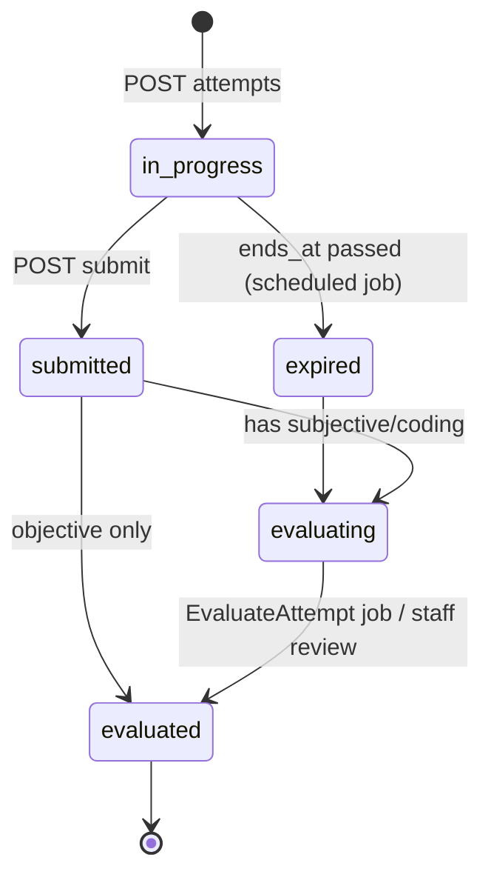
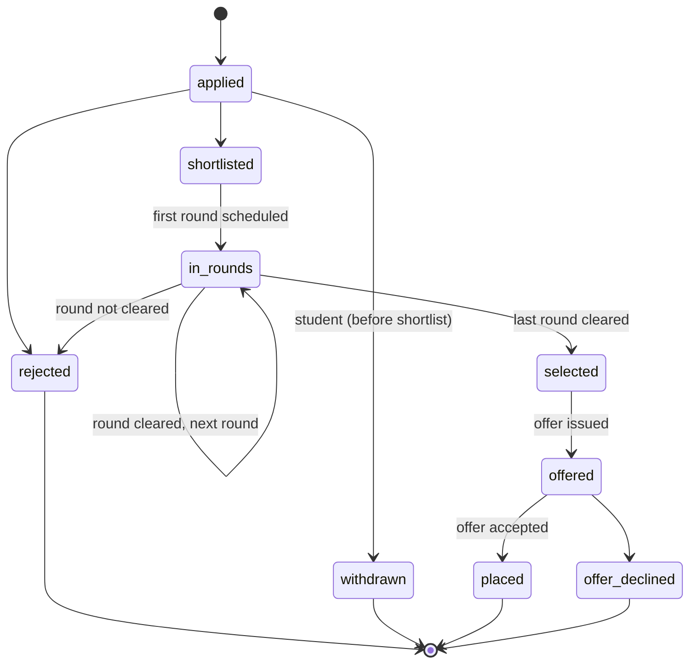

# Student Journey — Backend Specification

| Item | Value |
|---|---|
| Product | Alphagrew |
| Covers | Master Documentation §7.1 Student Journey, end to end |
| Builds on | PRD addenda in `documentation/prd/` (roles, data model, campus academics) and `backend/ARCHITECTURE.md` |
| Audience | Backend developers (Laravel API) |
| Version | 1.0 draft, 20 October 2026 |

This document says, for each of the 16 steps a student goes through, what exists today, what to build, which endpoints to expose, which tables to create or change, and which rules to enforce. Build the steps in the order given in [§11](#11-build-order).

---

## 1. The journey at a glance

```mermaid
flowchart LR
  subgraph Onboard
    S1[1 Register] --> S2[2 Build profile] --> S3[3 Academic details]
  end
  subgraph Resume
    S4[4 Upload resume] --> S5[5 AI analysis] --> S6[6 Skill profile]
  end
  subgraph Readiness
    S7[7 Assessments] --> S8[8 Skill gap] --> S9[9 Practice]
  end
  subgraph Interview practice
    S10[10 AI mock interview] --> S11[11 Feedback]
  end
  subgraph Placement
    S12[12 Job matching] --> S13[13 Apply] --> S14[14 Assessment round] --> S15[15 Interview round] --> S16[16 Placement]
  end
  S3 --> S4
  S6 --> S7
  S9 --> S10
  S11 --> S12
```



| # | Step | Today | Target | Priority (PDF §32) |
|---|---|---|---|---|
| 1 | Register | ✅ `POST /auth/register` with institution code + department | Add invite links, email verification | P0 |
| 2 | Build profile | ⚠️ Name/email only (`PUT /auth/profile`) | `student_profiles` with per-field recruiter visibility | P0 |
| 3 | Academic details | ⚠️ One hand-typed `students.cgpa` | `student_academics` (prior education) + derived CGPA/backlogs from published results | P0 |
| 4 | Upload resume | ⚠️ Structured form in `students.resume_profile`; no file | `resumes` with file upload to private storage, versions | P1 |
| 5 | AI analysis | ❌ | `ai_resume_analyses` filled by a queued job through the AI service layer | P2 |
| 6 | Skill profile | ⚠️ JSON `students.skills`; `student_skills` table unused | `skills` catalogue + `student_skills` with level and source | P0 |
| 7 | Assessments | ❌ (academic exams are a different module) | Assessment engine: questions, attempts, auto-evaluation | P1 |
| 8 | Skill gap | ❌ | `skill_gap_reports` per target role or job | P2 |
| 9 | Practice | ❌ | Practice-mode assessments + `ai_recommendations` | P2 |
| 10 | AI mock interview | ❌ | `ai_interviews` session engine (text first, voice later) | P2 |
| 11 | Feedback | ❌ | `ai_interview_evaluations` + report; feeds `readiness_scores` | P2 |
| 12 | Job matching | ⚠️ Company list filtered by department only | `job_postings` + `eligibility_rules` (deterministic) + `job_matches` (scored) | P0 / P2 |
| 13 | Apply | ⚠️ `POST /companies/{id}/apply`, no status | `applications` + `application_events` with a status machine | P0 |
| 14 | Assessment round | ⚠️ `placement_rounds/results` exist, unused | `drive_rounds` + `round_results` linked to assessment attempts | P0 |
| 15 | Interview round | ❌ | `interview_slots` booked per application | P0 |
| 16 | Placement | ⚠️ Company name in `students.placed_company` | `offers` + `placements` | P0 |

✅ working · ⚠️ partial or wrong shape · ❌ not started

---

## 2. Conventions for every endpoint

These come from `backend/ARCHITECTURE.md` and apply to all new code below.

**URLs and auth**
- Base path `/api/v1`, Bearer token (Sanctum), middleware `auth:sanctum` + `tenant`.
- Student self-service lives under `/students/me/...`. The student is always the signed-in user, never an id in the URL, so a student can't address another student's data.
- Staff/placement endpoints that act on a student use `/students/{student}/...`; route-model binding plus the tenant scope returns 404 for other institutions' students.

**Layers** — Route (permission middleware) → FormRequest (`authorize()` + `rules()` + `toData()`) → Controller → Action (writes) / Repository (reads) → Resource (JSON).

**Tenancy** — every new table below has `institution_id` (NOT NULL, FK, indexed) and its model uses `BelongsToInstitution`. Validation on tenant tables uses `TenantRule::exists/unique`. Jobs carry `institution_id` and run inside `Tenant::runAs()`.

**JSON**
- camelCase keys, ISO-8601 timestamps, money as integer paise in `*Paise` fields plus a display string where useful.
- Single record: `{ "data": { ... } }`.
- List: `{ "data": [ ... ], "meta": { "currentPage", "perPage", "total", "lastPage" } }` (`per_page` ≤ 100).

**Errors**

| Status | When | Body |
|---|---|---|
| 401 | No / expired token | `{ "message": "Unauthenticated." }` |
| 403 | Missing permission, or a business rule (`BusinessRuleException::forbidden`) | `{ "message": "<why>" }` |
| 404 | Record doesn't exist **or belongs to another institution** | `{ "message": "Not Found" }` |
| 409 | State conflict (e.g. attempt already submitted) | `{ "message": "<why>" }` |
| 422 | Validation, or rule violation on valid input (`BusinessRuleException::unprocessable`) | `{ "message", "errors": { field: [..] } }` |

**Files** — private disk (S3-compatible in production, `local` in dev) under `institutions/{institutionId}/students/{studentId}/...`. Never public URLs; downloads go through a signed, short-lived URL endpoint.

**Async work** — anything calling AI, parsing files or recalculating scores runs as a queued Job. The API returns `202 Accepted` with the record in `status: "queued"`; the client polls or receives a notification.

**New permissions** (add to `CampusPermission`, grant via `CampusStudentAccess::defaultPermissions()`):

| Permission | Used by |
|---|---|
| `profile.edit` | Steps 2, 3, 6 (own profile, academics, skills) |
| `resumes.manage` | Steps 4, 5 |
| `assessments.attempt` | Steps 7, 9, 14 |
| `interviews.practice` | Steps 10, 11 |
| `jobs.view` | Step 12 |
| `placement.apply` (exists) | Step 13 |
| `offers.respond` | Step 16 |

---

## 3. Data model

New tables in **bold**. Every table has `id`, `institution_id`, `created_at`, `updated_at`; soft deletes where noted.

```mermaid
erDiagram
  users ||--|| students : "user_id"
  students ||--o| student_profiles : has
  students ||--o{ student_academics : "prior education"
  students ||--o{ student_skills : has
  skills ||--o{ student_skills : "skill_id"
  students ||--o{ student_projects : has
  students ||--o{ student_certifications : has
  students ||--o{ student_experience : has
  students ||--o{ resumes : uploads
  resumes ||--o{ ai_resume_analyses : analysed_by
  students ||--o{ assessment_attempts : takes
  assessments ||--o{ assessment_sections : has
  assessment_sections ||--o{ assessment_questions : has
  questions ||--o{ assessment_questions : "reused in"
  questions ||--o{ question_options : has
  assessment_attempts ||--o{ attempt_answers : has
  students ||--o{ skill_gap_reports : has
  students ||--o{ ai_recommendations : receives
  students ||--o{ ai_interviews : practises
  ai_interviews ||--o{ ai_interview_turns : has
  ai_interviews ||--o| ai_interview_evaluations : "scored by"
  students ||--o{ readiness_scores : has
  companies ||--o{ job_postings : offers
  placement_drives ||--o{ job_postings : groups
  job_postings ||--o{ eligibility_rules : has
  job_postings ||--o{ job_matches : scored
  students ||--o{ job_matches : scored
  job_postings ||--o{ applications : receives
  students ||--o{ applications : submits
  applications ||--o{ application_events : history
  job_postings ||--o{ drive_rounds : has
  drive_rounds ||--o{ round_results : records
  applications ||--o{ round_results : has
  drive_rounds ||--o{ interview_slots : has
  applications ||--o| offers : "may receive"
  offers ||--o| placements : "accepted becomes"
```



Existing tables touched: `students` (columns retired, see §9), `student_skills` (reshaped), `companies` (reduced to the organisation), `company_applications`, `placement_rounds`, `placement_results` (migrated, then dropped), `semester_results` + `mark_entries` (read for CGPA/backlogs).

---

## 4. Onboarding

### Step 1 — Register

**Today.** `POST /auth/register` with `name, email, password, institutionCode, departmentCode` creates a `users` row (role `student`) and a `students` row through `CreateStudentAction`, and returns a token. Login refuses inactive institutions.

**Add.**
1. **Invite links** — admins/placement officers invite students in bulk; the link pre-fills institution and department and skips the code.
2. **Email verification** before any placement action (apply, offers).

| Method | Path | Permission | Request | Response |
|---|---|---|---|---|
| POST | `/auth/register` | public | `name, email, password, institutionCode, departmentCode` *or* `inviteToken, name, password` | 201 `{ token, user, data }` |
| POST | `/student-invites` | `students.create` | `{ invites: [{ email, departmentCode, batchCode? }] }` (≤ 500) | 202 `{ data: { queued: n } }` |
| GET | `/student-invites/{token}` | public | — | 200 `{ data: { institutionName, departmentName, email } }` / 404 / 410 expired |
| POST | `/auth/email/verification-notification` | auth | — | 202 |
| GET | `/auth/email/verify/{id}/{hash}` | signed URL | — | 302 to frontend |

**Table `student_invites`**: `email`, `department_id` FK, `batch_id` FK null, `token` (64, unique), `invited_by` FK users, `expires_at`, `accepted_at` null, `user_id` FK null.

**Rules.** Invite token single-use, 14-day expiry; email in invite must match the registering email. Registration rate-limited (5/min/IP).

**Tests.** Invite flow creates student in the invite's institution/department; expired/used token → 410/422; unverified student cannot apply (403).

---

### Step 2 — Build profile

**Today.** Only name, email and title via `PUT /auth/profile`. Contact data is in `students.phone`.

**Target.** A profile the student owns, with a visibility flag per section (PDF §6 "expose only authorized fields to recruiters").

| Method | Path | Permission | Request | Response |
|---|---|---|---|---|
| GET | `/students/me/profile` | `profile.view` | — | `{ data: StudentProfileResource }` |
| PUT | `/students/me/profile` | `profile.edit` | see table | `{ data: StudentProfileResource }` |
| POST | `/students/me/profile/photo` | `profile.edit` | multipart `photo` (jpg/png ≤ 2 MB) | `{ data: { photoUrl } }` |
| GET/POST/PUT/DELETE | `/students/me/projects[/{id}]` | `profile.edit` | `title, description, techStack[], url?, startDate, endDate?` | resource |
| GET/POST/PUT/DELETE | `/students/me/certifications[/{id}]` | `profile.edit` | `name, issuer, issuedOn, expiresOn?, credentialUrl?` | resource |
| GET/POST/PUT/DELETE | `/students/me/experience[/{id}]` | `profile.edit` | `type (internship|job|freelance), organisation, role, startDate, endDate?, description` | resource |
| GET | `/students/{student}/profile` | `students.view` | — | staff view (all fields) |

**Table `student_profiles`** (1:1 with `students`, `student_id` unique)

| Column | Type | Notes |
|---|---|---|
| `headline` | string(160) null | |
| `about` | text null | ≤ 2,000 chars |
| `date_of_birth` | date null | never shown to recruiters |
| `phone`, `alternate_email` | string null | |
| `city`, `state`, `country` | string null | |
| `linkedin_url`, `github_url`, `portfolio_url` | string null | validated URLs |
| `photo_path` | string null | private disk |
| `preferred_roles` | json | e.g. `["Backend Developer"]` |
| `preferred_locations` | json | |
| `willing_to_relocate` | boolean default true | |
| `visibility` | json | `{ "contact": false, "academics": true, "projects": true, ... }` — recruiter-visible sections |
| `completed_at` | timestamp null | set when §Rules completeness reaches 100 |

**Tables `student_projects`, `student_certifications`, `student_experience`** — `student_id` FK, the fields above, `sort_order`, soft deletes.

**Rules.**
- Profile completeness (0–100) computed in `StudentProfileResource` from weighted sections; shown on the dashboard and used by readiness (§7).
- Recruiter views (later, Recruiter Portal) go through a dedicated `RecruiterCandidateResource` that drops sections where `visibility[section] = false`. Contact details are hidden from recruiters until the student is shortlisted.

**Tests.** Student can only read/write own profile; recruiter resource omits hidden sections; completeness changes as sections are filled.

---

### Step 3 — Academic details

**Today.** `students.cgpa` is typed by an admin. Published results live in `semester_results` / `mark_entries` but nothing derives CGPA from them. No backlog count. No school/prior-education history.

**Target.** Two kinds of data, kept apart:
- **Prior education** (10th, 12th, diploma, previous degree) — entered by the student, verified by staff.
- **Current programme** (CGPA, backlogs, attendance) — **derived only** from published results (Campus Academics addendum A6). Students cannot edit it.

| Method | Path | Permission | Request | Response |
|---|---|---|---|---|
| GET | `/students/me/academics` | `profile.view` | — | `{ data: { summary: AcademicSummary, education: [EducationRecord] } }` |
| POST/PUT/DELETE | `/students/me/education[/{id}]` | `profile.edit` | `level (class_10|class_12|diploma|ug|pg), board_or_university, institution_name, year_of_passing, score_type (percentage|cgpa), score, document_id?` | resource |
| POST | `/students/{student}/education/{id}/verify` | `students.edit` | `{ verified: bool, remarks? }` | resource |
| GET | `/students/{student}/academics` | `students.view` | — | same as student view |

**Table `student_academics`** — prior education, one row per level:
`student_id`, `level`, `board_or_university`, `institution_name`, `year_of_passing` (smallint), `score_type`, `score` (decimal 5,2), `document_id` FK `student_documents` null, `verified_by` FK users null, `verified_at` null. Unique (`student_id`, `level`).

**Table `student_academic_summaries`** — derived, one row per student (`student_id` unique):
`cgpa` (decimal 4,2), `active_backlogs` (smallint), `backlog_history` (smallint), `attendance_percentage` (decimal 5,2), `semesters_published` (smallint), `calculated_at`.

**How the summary is calculated** (`RecalculateAcademicSummary` job, per student):
- `cgpa` = Σ(grade point × credits) / Σ(credits) over subjects in **published** `mark_entries` (status `locked`), grade points from `grade_rules`, credits from `subjects.credits`.
- `active_backlogs` = subjects whose **latest** locked result is `fail`.
- `backlog_history` = distinct subjects ever failed.
- `attendance_percentage` = present ÷ conducted from `attendance`.
- Triggered by events `ResultsPublished`, `ResultsUnlocked`, `RevaluationCompleted`, `AttendanceApproved`.

**Rules.** Staff verification required before prior-education scores count in eligibility. During migration `students.cgpa` stays as a fallback only while `semesters_published = 0`.

**Tests.** Hand-calculated fixture over two semesters (one cleared backlog) matches `cgpa`, `active_backlogs`, `backlog_history`; student cannot write the summary (no route).

---

## 5. Resume and skills

### Step 4 — Upload resume

**Today.** `PUT /students/me/resume` saves a structured form (template, headline, summary, links, projects…) into `students.resume_profile` JSON, plus pasted `uploadedResumeText`. No file.

**Target.** Real file uploads with versions; the structured builder stays as one way to produce a resume.

| Method | Path | Permission | Request | Response |
|---|---|---|---|---|
| GET | `/students/me/resumes` | `resumes.manage` | — | list of `ResumeResource` (newest first) |
| POST | `/students/me/resumes` | `resumes.manage` | multipart `file` (pdf/doc/docx ≤ 5 MB), `label?` | 201 `{ data: ResumeResource }` (`parseStatus: "queued"`) |
| PATCH | `/students/me/resumes/{resume}` | `resumes.manage` | `{ label?, isPrimary? }` | resource |
| DELETE | `/students/me/resumes/{resume}` | `resumes.manage` | — | 204 (cannot delete a resume attached to an open application → 422) |
| GET | `/students/me/resumes/{resume}/download` | `resumes.manage` | — | `{ data: { url, expiresAt } }` (signed, 5 min) |
| PUT | `/students/me/resume` | `profile.view` | (existing builder) | kept; later generates a PDF stored as a `resumes` row with `source = builder` |

**Table `resumes`**

| Column | Type | Notes |
|---|---|---|
| `student_id` | FK | |
| `label` | string(80) | e.g. "Backend – Oct 2026" |
| `source` | enum `upload`, `builder` | |
| `disk`, `path` | string | private disk |
| `original_name`, `mime_type` | string | |
| `size_bytes` | int | |
| `sha256` | char(64) | skip re-analysis of identical files (PDF §27) |
| `is_primary` | boolean | exactly one per student |
| `parse_status` | enum `queued`, `processing`, `parsed`, `failed` | |
| `parsed_text` | longText null | extracted text |
| `parsed_data` | json null | structured extraction (education, skills, projects, experience, certifications) |
| `parse_error` | string null | |
| soft deletes | | |

**Workflow.**
1. `StoreResumeRequest` validates type by **content** (finfo), not extension; max 5 MB; max 10 resumes per student.
2. `UploadResumeAction` stores the file, computes `sha256`, sets primary if it's the first, dispatches `ParseResume` (queue `documents`).
3. `ParseResume` extracts text (PDF: `smalot/pdfparser`; DOCX: `phpoffice/phpword`), fills `parsed_text`, then dispatches `AnalyzeResume` (step 5). On failure: `parse_status = failed`, `parse_error`, notification to student.

**Tests.** Rejects a renamed .exe; primary flag stays unique; download URL is signed and expires; another student's resume id → 404.

---

### Step 5 — AI analysis

**Today.** None. The unused `frontend/server.ts` prototype called Gemini directly from Node; that must not be reused (keys never reach the client — PDF §19).

**Target.** A provider-agnostic AI layer in Laravel, used here and in steps 8–11.

```
app/Services/AI/
  AiClient.php              interface: complete(PromptTemplate, array $vars, array $schema): AiResult
  Providers/AnthropicClient.php, OpenAiClient.php, FakeClient.php (tests)
  PromptRepository.php      loads versioned templates from prompt_templates
  AiUsageRecorder.php       writes ai_usage_logs
```

| Method | Path | Permission | Request | Response |
|---|---|---|---|---|
| GET | `/students/me/resumes/{resume}/analysis` | `resumes.manage` | — | `{ data: ResumeAnalysisResource }` or 404 if none yet |
| POST | `/students/me/resumes/{resume}/analysis` | `resumes.manage` | `{ targetRole? }` | 202 `{ data: { status: "queued" } }` (rate limit 5/day/student) |

**Table `ai_resume_analyses`**

| Column | Type | Notes |
|---|---|---|
| `resume_id` | FK | |
| `student_id` | FK | denormalised for reporting |
| `target_role` | string null | |
| `status` | enum `queued`, `processing`, `completed`, `failed` | |
| `overall_score` | tinyint null | 0–100 |
| `section_scores` | json | `{ structure, clarity, relevance, keywords, impact }` |
| `strengths`, `improvements` | json | arrays of `{ title, detail, example? }` — each improvement must be explainable (acceptance criterion 9) |
| `extracted_skills` | json | `[{ name, evidence }]` |
| `prompt_template_id`, `model`, `model_version` | FK / string | auditability (PDF §8 design rule) |
| `error` | string null | |

**Tables `prompt_templates`** (`key`, `version`, `system_prompt`, `user_template`, `output_schema` json, `is_active`; unique `key+version`; `institution_id` null = platform) and **`ai_usage_logs`** (`feature`, `subject_type`, `subject_id`, `model`, `input_tokens`, `output_tokens`, `cost_micros`, `latency_ms`, `status`).

**Workflow.** `AnalyzeResume` job → skip if an analysis for the same `sha256` + `target_role` exists → build prompt from `parsed_text` + profile → `AiClient` with JSON schema → validate output against schema (reject and mark `failed` on mismatch) → save → `ResumeAnalysed` event → listener upserts `student_skills` with `source = resume` (step 6) and notifies the student.

**Rules.** AI scores are shown as guidance, never as pass/fail (PDF §8). Usage counted per institution for AI credits (Phase 13).

**Tests.** With `FakeClient`: completed analysis stored; malformed AI JSON → `failed`; same file not re-analysed; usage log written.

---

### Step 6 — Skill profile

**Today.** `students.skills` is a JSON array of free text. Table `student_skills (student_id, skill)` exists but no code uses it.

**Target.** A shared skills catalogue so matching compares ids, not spellings.

| Method | Path | Permission | Request | Response |
|---|---|---|---|---|
| GET | `/skills?search=reac&category=` | auth | — | `{ data: [{ id, name, category, aliases }] }` (top 20) |
| GET | `/students/me/skills` | `profile.view` | — | `{ data: [StudentSkillResource] }` |
| PUT | `/students/me/skills` | `profile.edit` | `{ skills: [{ skillId, level (1-5) }] }` (≤ 50) | full list |
| DELETE | `/students/me/skills/{skill}` | `profile.edit` | — | 204 |

**Table `skills`** (platform catalogue, `institution_id` null; institutions may add their own rows): `name` (unique per institution scope), `slug`, `category` (language, framework, tool, domain, soft), `aliases` json.

**Table `student_skills`** (reshaped): `student_id` FK, `skill_id` FK, `level` tinyint 1–5, `source` enum `self`, `resume`, `assessment`, `verified_level` tinyint null (from assessments), `last_evidence_at`. Unique (`student_id`, `skill_id`). Drop the old free-text `skill` column after migration.

**Rules.** `self` entries never overwrite `assessment` levels; the highest-trust source wins in matching (`assessment` > `resume` > `self`).

**Tests.** Free-text "ReactJS" maps to catalogue "React" via aliases during migration; duplicate skill → one row.

---

## 6. Readiness

### Step 7 — Assessments

**Today.** None. (Academic `exams` / `mark_entries` are separate and stay separate.)

**Target.** Timed online tests with auto-evaluation (PDF §6 Assessment Engine).

| Method | Path | Permission | Request | Response |
|---|---|---|---|---|
| GET | `/students/me/assessments?status=available|completed` | `assessments.attempt` | — | list (assigned to student's department/batch or public practice) |
| GET | `/assessments/{assessment}` | `assessments.attempt` | — | overview: sections, duration, attempts left (no questions) |
| POST | `/assessments/{assessment}/attempts` | `assessments.attempt` | — | 201 `{ data: AttemptResource }` with first section's questions, `endsAt` |
| GET | `/attempts/{attempt}` | owner | — | current state (resume after refresh) |
| PUT | `/attempts/{attempt}/answers/{question}` | owner | `{ optionIds?: [], value?: string, code?: string, language? }` | 200 (autosave) |
| POST | `/attempts/{attempt}/submit` | owner | — | 200 `{ data: AttemptResultResource }` (or `status: evaluating` for subjective/coding) |
| GET | `/attempts/{attempt}/result` | owner | — | score, per-section, per-topic, correct answers if `show_answers_after` passed |

**Tables**

| Table | Key columns |
|---|---|
| `questions` | `type` (mcq, multi_select, true_false, numerical, subjective, coding), `stem`, `explanation`, `difficulty` (1–5), `topic`, `skill_id` FK null, `marks`, `negative_marks`, `institution_id` null = global bank |
| `question_options` | `question_id`, `body`, `is_correct`, `sort_order` |
| `question_test_cases` | `question_id`, `input`, `expected_output`, `is_hidden`, `weight` (coding) |
| `assessments` | `title`, `mode` (graded, practice, placement_round), `duration_minutes`, `max_attempts`, `shuffle`, `opens_at`, `closes_at`, `pass_percentage`, `show_answers_after` |
| `assessment_sections` | `assessment_id`, `title`, `sort_order`, `duration_minutes` null |
| `assessment_questions` | `section_id`, `question_id`, `sort_order`, `marks_override` null |
| `assessment_audiences` | `assessment_id`, `department_id` null, `batch_id` null, `student_id` null |
| `assessment_attempts` | `assessment_id`, `student_id`, `attempt_no`, `status` (in_progress, submitted, evaluating, evaluated, expired), `started_at`, `ends_at`, `submitted_at`, `score`, `max_score`, `percentage`, `question_order` json |
| `attempt_answers` | `attempt_id`, `question_id`, `option_ids` json, `value` text, `code` text, `language`, `is_correct` null, `marks_awarded` null, `evaluated_by` (auto, ai, staff) |
| `attempt_topic_scores` | `attempt_id`, `topic`, `skill_id`, `correct`, `total` (drives weak-area analysis) |

**Attempt status machine**



**Rules.**
- The **server** owns time: `ends_at` = start + duration; answers after `ends_at` → 409. A scheduled command (`attempts:expire`, every minute) closes overdue attempts.
- Questions are sent without `is_correct`; options shuffled per attempt (`question_order`).
- One `in_progress` attempt per student per assessment; `max_attempts` enforced.
- Coding questions run in an isolated sandbox service (e.g. Judge0), never on the API server.
- On `evaluated`: `AttemptEvaluated` event → update `student_skills.verified_level` from topic scores, refresh readiness (§7).

**Tests.** Late answer → 409; correct answers never in question payload; negative marking; max attempts; expiry job; topic scores sum to totals.

---

### Step 8 — Skill gap

**Target.** Compare the student's skills with a target role or a specific job.

| Method | Path | Permission | Request | Response |
|---|---|---|---|---|
| POST | `/students/me/skill-gap` | `profile.view` | `{ targetRole: string }` or `{ jobPostingId }` | 202 `{ data: { id, status: "queued" } }` |
| GET | `/students/me/skill-gap` | `profile.view` | — | latest reports |
| GET | `/students/me/skill-gap/{report}` | owner | — | `{ data: SkillGapResource }` |

**Table `skill_gap_reports`**: `student_id`, `target_role` null, `job_posting_id` null, `status`, `required_skills` json `[{ skillId, requiredLevel, weight }]`, `matched` json, `missing` json `[{ skillId, requiredLevel, currentLevel, gap }]`, `coverage_percent`, `summary` text (AI, optional), `model`, `prompt_template_id`.

**Workflow.** Required skills come from the job posting's `required_skills` (deterministic) or, for a free-text role, from a curated `role_skill_templates` table, with AI only filling gaps. The comparison itself is deterministic code; AI writes the human summary. Completion dispatches `GenerateRecommendations` (step 9).

---

### Step 9 — Practice

**Target.** Targeted practice from the gaps found in steps 7–8.

| Method | Path | Permission | Request | Response |
|---|---|---|---|---|
| GET | `/students/me/recommendations` | `profile.view` | `?status=open` | list of `RecommendationResource` |
| PATCH | `/students/me/recommendations/{id}` | owner | `{ status: done|dismissed }` | resource |
| POST | `/students/me/practice` | `assessments.attempt` | `{ skillId?, topic?, difficulty?, questionCount (5-30) }` | 201 attempt (step 7 flow, `mode = practice`) |

**Table `ai_recommendations`**: `student_id`, `source_type` / `source_id` (skill gap report, attempt, interview), `type` (practice_set, learning_resource, profile_fix, resume_fix), `title`, `detail`, `skill_id` null, `action` json (e.g. `{ "practice": { "skillId": 12, "difficulty": 2 } }`), `priority`, `status` (open, done, dismissed).

**Rules.** Practice attempts are generated from the question bank (`mode = practice`, unlimited attempts, answers shown immediately). They update `verified_level` with lower weight than graded tests and count towards readiness only as "practice activity".

---

## 7. Interview practice and readiness

### Step 10 — AI mock interview

**Target.** Resume-aware interview sessions (PDF §8). Text first; voice adds speech-to-text/text-to-speech later without changing these endpoints.

| Method | Path | Permission | Request | Response |
|---|---|---|---|---|
| POST | `/students/me/interviews` | `interviews.practice` | `{ mode (hr, technical, resume, role, mixed), targetRole, difficulty (1-5), resumeId?, jobPostingId?, durationMinutes (10-45) }` | 201 `{ data: InterviewResource }` (`status: planned`, plan summary) |
| POST | `/interviews/{interview}/start` | owner | `{ consent: true }` | `{ data: { turn: TurnResource } }` first question |
| POST | `/interviews/{interview}/answers` | owner | `{ turnId, text }` (later: `audio` upload) | `{ data: { next: TurnResource \| null, done: bool } }` |
| POST | `/interviews/{interview}/finish` | owner | — | 202 `{ data: { status: "evaluating" } }` |
| GET | `/students/me/interviews` | owner | — | history |
| GET | `/interviews/{interview}` | owner | — | session with turns |

**Tables**

| Table | Key columns |
|---|---|
| `ai_interviews` | `student_id`, `mode`, `target_role`, `difficulty`, `resume_id` null, `job_posting_id` null, `status` (planned, in_progress, evaluating, completed, abandoned, failed), `plan` json (topics, rounds), `consent_at`, `started_at`, `ended_at`, `prompt_template_id`, `model` |
| `ai_interview_turns` | `interview_id`, `sequence`, `kind` (question, follow_up), `topic`, `difficulty`, `question`, `answer_text`, `answer_audio_path` null, `asked_at`, `answered_at`, `quick_signal` json (relevance hint used for adaptation) |

**Session logic.**
1. `PlanInterview` (sync, < 5 s) builds context: profile + parsed resume + target role + mode → plan of topics.
2. Each answer → `NextTurn`: scores the answer quickly, then strong → deeper/harder; weak → fundamentals or clarifying follow-up; resume claim → verification follow-up (PDF §8 adaptive logic).
3. Hard limits: max 20 turns, `durationMinutes`; idle 15 min → `abandoned`.
4. Every AI call goes through `AiClient` with a versioned prompt and a JSON schema; usage logged.

**Rules.** Explicit consent stored before start (PDF §19). Transcripts kept per the retention policy (open question 3 in the data model addendum). One active interview per student.

---

### Step 11 — Feedback

| Method | Path | Permission | Request | Response |
|---|---|---|---|---|
| GET | `/interviews/{interview}/report` | owner (+ `students.view` for staff) | — | `{ data: InterviewReportResource }` (404 until `completed`) |
| GET | `/students/me/readiness` | `profile.view` | — | `{ data: ReadinessResource }` |
| GET | `/students/me/readiness/history` | `profile.view` | — | time series |

**Table `ai_interview_evaluations`** (1:1 interview): `overall_score`, `dimension_scores` json `{ technical, communication, problem_solving, behavioural, role_fit }`, `per_turn` json `[{ turnId, score, note }]`, `strengths` json, `improvements` json, `recommended_next_steps` json, `rubric_version`, `model`.

**Readiness (PDF §9).**
- **`readiness_models`**: `institution_id` null = platform default, `name`, `weights` json (`resume, aptitude, technical, coding, communication, interview, projects, skills` — sum 100), `is_active`.
- **`readiness_scores`**: `student_id`, `model_id`, `overall` (0–100), `dimensions` json, `inputs` json (which records were used), `calculated_at`.
- `RecalculateReadiness` job runs on `ResumeAnalysed`, `AttemptEvaluated`, `InterviewEvaluated`, `ProfileUpdated`. Missing dimensions are shown as "not measured yet", never as 0, and the UI never presents the score as an employability verdict (PDF §9).

**Workflow.** `finish` → `EvaluateInterview` job → evaluation saved → `InterviewEvaluated` → `GenerateRecommendations` + `RecalculateReadiness` → notification "Your interview report is ready".

---

## 8. Placement

### Step 12 — Job matching

**Today.** `GET /companies` returns companies; students see those whose `eligible_departments` contains their department. A company row is also the job and the drive.

**Target.** Split company / drive / job (data model addendum D5). Two separate questions answered per job:
- **Eligible?** Deterministic rules. Yes/no with the failing rule named.
- **How good a match?** Scored, may use AI. Never blocks applying.

| Method | Path | Permission | Request | Response |
|---|---|---|---|---|
| GET | `/students/me/jobs?eligible=1&search=&type=&sort=match|deadline` | `jobs.view` | — | paginated `StudentJobResource` (job + `eligibility` + `match`) |
| GET | `/students/me/jobs/{jobPosting}` | `jobs.view` | — | detail incl. rounds, eligibility reasons, missing skills |
| GET | `/job-postings/{jobPosting}/eligible-students` | `placement.manage` | — | placement officer list (PDF §7.2 auto-filter) |

**Tables**

| Table | Key columns |
|---|---|
| `companies` (reduced) | `name`, `industry`, `website`, `logo_path`, `about` |
| `placement_drives` | `title`, `company_id`, `starts_on`, `ends_on`, `status` (draft, published, closed), `created_by` |
| `job_postings` | `drive_id`, `company_id`, `title`, `description`, `employment_type` (full_time, internship, ppo), `location`, `ctc_min_paise`, `ctc_max_paise`, `stipend_paise` null, `openings`, `required_skills` json `[{ skillId, minLevel, weight }]`, `apply_deadline`, `status` (draft, open, closed) |
| `eligibility_rules` | `job_posting_id`, `field` (cgpa, active_backlogs, backlog_history, attendance_percentage, department, batch, class_12_score, gender, skill), `operator` (gte, lte, eq, in, not_in), `value` json |
| `job_matches` | `job_posting_id`, `student_id`, `is_eligible`, `failed_rules` json, `match_percent`, `matched_skills` json, `missing_skills` json, `calculated_at`; unique (`job_posting_id`, `student_id`) |

**Eligibility engine** (`App\Services\Placement\EligibilityEvaluator`): reads only `student_academic_summaries`, `student_academics`, `students` (department, batch) and `student_skills`; evaluates every rule; returns `{ eligible, failed: [{ field, operator, expected, actual }] }`. Pure function — unit-test it with a table of cases.

**Matching.** `RefreshJobMatches` job per posting (on publish and nightly) and per student (on `AcademicSummaryUpdated`, `SkillsUpdated`): weighted skill coverage using `required_skills` and the trusted skill level (§6 rules). AI only adds an explanation text.

**Tests.** Example rule from PDF §10 (`cgpa ≥ 7.0 AND active_backlogs = 0 AND department ∈ {CSE, IT} AND batch = 2027`) with pass/fail fixtures; student never sees postings from another institution or unpublished drives.

---

### Step 13 — Apply

**Today.** `POST /companies/{id}/apply` inserts `company_applications (student_id, company_id)` and increments a counter. No status, no history, no withdrawal.

| Method | Path | Permission | Request | Response |
|---|---|---|---|---|
| POST | `/job-postings/{jobPosting}/applications` | `placement.apply` | `{ resumeId, answers?: [{ questionId, value }] }` | 201 `{ data: ApplicationResource }` |
| GET | `/students/me/applications?status=` | `placement.view` | — | paginated, with current round |
| GET | `/students/me/applications/{application}` | owner | — | detail + `events` timeline + rounds |
| POST | `/students/me/applications/{application}/withdraw` | owner | `{ reason? }` | resource |
| PATCH | `/applications/{application}/status` | `placement.manage` | `{ status, note? }` | resource (placement officer) |

**Tables**
- **`applications`**: `job_posting_id`, `student_id`, `resume_id`, `status`, `current_round_id` null, `eligibility_snapshot` json (rule results at apply time), `applied_at`, `withdrawn_at`, `decided_at`. Unique (`job_posting_id`, `student_id`).
- **`application_events`**: `application_id`, `from_status`, `to_status`, `actor_id` null (null = system), `note`, `created_at` — append-only.

**Status machine**



**Rules (`ApplyToJobAction`).**
1. Posting `open` and before `apply_deadline` (else 422).
2. Student email verified (403) and not already placed if the institution's placement policy says "one offer" (open question 1).
3. `EligibilityEvaluator` passes (403 with failed rules in the message).
4. `resumeId` belongs to the student and is `parsed`.
5. Insert application + first `application_events` row in one transaction; snapshot eligibility.
6. Every status change goes through `ChangeApplicationStatusAction`, which validates the transition table above and writes an event.
7. Fire `ApplicationStatusChanged` → notification to student.

**Tests.** Ineligible → 403 listing the failing rule; duplicate → 422; withdraw after shortlist → 422; illegal transition → 422; events written for every change.

---

### Step 14 — Assessment round

**Today.** `placement_rounds (company_id, name, type, scheduled_at, …)` and `placement_results (student_id, company_id, round_id, status, score)` exist; nothing reads them.

| Method | Path | Permission | Request | Response |
|---|---|---|---|---|
| GET | `/students/me/applications/{application}/rounds` | owner | — | rounds with status, schedule, and `attemptId` for assessment rounds |
| POST | `/drive-rounds/{round}/attempts` | `assessments.attempt` | — | 201 attempt (step 7 flow) — only for shortlisted applicants of that round |
| POST | `/drive-rounds/{round}/results` | `placement.schedule_round` | `{ results: [{ applicationId, status (cleared, not_cleared, absent), score?, feedback? }] }` | 200 (bulk; recruiter later) |

**Tables**
- **`drive_rounds`** (replaces `placement_rounds`): `job_posting_id`, `sequence`, `name`, `type` (aptitude, technical_test, coding, group_discussion, technical_interview, hr_interview), `assessment_id` null (for test rounds), `starts_at`, `ends_at`, `venue` / `meeting_url`, `cutoff_percentage` null.
- **`round_results`** (replaces `placement_results`): `round_id`, `application_id`, `status` (pending, cleared, not_cleared, absent), `score`, `feedback`, `attempt_id` null, `decided_by`. Unique (`round_id`, `application_id`).

**Rules.** For test rounds with `cutoff_percentage`, `AttemptEvaluated` sets `cleared` / `not_cleared` automatically; placement officers can override with a note (audit-logged). Clearing the last round moves the application to `selected`.

---

### Step 15 — Interview round

| Method | Path | Permission | Request | Response |
|---|---|---|---|---|
| GET | `/students/me/interview-slots` | `placement.view` | — | upcoming slots across applications |
| POST | `/interview-slots/{slot}/confirm` | owner | — | slot `confirmed` |
| POST | `/drive-rounds/{round}/slots` | `placement.schedule_round` | `{ slots: [{ applicationId, startsAt, durationMinutes, mode (online, in_person), location?, meetingUrl?, panel?: [] }] }` | 201 |

**Table `interview_slots`**: `round_id`, `application_id`, `starts_at`, `duration_minutes`, `mode`, `location`, `meeting_url`, `panel` json, `status` (scheduled, confirmed, completed, no_show, cancelled), `confirmed_at`.

**Rules.** No two slots for the same student overlap (422); reminder notifications 24 h and 1 h before (`SendInterviewReminders` scheduled command); result recorded via step 14's `round_results`.

---

### Step 16 — Placement

**Today.** `students.placed_company` holds a company name typed by an admin; `students.status = placed`.

| Method | Path | Permission | Request | Response |
|---|---|---|---|---|
| POST | `/applications/{application}/offers` | `placement.publish_results` | `{ ctcPaise, joiningDate?, location?, letter (pdf) , respondBy }` | 201 offer, application → `offered` |
| GET | `/students/me/offers` | `placement.view` | — | list |
| POST | `/students/me/offers/{offer}/accept` | `offers.respond` | — | offer `accepted`, application `placed`, placement row created |
| POST | `/students/me/offers/{offer}/decline` | `offers.respond` | `{ reason? }` | offer `declined` |
| GET | `/students/me/offers/{offer}/letter` | owner | — | signed URL |

**Tables**
- **`offers`**: `application_id` (unique), `student_id`, `job_posting_id`, `ctc_paise`, `joining_date`, `location`, `letter_path`, `status` (issued, accepted, declined, expired, revoked), `respond_by`, `responded_at`.
- **`placements`**: `student_id`, `offer_id` (unique), `company_id`, `job_posting_id`, `ctc_paise`, `joining_date`, `batch_id`, `placed_at`. Source for placement reports and the dashboard "placed" count.

**Rules (`AcceptOfferAction`).** Offer `issued` and before `respond_by`; apply the institution's placement policy (e.g. after accepting, other open applications are withdrawn and no new applications allowed except "dream" CTC above a threshold — configurable in `institutions.settings.placement_policy`); `students.status` set to `placed`. `ExpireOffers` scheduled command marks overdue offers `expired`.

**Tests.** Accept twice → 409; accept after `respond_by` → 422; policy withdraws other applications; placement counts in reports come from `placements`.

---

## 9. Migrating today's data

One migration + one artisan command per item, run in this order, each idempotent:

| From | To | Notes |
|---|---|---|
| `students.skills` (JSON) | `skills` + `student_skills` | Map by name/alias; unknown names become institution-level `skills` rows flagged `needs_review` |
| `students.resume_profile` | `student_profiles` (headline, summary → about, links) + `student_projects` / `student_certifications` / `student_experience` | Keep the JSON column read-only for one release, then drop |
| `students.cgpa`, `students.attendance` | `student_academic_summaries` | Fallback values until results are published; then derived only |
| `companies` rows | `companies` + one `placement_drives` + one `job_postings` each | `eligible_departments` → `eligibility_rules (department in [...])` |
| `company_applications` | `applications` (status `applied`) + one `application_events` row | |
| `placement_rounds` / `placement_results` | `drive_rounds` / `round_results` | Re-key from company to job posting / application |
| `students.placed_company` | `placements` (+ synthetic offer) | Only where a matching company exists; otherwise report for manual fix |
| `students.placement_score`, `risk_level` | dropped | Unused; replaced by `readiness_scores` |

---

## 10. Events, jobs and notifications

| Event | Raised by | Listeners / jobs | Student notification |
|---|---|---|---|
| `StudentRegistered` | Step 1 | send verification email | "Verify your email" |
| `ResumeUploaded` | Step 4 | `ParseResume` → `AnalyzeResume` | — |
| `ResumeAnalysed` | Step 5 | upsert resume skills, `RecalculateReadiness`, `RefreshJobMatches` (student) | "Your resume analysis is ready" |
| `ResultsPublished` / `ResultsUnlocked` / `RevaluationCompleted` | Campus Academics | `RecalculateAcademicSummary` → `AcademicSummaryUpdated` | "Semester results published" |
| `AcademicSummaryUpdated` | Step 3 | `RefreshJobMatches` (student) | — |
| `AttemptEvaluated` | Step 7 | update `verified_level`, round result (step 14), `RecalculateReadiness` | "Your test result is ready" |
| `SkillGapReportReady` | Step 8 | `GenerateRecommendations` | "New practice recommendations" |
| `InterviewEvaluated` | Step 11 | `GenerateRecommendations`, `RecalculateReadiness` | "Your interview report is ready" |
| `JobPostingPublished` | Placement officer | `RefreshJobMatches` (posting), notify eligible students | "New drive you're eligible for" |
| `ApplicationStatusChanged` | Steps 13–15 | — | "Shortlisted for …", "Round result …" |
| `InterviewSlotScheduled` | Step 15 | reminders | "Interview on …" |
| `OfferIssued` / `OfferExpiring` | Step 16 | — | "You have an offer from …" |

Notifications use Laravel's `notifications` table (database channel) plus mail; preferences in `notification_preferences` (data model addendum D6). This replaces the sample-data `Api/Student/NotificationsController`.

Queues: `documents` (parsing), `ai` (all AI calls, rate-limited per institution), `default`. Every job implements an `institution_id` property and wraps `handle()` in `Tenant::runAs()`.

---

## 11. Build order

Each slice ships with migrations, Actions, FormRequests, Resources, policies and feature tests, following the Students module pattern.

| Sprint | Slice | Steps | Depends on |
|---|---|---|---|
| 1 | Profile: `student_profiles`, projects, certifications, experience, documents; skills catalogue + `student_skills` | 2, 6 | — |
| 2 | Academics: `student_academics`, `student_academic_summaries`, `RecalculateAcademicSummary`; batches | 3 | Campus Academics P0 (exam CRUD, single marks table) |
| 3 | Placement core: drives, job postings, eligibility engine, applications + events, data migration | 12 (eligibility), 13 | 2, 3 |
| 4 | Rounds, interview slots, offers, placements; notifications | 14 (manual results), 15, 16 | Sprint 3 |
| 5 | Resume upload + parsing; invites + email verification | 1, 4 | Storage, queues |
| 6 | Assessment engine (objective questions first) | 7, 14 (test rounds) | Sprint 4 |
| 7 | AI service layer, resume analysis, skill gap, recommendations, practice | 5, 8, 9, 12 (match scores) | Sprints 5, 6 |
| 8 | AI mock interview (text), evaluation, readiness | 10, 11 | Sprint 7 |

Sprints 1–4 complete the PDF's MVP student flow (acceptance criteria 2–5). Sprints 5–8 add the career-intelligence and AI layers (criteria 6–12).

---

## 12. Acceptance checklist

| Master Documentation §30 | Covered by |
|---|---|
| 2. Student can create a complete academic/career profile and upload a resume | Steps 2, 3, 4, 6 |
| 3. Placement officer can create a job and define eligibility rules | Step 12 tables + officer endpoints |
| 4. System produces an eligible student list from deterministic rules | `EligibilityEvaluator`, `/job-postings/{id}/eligible-students` |
| 5. Student can apply to an eligible job and track application status | Step 13 |
| 7. Student can complete an assessment and receive a result | Step 7 |
| 8. System can parse and store structured resume information | Steps 4–5 (`parsed_data`) |
| 9. AI resume analysis gives explainable suggestions | Step 5 `improvements` |
| 10–12. AI mock interview with resume context, structured report | Steps 10–11 |
| 13. Tenant isolation | `institution_id` on every table + add each new route group to `TenantIsolationTest` |

## 13. Open questions

1. **Placement policy:** one offer per student, or "dream company" exceptions above a CTC threshold? (Needed for steps 13 and 16.)
2. **Recruiter visibility:** which profile sections are visible by default, and does a student choose per application or globally?
3. **Assessment proctoring:** tab-switch detection and webcam snapshots are out of scope here. Are they needed for placement rounds?
4. **AI provider and data residency:** which provider(s), and may student resumes and transcripts leave India?
5. **Retention:** how long resumes, interview transcripts and audio are kept after a student graduates.
